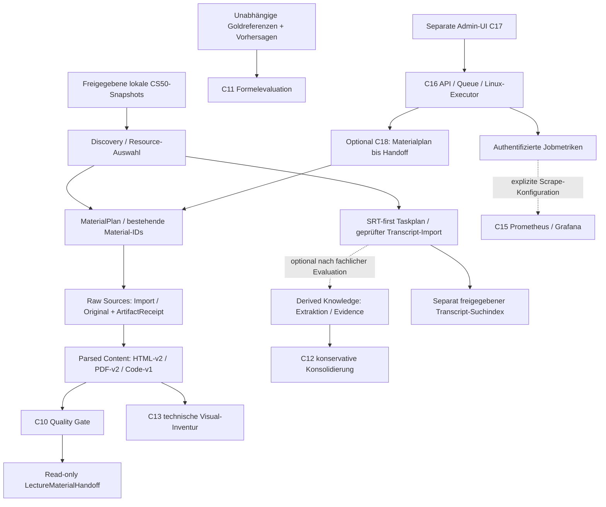

# Architektur des Personal Assistant

Planungsabgleich: 17.10.2026. Geprüfter Backend-`master` `476f0a0d`, UI-`main`
`14ccfc20`. C19–C22 und die Workflow-UI sind gemergt; C21-Q bleibt Draft #72.
[Aktueller Status](planning/status.md), [Roadmap](ROADMAP.md),
[bestehendes Inventar](repository_inventory.md). Alte Auditstände sind historische
Nachweise, keine aktuellen Releasefreigaben.

## Drei fachliche Ebenen und Entwicklungspriorität

**Raw Sources** halten Originalbytes, URLs und Metadaten. **Parsed Content** hält
strukturierte Texte, Kapitel/Seiten/Blöcke/Cues, Code und Bildreferenzen mit
versionierter Rückbindung. **Derived Knowledge** ist eine optionale Ableitung aus
zuvor evaluierten Materialien. Raw/Parsed bleiben unabhängig davon nutzbar.
Die folgende Grafik zeigt vorhandene Schnittstellen, nicht eine bereits
implementierte gemeinsame Source-Datenbank oder Search UI. C23/C24/C25 planen
erst diese Persistenz-/Such-/UI-Verträge; PostgreSQL bleibt ein ADR-Vorschlag.

## Fachliche Datenflüsse

Die Grafik stellt vorhandene Schnittstellen dar; der Knowledge-Zweig bleibt
optional und seine weitere Entwicklung wird bis zur fachlichen Evaluation
zurückgestellt. Sie aktiviert keine Downloads, LLM-Jobs,
Indexuploads oder Monitoringtargets. C18 beendet seinen Workflow am Handoff;
C13, C11 und Knowledge-Extraktion laufen nicht automatisch als Folgestufen.

## Verträge und Implementierungsstand

| Bereich | Tatsächlich implementiert | Nachweis / Grenze |
| --- | --- | --- |
| Discovery / Materialien | `model_discovery`, `model_materials/materials.py`, `tools_materials/processing.py`, `download.py`, `parse_html.py`, `parse_pdf.py`, `parse_code.py` | versionierte Bindings, normalisierte IDs/Blöcke, Raw-/Normalized-Hashes, Receipts; [Materialvertrag](cs50/contracts/material_artifacts.md) |
| Materialqualität | `model_materials/quality.py`, `tools_materials/quality.py`, `tools_lecture/material_handoff.py` | C10-Offlinevalidierung und vorhandener Handoff; Projektionen werden nicht doppelt aggregiert; kein Knowledge-Runner [C10](cs50/contracts/material_quality.md) |
| Lecture / SRT | `tools_lecture/adapt_cs50.py`, `execute_cs50.py`, `tools_transcribe/import_transcript.py` | Taskpläne und Provenienz/Receipts; SRT-first ohne impliziten Audiofallback; [Lecturebetrieb](cs50/operations/cs50_lecture_runner.md) |
| Transkription | `model_transcribe/data_transcribe.py`, `tools_transcribe/process_url.py`, `src/run_audio_transcription.py`, `run_video_transcription.py` | allgemeiner yt-dlp-/Whisper-/Settingspfad vorhanden; nicht Teil der freigegebenen C16/C18-Offlineprozesse; SDKs/Modelle und Livebetrieb separat |
| Knowledge | `model_knowledge/data_knowledge.py`, `tools_knowledge/run_cs50_lecture.py`, `cs50_checkpoint.py`, `cs50_budget.py`, `cs50_precise_evidence.py` | explizite Request-/Token-/Zeitbudgets, Source-/Cue-Evidence und Resume; synthetische technische Tests ersetzen keine fachliche Freigabe |
| Konsolidierung | `run_knowledge_consolidation.py`, `tools_knowledge/consolidation_run.py`, `consolidation_validation.py` | C12 lesender Standard, exklusive Publikation, konservative Operator-/Negations-/Evidencebehandlung; semantischer Adapter explizit [C12](knowledge_consolidation_hardening.md) |
| Mathematik | `model_evaluation/math_evaluation.py`, `tools_evaluation/evaluate_math.py`, `math_syntax.py`, `math_equivalence.py`, `sympy_worker.py` | C11: 42 synthetische Fälle, begrenzte Notation, optionale isolierte Polynomprüfung, unbekannt bleibt undetermined; [Grenzen](math_evaluation/README.md) |
| Visuals | `tools_materials/visual_inventory.py`, `visual_worker.py`; bestehend `tools_knowledge/rebuild_knowledge.py`, `postprocess_visual.py` | C13 inventarisiert Referenzen/Geometrie ohne OCR/LLMs; der frühere Docling-/Visualpfad ist davon getrennt und nicht allgemein E2E-freigegeben [C13](visual_inventory.md) |
| Transcript-Retrieval | `tools_rag/cs50_ingestion.py`, `tools_rag/cs50_retrieval.py`, `scripts/cs50_transcript_index.py` | lokale, getrennte Transcriptcollection und quellgebundene Offsets; kein automatisch vorhandener kanonischer Knowledge-Index [Index](cs50/operations/transcript_index_architecture.md) |
| Job-Control | `src/job_control/{models,registry,controller,store,executor,guardian,http}.py` | C16: zwei Defaultadapter, private SQLite-v1-Queue, Auth/Owner/Course, idempotente Starts, begrenzte Prozessgruppen, bestätigter Cancel/Restart [C16](job_control/README.md) |
| Orchestrierung | `src/workflows/`, `scripts/cs50_workflow.py` | C18 optional, deterministischer DAG, Skip/Stale/Resume; max. drei lokale HTML-/Code-/PDF-Materialien in einem C16-Job; C19 kontrolliert native PDF-Nachfahren; keine zweite Queue [C18](workflows/README.md) |
| Admin-UI | `app_admin.py`, `admin_ui_package/c16_client.py` **im UI-Repository** | C14/C17/C20-C/C22 gemergt; echte C16-Jobs und vollständige C18-Workflow-HTTP-DTOs, getrennte Chat-App; technische AppTest-/TCP-Nachweise, Search UI noch geplant |
| Monitoring | `src/core/pipeline_metrics.py`, `src/job_control/metrics.py`, `scripts/validate_monitoring.py`, `monitoring/` | C15-Schema + C16-Jobexporter; fehlende Targets liefern keine erfundenen Messwerte; Konfiguration getestet, kein Live-Deployment nachgewiesen |

## Identitäten, Evidence und Persistenz

Course/Section/Lecture/Resource/Material-IDs stammen aus bestehenden Discovery-
und Materialmodellen. Dokument-/Block-/Bild-IDs und Parser-/Schema-Versionen
bleiben durch normalisierte Artefakte und Handoff erhalten. Materialseiten/DOM
werden nicht zu Videozeitstempeln umgedeutet. Transcript-Evidence verweist auf
Source-, Chunk- und Segment-/Cue-Identitäten; Formelevaluations-Gold darf nicht aus
der zu prüfenden Vorhersage als vermeintlich unabhängige Wahrheit entstehen.

| Speicher | Zweck / Lebensdauer |
| --- | --- |
| Raw / normalisierte Materialien / `ArtifactReceipt` | bestehende lokale materialgebundene Artefakte mit Bytehashes; keine Migration durch das Audit |
| Transcript-/Knowledge-Dateien und Checkpoints | Originalprovenienz, Budgets, Chunk-/Evidencebelege und exklusive Ergebnisse |
| C16 `jobs.sqlite3`, private Jobordner | einzige Jobqueue/-historie; Inputsnapshots, Logs und Artefaktmetadaten; lokales Dateisystem/Single-Worker-Vertrag |
| C18 `workflows/<id>/state.v1.json` und `history/` | atomare Metadaten im bestehenden privaten C16-Workspace; ursprüngliche Stage-/Joboutputs bleiben unverändert |
| Qdrant | optionaler abgeleiteter Transcript-Suchindex, getrennte Collection; kein Beleg vorhandener produktiver Inhalte |
| Chroma / MLflow / DVC / Monitoringvolumes | Legacy-RAG, Experimentdaten, Artefaktverwaltung und Betriebspersistenz; weder gelesen noch migriert/bereinigt |

## Repositorygrenzen und erhaltene Legacy-Pfade

Backend/Worker/Modelle/Verträge/Evaluation/Monitoring bleiben in
`rf-data/Personal_Assistant`; Streamlit-Admin, API-Client, UI-Settings und
UI-Deployment gehören langfristig in `rf-data/personal-assistant-ui`.
`streamlit_app.py`, `frontend/pages/`, `frontend/admin_app/`, `frontend/chat_app/`,
`src/run_st_*`, `src/tools_parsing/`, `src/tools_rag/` und `_prototypes/` bleiben
unverändert erhalten. Sie sind teilweise noch durch Imports, Makefile oder
Dokumentation erreichbar und werden nicht aufgrund ihres Alters gelöscht.

Die allgemeinen Parsingmodelle sind nicht mit den versionierten CS50-
Materialmodellen austauschbar; parallele Dateinamen beweisen keine Duplikation.
Das alte Chroma-/SOP-System ist nicht der neue Transcript-/Knowledge-Vertrag.
E-Mail/Kalenderstubs, SOP-Update-Lücken und unvollständig verdrahtete Visualrunner
bleiben experimentell/offen. [Referenzprüfung und Freigabeliste](cleanup_plan.md).

## Deployment und Betriebsgrenzen

C16s eingebauter HTTPServer ist ein lokaler Loopbackstart und keine
Produktionsfreigabe. API und Executor sind getrennte Prozesse auf demselben
privaten lokalen Dateisystem; SQLite/flock sind kein Mehrhost-/NFS-Modell.
Die C20-C-UI kann den vollständigen C20-B-Workflowvertrag verwenden; Starts und
Resume verlangen weiterhin Backendfreigaben und ausdrückliche Bestätigung.

`api/Dockerfile` ist ein älterer Python-3.11-/FastAPI-Entwurf: referenzierte
`api/requirements.txt` und `fastapi_main` fehlen. Er ist **kein** C16-Image.
`docker/DockerFile.worker` ist ein umfangreiches Python-3.12-Lectureimage mit
Sleep-Default, kein automatischer Workflowworker. Das MLflow-Compose verweist
auf einen nicht belegten Buildpfad. Keine dieser Konfigurationen wurde hier
gebaut, gestartet oder als produktionsbereit bestätigt.

Der C15-Monitoringstack begrenzt Standardports auf Loopback; Host-/Container-
Exporter und Portainer benötigen explizite Profile, Targets und freigegebene
Images/Secrets. Der reale C16-Metrikpfad ist `/v1/metrics`, nicht das allgemeine
`/metrics`-Beispiel. C18 ergänzt einen festen elften Prozess-/Stagewert; IDs
werden keine Metriklabels. [Betrieb](monitoring/operations.md),
[Controllerintegration](job_control/integration.md).

C22 ergänzt inzwischen dedizierte Build-/Rollen-/Composevorlagen, einen privaten
TLS-Gateway, Wartungslock und synthetisch getesteten Backup/Restore;
[verbindliche Betriebsarchitektur](deployment/architecture.md). Die Vorlagen sind
gemergt, ihre tatsächlichen Image-/Container-/TLS-/OIDC-/Zielvolume-/Alarmtests
bleiben offen. Die UI benötigt noch geprüftes Authlib im eigenen Lockfile.
[C22-Gates](deployment/c22_validation.md) gehören zu C26, kein neuer Deploypfad.
C23.0 verändert keine Dienste, Modelle, Datenbanken oder vorhandenen Artefakte.

## C23-01: vorgeschlagene Content-Persistenz

Das [Persistenz-ADR](architecture/parsed_content_persistence_adr.md) empfiehlt für
die erste Single-Host-Version eine **separate SQLite-Contentdatenbank plus
unveränderliche Dateiartefakte**. Bestehende Material-/Transcript-Nutzdaten und
C16s Jobqueue bleiben erhalten. PostgreSQL ist die spätere Ausbauoption bei
belegtem Bedarf. Das [Datenmodell](architecture/parsed_content_data_model.md)
definiert Identitäten, Versionen, ACLs, Locator und Leseverträge;
der [C23-Umsetzungsplan](planning/c23_implementation_plan.md) ordnet Adapter,
Recovery und Tests C23-02 bis C23-06 zu. Dies ist ein Vorschlag zur Freigabe
vor Implementierung, keine vorhandene Contentdatenbank oder Bestandsmigration.

## C23-02A: isolierter ContentStore-Kern

Die [Implementierungsdokumentation](architecture/content_store_implementation.md)
beschreibt die separate content-v1-SQLite-Datenbank, unveränderliche Blobablage,
Autorisierung und synthetische Persistenztests. Echte Material-/SRT-Verifikation
und Veröffentlichung bleiben bis C23-02B gesperrt; vollständige Recovery und
Backup-/Integrationsabnahme folgen in C23-02C. C16s Queue und die vorhandenen
Material-/Transcriptmodelle werden nicht verändert. C23 ist damit nicht abgeschlossen.
