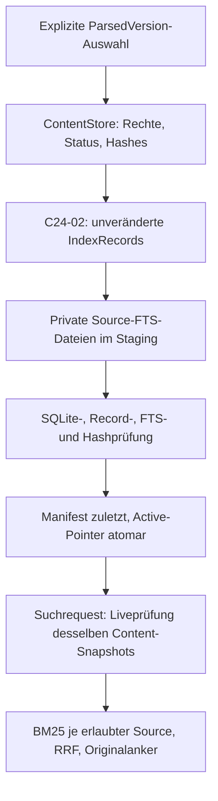

# C24-03: SQLite FTS5 und autorisierte lokale Suche

DEV-01B / C24-02-C bindet den vorhandenen Builder nun opt-in an die bestehende
C16-Queue: [Indexjob-/Statusvertrag](../api/content_index_jobs_v1.md). Keine
zweite Queue; explizite hashgebundene Katalogselektion, Sourceownership auch der
ersetzten aktiven Generation, bestehende Prozessaufsicht und fail-closed Retry.
Umfang und [tatsächliche Validierung](../api/content_index_jobs_validation.md)
bleiben von noch ausstehender UI-/Real-/Produktivabnahme getrennt.

DEV-01 A / C24-03-B ergänzt auf Basis `e478520` den opt-in
[HTTP-Suchvertrag](../api/content_search_v1.md) am bestehenden C16-Gateway.
Vorhandene FTS5-Fassade/DTOs, Live-ACLs und Cursor bleiben unverändert; der
Retrieval-Guard umfasst nun auch die begrenzte HTTP-Auslieferung. Indexjobs und
allgemeine Search UI bleiben Folgepakete. Die folgenden historischen
HTTP-Offenstände behalten ihren damaligen Basisbezug. Aktuelle
[Validierung](../api/content_search_validation.md); Integration erst nach PRreview.

18.10.2026 · Basis `master` `fcb5da98ca94998e2a024c1a898ff20bdd9f79ab`,
nach [C24-01/#83](https://github.com/rf-data/Personal_Assistant/pull/83) und
[C24-02/#84](https://github.com/rf-data/Personal_Assistant/pull/84).
Maßgeblich bleiben [ADR](retrieval_indexing_adr.md),
[Record-/Retrievalvertrag](index_record_contract.md),
[Projektion](index_projection_implementation.md) und
[Umsetzungsplan](../planning/c24_implementation_plan.md).

## Implementierter Umfang und Wiederverwendung

Nachtrag C24-04-A: [optionale Fake-Vektorvariante](content_vector_implementation.md)
nutzt dieselben Backendhooks, Generationen, Cursor und Livehydrierung. Die folgenden
FTS-Verträge und datierten C24-03-Messergebnisse bleiben unverändert; keine reale
Qdrant- oder Hybridaktivierung durch den Nachtrag.

`src/tools_rag/content_index.py` bietet Builder, explizite Versionsauswahl,
Generationenverwaltung und die interne, typisierte `search_lexical`-Schnittstelle.
`content_fts.py` kapselt SQLite, `content_index_files.py` private Dateien und
`content_index_models.py` die versionierten Index-/Suchverträge. Die lokale CLI
liegt in `scripts/content_index.py`. Keine neue Dependency.

Unverändert wiederverwendet: C24-02-Recordmodelle, Auswahl und Fenster,
canonical/fingerprint/record_set_sha256, ContentStore-Ownership/Course/Grants,
Maintenance-/DBlocks, private Inodeprüfungen sowie C23-04-Locatoren, TextWindow
und Routen. Der bisherige Projektor erhält eine interne `_project_locked`-Grenze
für denselben bereits gehaltenen DBsnapshot und ein kumulatives Lesebudget.
Die öffentliche Projektionsmethode und ihre Ausgaben bleiben gleich.

Kein eigener Parser, Chunker oder Knowledgeexport. Die alten Chroma-/Qdrant-
Hilfsmodule und Appsettings werden nicht importiert. Kein HTTPendpoint, UI,
Scheduler, Embedding oder produktiver Storezugriff. Der aktuelle Benutzerauftrag
nennt dieses Paket C24-03; im ursprünglichen Plan deckt es **02-B und 03-A** ab.
03-B (HTTP) und 02-C (Jobanbindung) bleiben separate Folgearbeit.

## Datenfluss und Konsistenzgrenze



Build verlangt Operator, Ownership und Course für jede ausgewählte Source;
Readgrants erlauben keine Indexverwaltung. Suche verlangt einen vorhandenen
`Principal`, Owner oder Readgrant **und** Course. Indexinformationen verleihen
keine Rechte. Eine neue Parsed-/SourceVersion wird nicht automatisch als „latest“
eingesetzt: die aktive Auswahl ist ausdrücklich gepinnt.

Eine Suche hält in dieser Reihenfolge Catalog-SH → Content-Maintenance-SH →
Content-DB-SH bis zur Serialisierung/Verwendung im Contextmanager. Danach gilt
kein Berechtigungsversprechen für aufbewahrte DTOs. Grantwriter und Aktivierung
erhalten währenddessen Busy. Keine Kombination unabhängig paginierter Reads.
Jede Seite prüft erneut alle zu ihrer erlaubten Source gehörenden gepinnten
Versionen, Raw-/Payload-/Projektions-/Receiptbelege, SQLblöcke und Locatoren über
den vorhandenen Projektor. Keine ungeprüften persistenten Hydrierungscaches.

Fremde Source-Dateien werden vor Ranking und SQLitezugriff ausgeschieden.
Wird eine gepinnte Version einer erlaubten Source ungültig, wird deren ganze
Partition `stale_index`; es gibt keine Treffer aus verbleibenden Versionen mit
alten BM25-Statistiken. Tombstoned/unerlaubte Sources verschwinden vollständig.
Fehlende/defekte erlaubte Indexdateien führen zu Unavailable, niemals zum Fallback
auf eine frühere Generation. Keine unberechtigten Trefferzahlen oder Rohdiagnosen.

## Persistenz, Schema und Generationen

Separater expliziter privater Root, außerhalb von Repository und Contentroot;
Verzeichnisse 0700, Dateien 0600, gleiche UID, keine Symlinks/Hardlinks als Dateien.
Vorhandene oder teilweise initialisierte Roots werden nicht automatisch adoptiert.

```text
identity.json                       # content-fts5-v1, schema 1, Storepurpose
.content-index-catalog.lock         # shared Suche / exklusiv Aktivierung
.content-index-build.lock           # ein Builder bzw. explizite Bereinigung
attempts/<build_uuid>/status.json   # private Zustände und Prüfbelege
staging/<build_uuid>/source-<source_fingerprint>.sqlite3
staging/<build_uuid>/manifest.json  # zuletzt
generations/<generation_digest>/<build_uuid>/...
active.json                         # atomarer Pointer + Manifest-SHA
```

Jede Source-Datei hat application_id `0x43323446`, user_version **1** und exakt:

```sql
CREATE TABLE metadata (key TEXT PRIMARY KEY, value TEXT NOT NULL);
CREATE TABLE records (
  rowid INTEGER PRIMARY KEY,
  record_id TEXT NOT NULL UNIQUE,
  parsed_version_id TEXT NOT NULL,
  content_type TEXT NOT NULL,
  body TEXT NOT NULL,
  text TEXT NOT NULL
);
CREATE VIRTUAL TABLE fts USING fts5(
  text, tokenize='unicode61 remove_diacritics 0'
);
```

Die automatisch erzeugten FTS5-Shadowtabellen gehören zum exakten Schemavergleich.
`metadata` bindet Backendname, SQLiteversion, Tokenizer, Score- und Rankvertrag.
`body` ist der kanonische C24-02-Recordbody, `text` sein exakter search_text;
keine Originalpayloads oder Rawdateien. UNIQUE erkennt doppelte Record-IDs,
Rowids bleiben rein technische Zuordnungen. Einfügeordnung:
ParsedVersion, Blockorder, Start, Record-ID. SQLiteintegrität, vollständige Bodies,
Text-/Rowidgleichheit zwischen Records/FTS und FTS-integrity-check werden geprüft.

GenerationBasis bindet sortierte Auswahl, vollständige Projektionskonfiguration
und Policy-ID, Source-/SourceVersion-/Parsed-/Parser-/Payload-/Projektionsbezüge,
Recordsethash und Backendkonfiguration. Daraus entsteht die deterministische
`content_index_generation_v1`-ID. Ein identischer Rebuild hat denselben fachlichen
Recordbestand und dieselbe Generation-ID, aber einen neuen privaten Buildversuch.
Dateihashes und Zeitstempel sind keine fachlichen Recordidentitäten.
Die SQLzeile speichert Body plus stabile Record-ID; Generation und Build werden
gemeinsam über das geprüfte Manifest samt Dateihash gebunden. Es gibt keinen
ungeprüften Export eines angeblich aktiven IndexRecord mit null-Kontextfeldern.

GenerationManifest enthält Basis, je Source SHA/Größe/Recordzahl/Recordsethash,
ready-Zustand und Digest des kanonischen Manifests ohne Selbsthashfeld.
BuildReceipt bindet privat Actor, Sources, Auswahl, Content-Publikations- und
Collectionrevision, ACLrevisionen, Zustände, Zeiten, Recordhash und Implementierung.
ActiveGeneration bindet Generation, Build und exakten Manifest-SHA. Diese Modelle
liegen im genannten Modul; persistierte Manifest-/Pointer-/Receiptschemas müssen
explizit integer 1 sein. Unbekannte Versionen bleiben gesperrt. Kein Schemaimport,
keine automatische Migration: neuer freigegebener Indexroot und expliziter Rebuild.

SQLite-Dateien entstehen pro Source in einer begrenzten In-memory-Verbindung und
werden mit der vorhandenen SQLite-Serialize-API gespeichert. Suche liest private,
größen-/SHA-geprüfte Dateibytes und öffnet sie via Deserialize als isolierten
RAMsnapshot. Sie öffnet keinen möglicherweise zwischen Prüfung und Connect
ersetzten Pfad. Die FTS-integrity-check-Anweisung schreibt ausschließlich in
diesen flüchtigen Snapshot, niemals in ContentStore oder Indexdateien.
FTS5 und Serialize/Deserialize werden beim Öffnen geprüft; fehlt etwas, bleibt
der Adapter unavailable. Keine Extensiondownloads oder ladbaren Clientextensions.

## Aufbau, Abbruch und Entfernen

PREPARING → BUILDING → VERIFYING → READY → ACTIVE. Ein nonblocking Buildlock
serialisiert Prozesse. Der erste autorisierte Content-Snapshot wird festgehalten;
danach können Leser die bisherige aktive Generation während des Builds verwenden.
Stagingdateien werden vollständig geschrieben und fsynced, erneut geprüft,
Manifest zuletzt geschrieben. Unter Catalog-EX und erneutem Content-Snapshot
werden Pointer-CAS, Revisionen, Rechte und Recordbestand geprüft. Erst dann folgen
Directoryrename und atomarer Active-Replace mit Directory-fsync. Datei-/SQLite-
Atomizität wird nicht verwechselt. Keine Teilaktivierung.

Fehler vor Active lassen den alten gültigen Pointer bestehen; ein Abbruch nach
Active kann einen vollständigen aktiven Build mit verlorener Antwort hinterlassen.
`inspect_builds(actor=...)` nimmt den Buildlock, gleicht eigene Belege gegen Active
ab und weist verlassene nichtterminale Versuche als interrupted aus. Statusreads
ändern keine Dateien. Keine automatische Fortsetzung und keine Übernahme fremder
Stagingdaten. Ein erneuter expliziter Build liest nur ContentStore-Publikationen.

`discard_build(build_id, actor=...)` verlangt eigenen Versuch plus vollständige
Ownership/Course, Build-EX und Catalog-EX. Active darf nie entfernt werden.
Nur bekannte Derivatdateien in genau diesem Staging-/Generationsverzeichnis
werden nach privater Inventarprüfung entfernt; Receipt bleibt discarded.
Keine automatische Retention, kein rekursives Löschen unbekannter Dateien.
Leere übergeordnete Generationverzeichnisse und Crash-Pendingdateien werden
nicht automatisch gesammelt; Kapazität kann eine Operatorprüfung erfordern.

## Query, Ranking, Treffer und Cursor

Query: 1–512 Codepoints, maximal 2 KiB UTF-8, maximal acht Whitespace-Terme à
64 Codepoints. Jeder Term wird als FTS-Phrase gequotet, doppelte Quotes escaped,
Phrasen mit AND verbunden und MATCH/Filter gebunden. Keine freigegebenen OR-,
NEAR-, Prefix- oder SQLoperatoren. Quotes und Satzzeichen sind Literalinput für
den Unicode61-Tokenizer; reine Satzzeichen/Emoji ohne Tokens ergeben keine Treffer.
Leere/ungültige Unicodequeries werden `invalid_parameter`.

Unicode61 faltet Groß-/Kleinschreibung, erhält Diakritika, verwendet weder Stemming
noch NFCnormalisierung des Originaltexts. Codeoperatoren/Formelzeichen können
Tokentrenner sein; `+` und `-` müssen lexikalisch nicht unterscheidbar sein.
Kein Ausführen von Code, keine mathematische Äquivalenz. Kurze Texte können durch
BM25-Längennormierung bevorzugt werden; dies ist keine fachliche Relevanzgarantie.

Je Source `(bm25(fts,1.0) ASC, record_id ASC)`: kleinere Rohwerte sind besser.
Fusion über erlaubte Sources: `source_rrf_v1`, `1/(60+rank)` ab Rang 1, danach
absteigender Fusionsscore und Record-ID. Keine Addition inkompatibler BM25werte,
keine 0–1-Wahrscheinlichkeit. Source-/Contenttypfilter begrenzen die gerankten
Treffer; fremde Sourcekorpora verändern keine sichtbaren Rohscores.

SearchHit enthält unveränderte Record-/Source-/Versions-/Block-IDs, Codepointanker
mit ganzem Blocktexthash, `lexical`, BM25-Komponente mit Source/Scorevertrag/Richtung,
RRFscore, opake Generations-HMAC, Originalprojektionshash, Text-/Strukturrouten
und redigierte ContentLocator-Daten. Excerpt ist ein exakter Originalslice ab
Recordstart, höchstens 512 Codepoints; kein Highlight-/Matchoffsetversprechen.
Sehr große Locatormengen verweisen auf die bestehende strukturierte Leseroute.
Unknown-Time bleibt null/unknown, nie erfundene Sekunde 0. Freies Block.data,
Receipts, private Buildscopes und globale Zähler fehlen in öffentlichen DTOs.

Cursor: eigene HMAC-Domain/key, schema 1, höchstens 1600 Zeichen, fünf Minuten TTL.
Bindet Actor/Role/Courses, Query/Filter/Limit, logische Generation, opaken aktuellen
Content-Snapshot, vollständigen begrenzten erlaubten Resultsethash und letzte
autorisierte Record-ID. Jede Seite berechnet den begrenzten Resultbestand erneut;
keine unbeschränkten SQLoffsets. Actor-/Signatur-/Parameterfehler: invalid_cursor.
Generation-, ACL-/Publikationsrevision- oder Resultsetwechsel: snapshot_changed,
keine Items; Client beginnt neu. Auch eine fremde Revision kann diesen generischen
Neustart auslösen, ohne IDs/Zähler offenzulegen. Identischer logischer Rebuild
ohne Contentänderung invalidiert Cursor nicht unnötig.

## Limits und Betriebsgrenzen

| Grenze | Tatsächliches Verhalten |
| --- | --- |
| 128 gepinnte Versionen / 200.000 Records | vollständiger Build oder Abbruch; keine automatische Sourceselektion |
| 128 MiB verifizierte Content-/Indexbytes pro Query | kumulativ, kein Hashcache-Fallback |
| 64 MiB kumulatives Record-JSON und 64 MiB SQLite je Source | konservative RAMsnapshotgrenze; keine RSS-Garantie |
| 1 GiB SQLite pro Build; 2 GiB eigener Root; 20.000 Einträge | Kapazitäts-/Free-Spaceprüfung, mindestens 1 MiB Diskreserve |
| 32 erlaubte Sources je Suche | darüber scope_required ohne Count; explizite Sourceauswahl nötig |
| 1000 Matches insgesamt | 1001. Match führt query_too_broad; keine abgeschnittene Erfolgsseite |
| 100 Hits / maximal 256 KiB Antwort | kleinere vollständige Seite mit Cursor, Excerpts maximal 512 CP |
| 2 s Query, 5 s Guard, 2 Suchen pro Prozess | nonblocking Busy; SQLite-Progresshandler und monotone Prüfungen |
| 15 min Build | gemeinsame monotone Frist inklusive SQLiteprüfungen, keine Backgroundretries |

Keine Streamingprojektion wird erfunden: C24-02 liefert vollständige begrenzte
Versionsrecords. Builder hält nur diese explizite begrenzte Auswahl und öffnet
jeweils eine Source-SQLite-Verbindung. Query hält bounded autorisierte Recordsets
für Sortierung/Paging. Pythonobjekte, JSON und SQLitekopien benötigen mehr RAM als
ihre Nutzbytes. I/O-/Python-Teilschritte sind nicht hart präemptiv; ein begrenzter
Hash-/Dateischritt kann die Frist überschreiten, danach gibt es keine Erfolgsseite.
Der Contextmanager ist kein externer HTTPwatchdog; ein späteres Gateway muss
zusätzlich eigene Socket-/Worker-/Antwortlimits durchsetzen.

## Interner Aufruf und lokale CLI

```python
from src.content_store.store import ContentStore
from src.tools_rag.content_index import ContentIndex
from src.tools_rag.content_index_models import IndexSelection

store = ContentStore(explicit_existing_root)  # kein Recovery/Import
index = ContentIndex.initialize(store, new_explicit_index_root,
                                cursor_key_file=explicit_private_key)
receipt = index.build(IndexSelection(parsed_version_ids=(existing_version_id,)),
                      actor=authenticated_operator)
with index.search_lexical("python function", actor=authenticated_reader,
                          limit=20) as page:
    serialized = page.model_dump_json()  # innerhalb der Guardgrenze verwenden
# Wiederöffnung: ContentIndex(store, existing_index_root, cursor_key_file=...)
```

Key: ausdrücklich bereitgestellte private reguläre Datei, 32–64 Bytes außerhalb
von Repo, Content- und Indexroot. Kein Defaultsecret, keine automatische Erzeugung
oder ENVausgabe. Lokale CLI verwendet den vom vertrauenswürdigen lokalen Aufrufer
angegebenen Principal; dies ist **keine HTTPauthentifizierung**.

```sh
python -m scripts.content_index build \
  --store /tmp/authorized-content --index /tmp/new-fts \
  --cursor-key /tmp/private-cursor.key --actor operator --role operator \
  --course cs50_python --version EXISTING_PARSED_VERSION --initialize --execute

python -m scripts.content_index search \
  --store /tmp/authorized-content --index /tmp/new-fts \
  --cursor-key /tmp/private-cursor.key --actor reader --role viewer \
  --course cs50_python --query 'python function' --limit 20
```

Build/discard sind ohne `--execute` dry-run. Initialisierung verlangt explizit
neuen Root und `--initialize --execute`. `status` liest eigene Versuche;
`discard --build-id UUID --execute` entfernt nur einen inaktiven eigenen Versuch.
Rebuild ohne --initialize, mit derselben oder neuer expliziter Versionsliste.
CLI gibt JSON und redigierte feste Fehler aus, Exit 0/2; keine freien Hostpfade.
Keine automatische Rootsuche, Sourcekopie, Datei-Migration, WALrecovery, Server-
oder Modellinitialisierung. API erlaubt eine leere Auswahl, CLI verlangt Versionen.

## Technische Abnahme, Benchmark und offene Grenzen

Die folgenden Nachweise verwenden ausschließlich synthetische Originalbytes und
vorhandene B-Gates bzw. einen dauerhaft als synthetic_test markierten Teststore.
Normaler Adapter/CLI verweigert diesen Testpurpose. HTML/Code/SRT durchlaufen die
bestehenden B-Adapter; PDF ist ein gespeicherter Normalized-Vertrag, **kein nativer
PDFparserlauf**. Unknown-Time/Formeln im Teststore belegen keinen neuen echten
TXT-Bundleadapter. Tabellen-/Ansichtsausschlüsse bleiben die C24-02-Auswahl.

Tatsächliche synthetische Antwort: [SearchResultPage](examples/fts5-search.synthetic.v1.json).
Technische Messbelege: [125 Records](examples/fts5-benchmark-125.synthetic.v1.json),
[1.001 Records](examples/fts5-benchmark-1001.synthetic.v1.json).

| Eigener synthetischer Store / eine Source | 125 Records | 1.001 Records |
| --- | ---: | ---: |
| SQLitebytes / aktive Generation mit Manifest | 319.488 / 321.546 | 2.306.048 / 2.308.109 |
| Erstbuild / identischer Rebuild | 1,007 / 1,261 s | 8,247 / 8,664 s |
| Zielquery (je drei Versuche) | 0,364–0,437 s, ein Treffer | unavailable, 2,678–4,912 s |
| Mehrwortquery | 0,332–0,367 s, ein Treffer | unavailable, 3,436–3,762 s |
| Query mit Diakritikum | 0,416–0,953 s, ein Treffer | unavailable, 3,071–4,457 s |
| Große Trefferliste | 84 vollständige Hits plus Cursor, 0,953–1,115 s | unavailable, 3,273–4,908 s |

Bei 125 Treffern begrenzt das Antwortbytebudget die erste Seite trotz Limit 100
auf 84 Hits. Die 1.001er-Läufe überschreiten **vor** erfolgreichem Matching die
unveränderte Zwei-Sekunden-Frist bei der vollständigen Liveverifikation. Es gibt
keine vermeintlich erfolgreiche leere Seite und keinen hier gemessenen
`query_too_broad`-Erfolg für diesen Korpus. Selbst die dortige No-Match-Query bleibt
unavailable. Die längere beobachtete Ablehnungsdauer ist der oben dokumentierte
nicht präemptive Verifikationsschritt. Diese konkrete Skalierungsgrenze bleibt
offen; ein späterer Optimierungsvertrag darf Hash-/ACLsicherheit nicht umgehen.
Testhost mit teils gleichzeitigem Pytest, keine isolierte Throughputmessung.

Reproduktion mit vorhandener freigegebener Python-/Pytestumgebung, ohne Sync:

```sh
PYTHONPATH=/usr/lib/python3/dist-packages PYTHONDONTWRITEBYTECODE=1 \
  /home/robfra/0_Portfolio_Projekte/ai-job-search/.venv/bin/python \
  -m tests.content_fts_benchmark --records 125 \
  --work-root /tmp/new-c24-benchmark --output /tmp/new-c24-benchmark.json
# Separater neuer Root/Output und --records 1001 für den Grenzlauf.
```

Messungen schließen Content-Liveprüfung, SQLiteprüfung und Hydrierung ein.
Datensatz: handgeschriebene synthetische Unicode-/Codezeilen mit Unknown-Time,
kein Kurskorpus oder unabhängiges Gold. Beide Läufe vergleichen vollständige
Content-Dateiinventare vor/nach. Keine Hostpfade oder privaten Keys in Reports.
Der Benchmarker schreibt Output nur exklusiv in eine neue Datei.

Reale Relevanzqualität ist **blockiert**: C23-06 hat weiterhin keine freigegebenen
vollständigen Realbundles und keine unabhängig bestätigten Relevanzurteile (D06/D07).
Keine Precision@k-, Recall@k- oder MRRwerte aus Funktionsfixtures ableiten.
Reale Korpusgröße, Last/RSS, Netz-/HTTPauth, Browser/UI, Betrieb/Backup/Restore,
Stromverlust/Diskkorruption und produktiver Go-live sind hier nicht abgenommen.
Prozess-SIGKILL ist kein Nachweis für beliebigen Hardware-/Dateisystemausfall.
Hashes schützen nicht gegen einen Angreifer mit Schreibzugriff unter derselben UID.

Nächster Schritt: getrenntes opt-in Suchcapability-/Gatewaypaket auf dieser Guard-
und DTOgrenze, einschließlich HTTPauth, redigierter Fehler, Antwortzeitlimits und
Cross-Repo-Vertrag. Jobanbindung und reale Relevanzevaluation separat freigeben.
Optionales Qdrant muss denselben C24-Projektor und Liveanker verwenden; alte
Transcriptvektoren sind kein Ersatz. Keine Aktivierung dieses optionalen Pfades.

## Abschließender Prüfvermerk

Python 3.12.12, Pydantic 2.13.5, SQLite 3.50.4, vorhandenes System-Pytest 7.2.1,
Ruff 0.16.0. Keine Installation/Downloads. System-Pytest wird über PYTHONPATH
verwendet; dessen AST-Warnungen unter Python 3.12 sind keine Skips.
Gemeinsames tatsächliches Pytestpräfix:

```sh
PYTHONPATH=/usr/lib/python3/dist-packages PYTEST_DISABLE_PLUGIN_AUTOLOAD=1 \
 PYTHONDONTWRITEBYTECODE=1 \
 /home/robfra/0_Portfolio_Projekte/ai-job-search/.venv/bin/python -m pytest \
 -q --disable-warnings -p no:cacheprovider
```

Gezielte Regression (aus dem gemeinsamen 244-Fälle-Entwicklungslauf):
`tests/test_content_index_projection.py` 41, `test_content_store_models.py` 25,
`test_content_store_adapters.py` 49, `test_content_store_store.py` 34,
`test_content_read_contracts.py` 14, `test_cs50_material_evaluation.py` 38:
**201 passed / 0 failed / 0 skipped**, alle sechs Module unverändert nach diesem
Lauf. Basetemp `/tmp/c2403-contracts`, gemeinsame Laufdauer 218,01 s. Der ganze
244er-Lauf war **242 passed / 2 failed**: zwei neue Testpräparationen erwarteten
OSError statt der vorhandenen Store-Unavailable-Wrappingregel bzw. verwendeten
erneut den bereits gebundenen synthetischen Requestkey. Erwartung und expliziter
Testrequestkey wurden korrigiert, keine Storeverträge abgeschwächt.

Nach den Korrekturen: `tests/test_content_fts.py tests/test_content_index_projection.py
--basetemp=/tmp/c2403-release`: **87 passed / 0 failed / 0 skipped**, 188,66 s
(46 neue Fälle plus 41 bestehende Projektionsfälle). Anschließend kam ein weiterer
Ressourcen-/Dateisicherheitstest sowie die zusätzliche Fristprüfung nach der
Hydrierung hinzu. Die endgültige FTS-Nachprüfung ist unten vermerkt.

Endgültiger Lauf auf dem abschließenden Pythonstand:
`tests/test_content_fts.py --basetemp=/tmp/c2403-final` mit obigem Präfix:
**47 passed / 0 failed / 0 skipped**, 107,25 s. Alle neuen Prozess-, CLI-,
Hydrierungsfrist-, Slots-, Filter-, Bytebudget- und Symlinkfälle sind ausgeführt.
Die vorhandenen 41 Projektionsfälle wurden im grünen 87er-Lauf erneut geprüft;
an ihrem Projektionscode gab es anschließend keine weitere Änderung.

Ruff Check und `format --check` erfolgreich für die neun geänderten/neuen
Pythondateien; `git diff --check` erfolgreich. Beispielantwort wird gegen
SearchResultPage validiert, beide Messreports stammen byteidentisch aus den
expliziten Läufen. Lokale Dokumentationsziele werden vor PR-Erstellung geprüft.

Die neuen Prüfungen verwenden echte private SQLite-/ContentStore-Dateien:
HTML/Code/PDFmodell/SRT, Exact-Excerpts und Restart; Unicode/Quotes/Operatoren;
keine duplizierte alternative Codeansicht; Source-/Course-/Typfilter; gleiche
Generation bei identischem Rebuild; neue Raw-/Parsed-Auswahl; Owner/Grant/Course,
Widerruf, Tombstones und Quarantäne; unabhängige BM25scores trotz fremder Source
und deren defekter Datei; ganze Source stale bei einer ungültigen Version;
Cursorseiten ohne Duplikate, Signatur/Actor/Parameter/TTL/Generation/Revision;
echte geänderte SQLite-Schema-/Metadaten-/FTS-/Recordbytes; Fehler vor Active;
ACLänderung während Build; Reader und konkurrierende Builder in getrennten
Prozessen. Separate Prozesse werden mit SIGKILL bei READY, nach Directorypublish
und nach Active-Replace beendet. Statusrekonstruktion und explizites Verwerfen
beweisen keine Teilaktivierung bzw. vollständige Active-Publikation nach
Antwortverlust. Keine Mocks ersetzen diese Kernintegration; gezielte Failpoints
und reduzierte Konstanten prüfen Fehler-/Limitzweige zusätzlich.

Frühere Vorprüfung: 30 pass / 1 fail in 64,16 s; der manipulierte SQLite-Snapshot
brauchte vor Serialize einen expliziten Testcommit. Gezielter Entwicklungslauf:
7 pass / 2 fail / 37 deselected in 30,48 s, dieselben beiden oben korrigierten
Testannahmen. Dies sind keine zusätzlichen Abnahmeerfolge. Der erste 1.001er-
Benchmark brach bei Unavailable ab; der endgültige Messrunner erfasst diese
Fehler als eigene Outcomes und erfindet daraus keine Trefferzahlen.

Keine vollständige Repositorysuite, native PDFparser-, HTTP-/Browser-/Qdrant-
oder reale Materialabnahme. Projektions-/Read-/Adaptertests sind überlappende
Nachweise und werden nicht als zusätzliche eindeutige Fälle addiert.
Eigene temporäre Test-/Messroots werden nach Prüfung entfernt, Logs bleiben
außerhalb des Repositories. Der offene PR-Worktree bleibt bis zum Merge erhalten;
Primärcheckouts und andere Worktrees werden nicht bereinigt.
