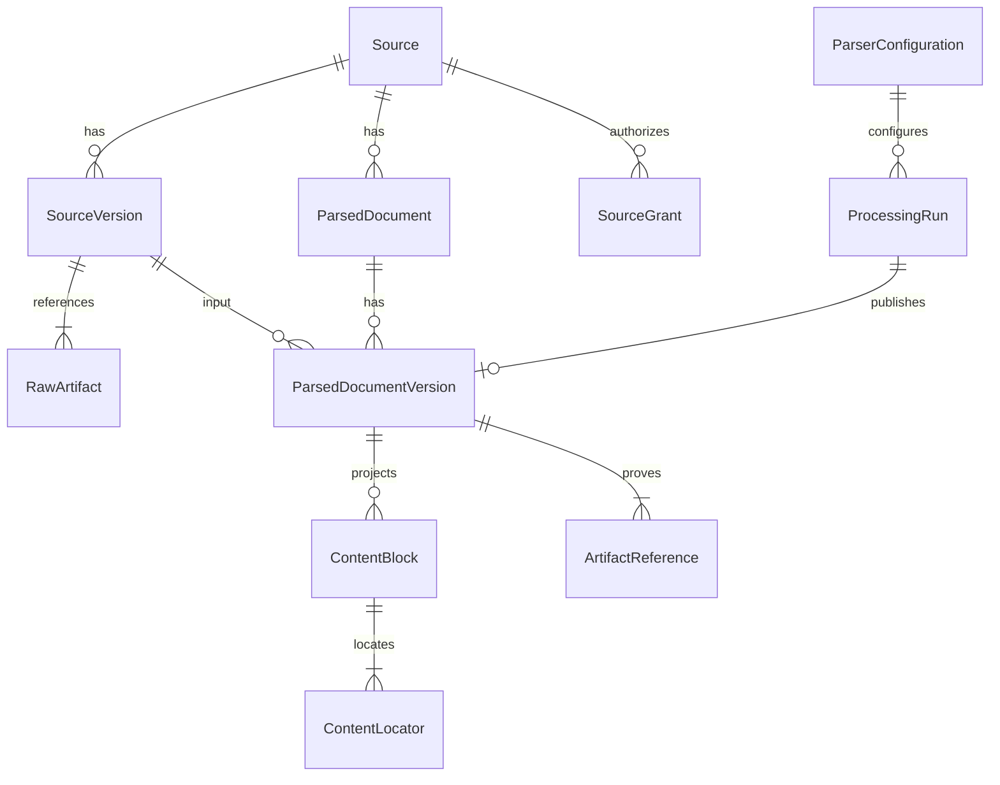

# C23: logisches Contentmodell und Schnittstellenvertrag

**Implementierungsnachtrag C23-04, 18.10.2026:** Content-v1-Persistenz ist mit
A/B/C (#76–#78) implementiert. Die folgenden ursprünglichen Planungstabellen
behalten ihren Datumskontext. Der verbindliche erste HTTP-Readvertrag steht in
[Content Read API v1](../api/content_read_v1.md), inklusive tatsächlicher DTOs,
Beispielantworten, Autorisierung, Limits und Tests. Begründete Konkretisierungen:
separate paginierte Parsed-Referenzroute statt eingebetteter unbegrenzter Historie;
im Cursor HMACgebundene globale Snapshotrevisionen statt ablesbarer fremder Zähler;
redigierte allowlistbasierte Strukturattachments und opake Keysets im bestehenden
Gateway. Rawantworten über einen gehashten, anonymen versiegelten Handle. Die
internen A/B/C-Tupelmethoden werden nicht still zu HTTP-Datenmodellen umdefiniert.
C23-03/#79 war offen; weder Bestandsmigration noch allgemeine Publikation folgt
aus der Read API. C23 bleibt offen.

Stand 17.10.2026, **Entwurf v1**, abhängig von der Freigabe des
[ADR](parsed_content_persistence_adr.md). Alle Tabellen, DTOs, Methoden und Routen
in diesem Dokument sind **geplant**. Es existiert noch kein `src/content_store`.
Bestehende Pydantic-Nutzdaten bleiben erhalten; diese Spezifikation ergänzt
Registerhüllen und abgeleitete Leseprojektionen, keinen neuen Universalparser.

## Autorität und Beziehungen



Eine Parsed-Version hat genau eine SourceVersion und einen logischen
ParsedDocument-Stream. Ein Stream gehört zu genau einer Source. Eine SourceVersion
hat mindestens ein primäres Rawartefakt. Ein Run kann auch nur Raw speichern oder
ohne Veröffentlichung scheitern. Wiederholungsruns dürfen auf dieselbe fertige
Parsed-Version verweisen, nicht mehrere Versionen erzeugen.

| Entität / geplante Tabelle | Pflichtinhalt und Integrität | Bestehender Anteil / neue Hülle |
| --- | --- | --- |
| Source / `sources` | `source_id` PK, `identity_namespace`, `external_identity`, `course_id`, `owner_subject`, Typ, Original-URL, `registered/tombstoned`, `acl_revision`; Unique(namespace, external_identity) | Für CS50 unveränderte `ResourceCandidate.resource_id` als PK; Material-/Transcriptbindung behalten. Neu: Register/Owner/ACL; keine Titel-/Pfadheuristik |
| SourceVersion / `source_versions` | `source_version_id` PK, Source-FK, `variant_key`, Rawmanifest samt SHA, `verified/quarantined`, Provenienzsnapshot-Ref; primäre Rawrefs atomar zuordnen | Neue gemeinsame Hülle um überprüfte Rawbytes; URL allein ist keine Inhaltsversion |
| RawArtifact / `source_raw_artifacts` | (SourceVersion, role, ordinal) PK, Blob-FK, erwartete MIME/Größe/Hash, ursprünglicher relativer Bindingpfad; genau ein `primary` | Bestehende Rawhashes/Pfade aus Receipt/Binding; neue unveränderliche Zuordnung, kein Überschreiben |
| Blob / `artifacts` | SHA256 PK, `size_bytes`, relativer vom Store berechneter Key, Medientyp, Integritätszustand; gleicher SHA mit anderer Größe → Incident | Physisch gemeinsame unveränderliche Bytes; niemals über Hashbesitz Zugriffsrechte vergeben |
| ParsedDocument / `parsed_documents` | `parsed_document_id` PK, Source-FK, `representation_key`, Unique(Source, representation_key) | Neuer stabiler Stream, z. B. `material:<material_id>` oder `transcript:srt:<resource_id>`; ursprüngliche Dokument-ID ist Versionsalias, kein ersetzter Identifier |
| ParsedDocumentVersion / `parsed_versions` | `parsed_version_id` PK, Stream-/SourceVersion-/Parserconfig-FKs, eindeutiger Slot, Payload-/Projektion-Refs, Payloadschema, Status, Publikationssequenz, Qualityzustand, ursprüngliche Dokument-ID | Original `NormalizedDocument` oder `TranscriptDocument` als unveränderte Datei. Neu: Version/Veröffentlichung. Gemeinsame Source-ID in zusammengesetzten FKs auf Stream und SourceVersion erzwingen |
| ContentBlock / `content_blocks` | (ParsedVersion, `block_id`) PK, Unique(ParsedVersion, `order`), Typ, Originaltyp, `payload_pointer`, exakter Text, `text_sha256`, `aggregation_role` und ggf. Fensterrefs | Projektion des bestehenden `Block` oder eines Transcriptsegments; Originaldaten einschließlich `data`, Unsicherheiten und Geometrie bleiben im Payload |
| ContentLocator / `content_locators` | (ParsedVersion, Block, ordinal) PK/FK, Rawref, ursprünglicher Pointer/Segment-ID, Seite/DOM/Zeilen/BBox/Kapitel/Zeitstatus; mindestens ein Locator pro Block | Bestehendes `Location`, Discovery-Provenienz und Cues ergänzen sich; keine Umdeutung von Materialseiten in Videozeiten |
| ParserConfiguration / `parser_configs` | Fingerprint PK, Parsername/-version, ursprüngliche Config-ID, vollständige Parameter, Implementierungsrevision, Payload-/Projektionsschema, Adapterversion | `ParserConfig` vollständig erhalten; Transcriptimportparameter/Encoding/Empty-Cue-Policy außen versionieren; Legacy ohne bekannten Parserstand nicht publizieren |
| ProcessingRun / `processing_runs` | Run-ID PK, Slot, C16-Job-/Workflow-/Attempt-Refs optional, Actor, ACLrevision, Zustände/Ereignisse, Manifest, Fehlercode | Neue Importtransaktion, keine Jobqueue; reservierte Slots und SQLzustand mit eigenem Runlock absichern |
| Provenance / `artifact_references` | Pro Version/Run role+ordinal, Blob-FK, Ursprung-IDs, logische Bindingpfade, Original-URL und genaue Pointer; Evidence-/Receipt-/Plan-/Gatebelege getrennt | `Provenance`, `ArtifactReceipt`, Transcriptprovenienz, Executionreceipt und Handoff unverändert archivieren; kein `KnowledgeEvidence` erzwingen |
| SourceGrant / `source_grants` | (Source, Subject, permission) unique, `read`, Revision; Owner in Source | Minimal nötige neue fachliche ACL. Keine zweite Authentifizierung oder kopierte Tokenhashes |

Die Tabellenliste ist der C23-02-Schemaumfang, keine ausgeführte DDL. Alle
Fremdschlüssel aktivieren, Löschungen restriktiv. Publizierte Nutzdaten/Versionen
sind unveränderlich; Status, ACLrevision und append-only Runereignisse sind
kontrollierte mutable Metadaten. Integritätsquarantäne gilt für alle Versionen,
die den beschädigten Blob referenzieren. Unbekannte Schemaversionen zurückweisen.

## Deterministische Identität und Versionierung

Für neue IDs wird vorhandenes `model_discovery.cs50.deterministic_id` verwendet:
SHA256 über UTF-8-JSON `[kind, *parts]`, `ensure_ascii=False`, Separatoren `,`/`:`,
Präfix `kind:`. Bestehende CS50-IDs werden **nicht** neu berechnet oder normalisiert.
Für neue strukturierte Fingerprints gilt `J(v)`: UTF-8-JSON, sortierte Objektkeys,
kompakte Separatoren, `ensure_ascii=False`, `allow_nan=False`, **ohne** Schluss-LF.
`H(v)=sha256(J(v))`. Kein Unicode-/Whitespace-Normalisieren von Quelltexten.
Floats nur endlich; bestehende Config-ID wird als eigene unveränderte Referenz
erhalten. Die Fingerprintregeln sind ein eigener `content-v1`-Vertrag, nicht
nachträglich der vorhandene Receipt-/Checkpointserializer.

| Neue Identität | Exakte Teile für `deterministic_id` |
| --- | --- |
| Source, CS50 | Keine neue: bestehende `resource_id`, auch für Transcript `source_id`; `material_id`, `lecture_id` und `media_id` bleiben getrennt |
| Source, künftiger anderer Provider | `("content_source_v1", namespace, provider_stable_key)`; keine URLaliasheuristik. Provider muss vor Import einen expliziten stabilen Schlüssel/Namespace liefern; für lokale Quellen ein registrierter, danach unveränderlicher Schlüssel |
| SourceVersion | `("content_source_version_v1", source_id, variant_key, H(raw_manifest))` |
| ParsedDocument | `("content_document_v1", source_id, representation_key)` |
| Parserconfigfingerprint | `("content_parser_v1", H(parser_config_envelope))` |
| Importslot | `("content_slot_v1", source_version_id, parsed_document_id, parser_config_id)` |
| Parsed-Version | `("content_version_v1", slot_id, payload_sha256, projection_sha256)` |
| Transcriptblock | `("content_cue_v1", parsed_version_id, str(original_seg_id))`; ursprüngliche `seg_id` zusätzlich unverändert speichern |

`raw_manifest` ist eine Liste sortiert nach `(role, ordinal)`, Einträge exakt
`{role, ordinal, sha256, size_bytes, mime_type}`. Eindeutige Roles/Ordinals, ein
`primary`, keine doppelten Einträge. Primäre Version enthält nur Rawinhalt und
inhaltlich zugehörige Rawattachments, **keine** austauschbaren Receipt-/Gatebytes.
`variant_key` ist bei CS50-Material `variant_id` oder `default`, bei SRT `srt:<language>`.
Sprache, Original-URL und vorhandene Variantbindung werden separat gegen den
Source-/Bindungssnapshot geprüft, nicht aus Dateinamen erschlossen.

`parser_config_envelope` enthält genau `parser_name`, `parser_version`,
`parameters`, `implementation_revision`, `payload_schema`, `projection_schema`,
`adapter_version`. Für Material ist `parameters` das vollständige originale
`ParserConfig.model_dump(mode="json")`; dessen `config_id` bleibt Auditfeld.
Für SRT/VTT sind Encoding, Format, Sprache und `preserve_empty_cues` explizit.
`implementation_revision` ist die konkrete Parserimplementierungsrevision des
Ausgaberuns, nicht die zufällige Revision des späteren Importers. Fehlt sie in
historischen Receipts, muss der Importauftrag einen begründeten, mitgesicherten
Implementierungsbeleg bereitstellen; andernfalls `UnverifiedBinding`.
Materialpayloadschema heißt `NormalizedDocument:1`; das aktuelle Transcriptmodell
hat **keine eigene Schemaversion**, daher `TranscriptDocument:legacy-unversioned`
plus strenger Adaptervertrag `cs50_srt_content_v1`. Kein erfundenes Transcript-v1.

Die Projektion darf für die Versions-ID nicht ihrerseits `parsed_version_id`
enthalten: serialisierte `projection.v1` referenziert `slot_id`, Originalblock-IDs
bzw. Segment-IDs und Pointer. Abgeleitete Transcriptblock-IDs entstehen erst
nach Hashberechnung. Keine zirkulären IDs. `publication_seq`, Run-ID, Zeitpunkte,
Actor und absolute Laufpfade sind nicht Teil von Payload-/Projektionsfingerprints.

Unique(Slot) gilt über alle veröffentlichten und tombstoned Versionen. Ein
identischer Slot plus identische Payload-/Projektionsbytes liefert dieselbe ID;
abweichende Bytes bedeuten `Conflict`. Ein späterer Gate-/Receiptbeleg kann an
einem neuen Run archiviert werden, ändert aber keine fertige Version. Ein echter
Parser-/Adapter-/Schemawechsel erzeugt einen neuen Slot. Gelöschte Identitäten
werden nicht unbemerkt wiederverwendet oder mit anderen Bytes ersetzt.

Mehrere Parserstände derselben Rawversion sind erlaubt. Die heutigen
Materialrunner verlangen dafür **getrennte Arbeitsbundles**, weil ein Receipt
genau eine Konfiguration bindet. C23-02 speichert beide überprüften Bundles;
es erweitert weder Parser noch Receiptmodell. Für Transcripte vorhandenes
Outputbundle erneut importieren: Neuparsen mit neuer `acquired_at` ist nicht
byteidentisch und darf keine stille Aktualisierung auslösen.

## Blöcke, Locator und C29-Anschluss

Blocktyp projektiert `paragraph`, `heading`, `code`, `table`, `formula`,
`image_reference`, außerdem bestehende `list`, `link`, `unknown_block`.
Material-`math` wird als `formula` mit `original_type=math` lesbar; die Quellbytes
bleiben gleich. Code wird nie ausgeführt. Tabellen-/Formelstrukturen werden
verlustfrei referenziert, ohne daraus geprüfte Aussagen zu machen. SRTsegments
werden als Absatzblöcke mit unverändertem `seg_id`, Text und Zeiten projiziert.

Locatorfelder sind optional, aber müssen ihren Status erklären:

- Seite 1-basiert; BBox unveränderte vier Koordinaten plus `coordinate_system`
  (z. B. `pymupdf_points_top_left`) und Seitenmaße, soweit vorhanden. Fehlt die
  Konvention, `coordinate_system=unknown`, keine geratenen Konvertierungen.
- DOM-/Zeilenpfade aus `Location`, zusätzliche `chapter_path` als geordnete Liste
  originärer ID-/Titelreferenzen. Für EPUB später Spine/Fragment, kein heutiger Parser.
- `time_status=known`: endliche nichtnegative `start/end`, `end>=start`, Original-Cue;
  `unknown` oder `not_applicable`: beide Werte `null`. Unbekannt ist niemals 0.
  SRTüberlappungen nicht wegkorrigieren. Materialseite ist kein Zeitlocator.
- `origin_pointer` ist JSON Pointer in das unveränderliche Payload oder eine
  explizite Original-Cue-Referenz; `raw_artifact_sha256` bindet die Ursprungsbytes.
  Gibt es mehrere Ursprünge, mehrere Locatorrows statt verwischter Sammelposition.

Alle Blöcke bleiben lesbar, aber `aggregation_role` ist `primary`, `structure`,
`reference_projection`, `alternative_view` oder `non_text_reference`.
Materialadapter übernimmt **exakt** C10s `aggregation_units`, `excluded_blocks`
und `alternative_views`: TOC/Links/leere Listen/PDF-Tabellenprojektionen und
`code_view` nicht nochmals aggregieren. Kein zweiter heuristischer Filter.
C24 muss dieselbe primäre Auswahl verwenden und sonstige Blöcke ausdrücklich
als Referenzen anzeigen. Das verlustfreie Lesen aller Blöcke ist davon unabhängig.
Formeln/Bilder/Unknown dürfen trotz fehlender Textunits referenzierbar bleiben.

`ImageArtifact` mit URL/ID aber ohne lokale Bytes bleibt ein Bildverweis mit
`availability=reference_only`. Ein deklarierter lokaler Bildpfad verlangt Bytes
und den passenden Receipt-/SHAbeleg; fehlt er, ist das ein technischer Fehler.
Keine Remote-Bilddownloads durch Lesen oder Indexieren. Bildbytes als eigene
Artefakte, niemals Base64-Duplikate im Suchtext oder als zweiter Textblock.

C29 bindet eine **separate Annotation** an
`(parsed_version_id, block_id, text_sha256, char_start, char_end, offset_unit)`.
`offset_unit=unicode_codepoint`, Null-basiert, Ende exklusiv, Python-String-Slicing
über den exakten unveränderten Blocktext; Hash über dessen UTF-8-Bytes.
Keine Normalisierung. Pointer auf Codeansichten brauchen eine eigene View-ID
und deren Texthash; kein Offset im Originalcode mit einer nummernlosen Ansicht
verwechseln. Neue Parsed-Version → alte Annotation bleibt auf alter Version;
Reanchoring ist spätere explizite Arbeit. Keine Mutation von `Block.data`,
`TranscriptSegment` oder Originaltext. Publikations-/Retentionsrefs für externe
Annotationen vor C29 ergänzen, nicht jetzt ein Entitysystem bauen.

TXT: C23-02 stellt den nullable Locatorvertrag bereit, übernimmt aber keine
heute fehlerhaften TXT-`TranscriptDocument`s. C23-05 muss Modell/Importer und
zeitbasierte Verbraucher gezielt reparieren. Diese dürfen unbekannte Zeiten
ablehnen; es gibt keinen automatischen Weg in Timed-Chunker oder KnowledgeEvidence.

## Rechte und Leseansichten

Authentifizierung und `Principal.subject/role/courses` kommen vom vorhandenen
C16-Gateway. Storemethoden erhalten einen bereits authentifizierten Actor,
speichern keine Tokens. Autorisierung wird **in jeder Query und vor Commit**
geprüft, nicht erst nach Pagination.

Für CS50 gilt: Kurs muss in `actor.courses` stehen **und** Actor ist Sourceowner
oder besitzt explizites Source-`read`-Grant. Operatorrolle allein gibt keinen
globalen Inhaltszugriff. Schreiben verlangt Operator **und** Sourceownership;
Registrieren setzt Owner serverseitig auf Actor und prüft den Kurs. Anfangs keine
öffentlichen Sources und keine Ownerübertragung. Grants sind explizit,
keine implizite Freigabe durch identische Blobhashes. Andere Provider benötigen
später einen erweiterbaren Kurs-/Sammlungsregistryvertrag; bestehende sechs
C16-Course-Literale werden hierfür nicht still erweitert.

Unbekannte und unautorisierte IDs ergeben im HTTPvertrag gleichermaßen 404.
Listen, Zähler, Versionrefs, Blobdownloads und Indexexporte beachten dieselben
Rechte. Read DTO enthält **keine** Root-/Bindingpfade oder kompletten privaten
Receipts, sondern stabile IDs, Original-URL, freigegebene Provenienzfelder und
Locatoren. Byteidentische Vollpayloads sind ein interner Exportvertrag, nicht
automatisch HTTP-lesbar, da Transcriptprovenienz lokale Pfade enthalten kann.

ACLänderung erhöht `acl_revision`; C24treffer sind vor Auslieferung erneut live
gegen Source/Version/ACL zu prüfen. Keine ungefilterten Trefferzahlen. C25 darf
keine nutzerübergreifenden Contentcaches verwenden. Quarantined/tombstoned Content
ist aus fachlichen Reads/Indexexporten ausgeschlossen; Incidentdiagnostik ist ein
privates Operatorwerkzeug außerhalb dieses Lese-API.

## Geplante Python-Schnittstelle für C23-02 / C23-04

Zielmodule: `src/content_store/{models,store,artifacts,adapters,errors}.py`.
Vorhandene `Contract`-/`Principal`-Formen wiederverwenden; kein Import des
`job_control.Store` und keine globale Settings-/Runtimeinitialisierung. Folgende
Signaturen sind Spezifikation, kein ausführbarer Paketcode:

```python
class ContentStore:
    def register_source(self, source: SourceRegistration, *, actor: Principal) -> Source: ...
    def store_raw_artifact(
        self, source_id: str, stream: BinaryIO, *, expected_sha256: str,
        expected_size: int, mime_type: str, actor: Principal,
    ) -> ArtifactReference: ...
    def register_source_version(
        self, source_id: str, manifest: RawManifest, *,
        variant_key: str, binding: SourceBindingSnapshot, actor: Principal,
    ) -> SourceVersion: ...
    def publish_parsed_document(
        self, source_version_id: str, candidate: ParsedPublication, *,
        actor: Principal, request_key: str, job_ref: JobReference | None = None,
    ) -> PublishedVersion: ...
    def get_source(self, source_id: str, *, actor: Principal) -> SourceView: ...
    def get_parsed_document(
        self, parsed_version_id: str, *, actor: Principal,
    ) -> ParsedDocumentView: ...
    def list_sources(
        self, *, actor: Principal, course_id: str | None = None,
        cursor: str | None = None, limit: int = 50,
    ) -> SourcePage: ...
    def list_content_blocks(
        self, parsed_version_id: str, *, actor: Principal,
        cursor: str | None = None, limit: int = 50,
    ) -> BlockPage: ...
    def list_source_versions(
        self, source_id: str, *, actor: Principal,
        cursor: str | None = None, limit: int = 50,
    ) -> SourceVersionPage: ...
    def set_source_grants(
        self, source_id: str, grants: tuple[SourceGrant, ...], *,
        expected_acl_revision: int, actor: Principal,
    ) -> Source: ...
    def tombstone_source(
        self, source_id: str, *, expected_acl_revision: int, actor: Principal,
    ) -> Source: ...
```

`SourceRegistration`: namespace/externe stabile Identität, bestehende Source-ID
und verifizierte Kurs-/Original-URLbindung, Typ; **kein vom Client gewählter Owner**.
`RawManifest`: obige sortierte Rawrefs. `SourceBindingSnapshot`: vollständiges
originales Material-/CS50TranscriptBinding plus überprüfte Discoverybelege,
Receipt-/Task-/Pfadprüfbelege und genehmigte Inputreferenz. Ein bloßes
selbstdeklariertes Bindingdict genügt nicht. Der öffentliche Bibliothekseinstieg
nimmt v1 nur die beiden fest implementierten Bundleadapter an; deren Prüfergebnis
aus eigenem Staging wird vor Commit erneut gebunden. Raw-only-Materialimporte
prüfen ihren Rawreceipt; historische SRTtripel müssen die vollständige bestehende
Executionreceiptprüfung bestehen. So wird #72 auch vor Parsing nicht umgangen.
`ParsedPublication`: representation_key, sichere lokale Staging-Streamrefs,
Payloadhash/-schema, Parserconfig, originales Receipt/Planmanifest, Gateadapter
und abgeleitete Projektion. Zulässige Union in v1 ausschließlich überprüfte
Material-/CS50-SRT-Bundles. Kein beliebiges dict als ausführbare Adapterdefinition.
Gates und Projektionen werden intern aus dem eingefrorenen Bundle nochmals
berechnet; ein übergebener Report ist kein Berechtigungsnachweis.
`ArtifactReference`: SHA, Größe, MIME, Rolle, interner relativer Storekey;
`JobReference`: reine IDs von Job/Workflow/Attempt, keine DB-FK über Jobroots.
`PublishedVersion`: stabile ID, Payload-/Projektionshashes, Qualityzustand,
`created: bool`; keine implizite neueste Version.

`store_raw_artifact` darf allein einen geprüften, zunächst ungebundenen Rawblob
speichern. Seine Reservation ist ein Raw-only-Run mit Runlock und Referenz im
Register, kein Parsed-Slot. `register_source_version` überprüft zugehörige
Reservation/Owner/Hashrefs und committet Rawmanifest samt Provenienz atomar zu
`verified`; Raw ist danach unabhängig von Parsing lesbar. Verwaiste Reservations
fallen unter dasselbe explizite Recovery-/GC-Protokoll des ADR.

`publish_parsed_document` reserviert/importiert und veröffentlicht gemäß ADR.
Unique(Actor, request_key) mit unveränderlichem Requestfingerprint; gleicher Key
mit anderer Source/Config/Payload → `Conflict`. Verschiedene Keys für denselben
Slot werden über Slotunique dedupliziert. Keine Überschreibung durch `force`.
IO erfolgt außerhalb kurzer SQLtransaktionen, Reads in konsistentem Snapshot.
Geplanter SQL-Busyrahmen: 2 Sekunden pro Versuch, maximal 3 Versuche; anschließend
`Busy`, kein endloses Retry. Requestwiederholung nur explizit durch Aufrufer.

V1-Grenzen: Raw und jedes JSONartefakt höchstens 64 MiB, höchstens 50.000 Blöcke
und 500 Bilder; bestehende strengere Parser-/C16grenzen gelten zusätzlich.
Streams mit erwarteter Größe + 1 begrenzen, JSONtiefe/Struktur vor Projektion
auf maximal 64 Ebenen begrenzen, keine dynamische Deserialisierung. Größere eBooks benötigen spätere
explizite Limits/Tests. Page-`limit` 1–100, maximal 256 KiB JSON je Antwort;
ein zu großer einzelner Block wird nicht abgeschnitten, sondern als Ref mit
`text_available_separately=true` ausgegeben. Separates Textfenster unten.

Grantänderung/Tombstone verlangen Operator und Ownership sowie einen Compare-and-
Swap auf `acl_revision`; sie erhöhen diese und die Collectionrevision im selben
Commit. Kein öffentlicher Mutationsendpunkt in C23-04. Tombstoning ist idempotent,
physische Löschung bleibt separat freigabepflichtig. Source- und Rawveröffentlichungen
erhalten ebenfalls `publication_seq`, nicht nur fertige Parsed-Versionen.

| Fehlerklasse | Auslöser / Wiederholbarkeit |
| --- | --- |
| `InvalidInput` | Ungültige Typen, Grenzen, Locator/Schema; korrigierten Auftrag prüfen |
| `UnverifiedBinding` | Fehlende/abweichende Receipt-/Source-/Parserbelege, einschließlich #72; keine automatische Wiederholung |
| `IntegrityError` | SHA/Größe/FK/Manifest/Blobfehler; Quarantäne, geprüfter Restore statt Reparse |
| `Conflict` | Gleicher Schlüssel/Slot mit anderen Inhalten oder Identität; explizite Diagnose |
| `Forbidden` / `NotFound` | Kurs/Owner/Grant fehlen bzw. ID fehlt; HTTP vereinheitlicht objektbezogen zu 404 |
| `Busy` | Aktiver Run/Writer/maintenance; begrenzter expliziter Retry mit demselben Key |
| `Unavailable` | Datenträger-/DBfehler, unbekanntes DBschema; gesperrt bis Recovery, keine Adoption |

## Geplantes C23-04-HTTP-Lese-API

Feste Routen unter `/v1/content`, eigenes DTO `schema_version=1` und
Capability `content_read_v1`. Bestehende Job-/Workflow-DTOs bleiben unverändert.
Ohne Capability zeigt das UI den Bereich als nicht verfügbar. Nur GET, keine
Import-/Pfad-/SQLparameter über HTTP; Schreibaufträge später ausschließlich
über einen expliziten freigegebenen C16-Adapter/Katalog.

| Route | Ausgabe |
| --- | --- |
| `GET /v1/content/sources?course_id=...&limit=...&cursor=...` | Autorisierte Sourceviews, nächste Cursorref |
| `GET /v1/content/sources/{source_id}` | Owner-/Coursefilter, Titel/Typ/Original-URL und Route zur Versionsliste; keine unbeschränkte eingebettete Historie oder Hostpfade |
| `GET /v1/content/sources/{source_id}/versions` | SourceVersionen mit Raw-SHA, geprüfter Herkunft und Parsed-Versionsrefs, paginiert |
| `GET /v1/content/parsed/{parsed_version_id}` | Konkrete immutable Version, SourceVersion, Parser-/Schema-/Hashangaben, Quality/Warnungen und Blockzählung |
| `GET /v1/content/parsed/{parsed_version_id}/blocks` | Blockviews, Locatoren, Text/Referenzen und Aggregationsrolle, paginiert |
| `GET /v1/content/parsed/{parsed_version_id}/blocks/{block_id}/text?start=...&limit=...` | Exakte Unicode-Codepoint-Fenster, start/end/text_sha256, maximal 16.384 Codepoints; keine Normalisierung |
| `GET /v1/content/parsed/{parsed_version_id}/blocks/{block_id}/structure` | Vollständiges strukturiertes `data` des Originalblocks als geprüftes JSONattachment; keine privaten Pfade, höchstens die Artefaktgrenze, größenbegrenzt streamen |
| `GET /v1/content/sources/{source_id}/versions/{source_version_id}/raw/{role}/{ordinal}` | Autorisierte geprüfte Originalbytes als Download, MIME allowlist/sonst octet-stream, attachment, nosniff; kein Remoteproxy und keine inline aktive HTMLausführung |

IDs enthalten ggf. `:` und werden im Pfad percentkodiert; strikt dekodieren und
validieren, keine Slash-/Traversalinterpretation. Original-URLs sind Herkunft,
kein automatischer Fetch. Bilddownload später analog Source-/Versionbindung,
keine globale `/blobs/{sha}`-Route. Bei fehlenden Originalbytes kontrollierter
Integritätsfehler, kein URLfallback. Vor Download zunächst kompletten sicheren
Handle prüfen, dann denselben unveränderlichen Handle streamen.

Blockviews erhalten den strukturierten Quellinhalt einschließlich Table-/Code-/
Formelmetadaten, soweit er in die Antwortgrenze passt. Andernfalls verweist die
View auf die feste `structure`-Route. Deren DTO ist eine separate redigierte
Leseprojektion mit eigenem Hash; relative Bildverweise werden zu autorisierten
Artefaktreferenzen, keine Hostpfade aus frei strukturierten Metadaten durchreichen.
Der interne vollständige Byteexport bleibt der unveränderte fachliche Beleg.
Antwortgrenzen sind je Medientyp getrennt: 256 KiB für normale JSONpages,
höchstens 64 MiB für kontrollierte Attachments. Unsichere/unbekannte freie
Metadatenfelder bleiben in der internen Payload, bis ein expliziter DTOadapter
sie freigibt; das ist kein Beleg ihres Verlusts im Speicher.

Pagination ist keysetbasiert. Erste Anfrage fixiert `max_publication_seq`, Sortierung
Source-/Versions-ID bzw. Blockorder+ID. Folgecursor enthält Actor, Filter,
max_seq, letzte Position, ACLrevisionen und ist serverseitig signiert; Schlüssel
privat konfiguriert, kein Token im Cursor. Bei ACL-/Statusänderung fail closed
mit `409 snapshot_changed`, erste Seite neu laden. Cursor gewährt nie Rechte:
jede Seite autorisiert erneut. Keine unautorisierten Gesamtzahlen; kein
offsetbasiertes Überspringen fremder Sources. C23-04 muss dafür Collectionrevision
bei ACL-/Source-/Quarantäneänderungen transaktional erhöhen und im Cursor binden.

Fehlerbody: `{schema_version:1,error:{code,message}}` mit festen redigierten
Meldungen; 400 Cursor/Parameter, 401 fehlende Auth, 404 nicht sichtbares Objekt,
409 geänderter Snapshot, 422 bekannte ungültige Anfrage, 503 Busy/Integrität/
Unavailable. Berechtigte Nutzer sehen Integritätsfehler ohne Hostpfad. DTOs
enthalten `schema_version`, IDs, Provenienzrefs, `quality_status`, Warnungen und
`next_cursor`, niemals DBschlüssel, Tokens oder freie lokale Pfade.

## Synthetisches Objektbeispiel

Das folgende **synthetische Registerexzerpt** zeigt das Hash-/Versionsprinzip;
es ist kein `NormalizedDocument` und kein importierbares CS50-Originalbundle.
Die Payloadbytes sind hier absichtlich nur das literale UTF-8-Beispiel
`{"text":"Hallo."}` ohne LF; spätere reale Payloads sind die vollständigen
unveränderten Normalized-/Transcriptdateien. `raw_utf8`/`payload_utf8` dienen
ausschließlich dieser Dokumentationsprüfung und sind keine Speicherfelder.

<!-- c23-example:start -->
```json
{
  "schema_version": 1,
  "source": {
    "source_id": "content_source_v1:a70e83a6e45fb92e94cd9427eebf5bcce62bf879e579e7e4c99e8ecd2d22fe38",
    "identity_namespace": "synthetic:c23-01",
    "external_identity": "hello-html",
    "course_id": "synthetic-course",
    "owner_subject": "synthetic-owner",
    "source_origin": "synthetic"
  },
  "source_version": {
    "source_version_id": "content_source_version_v1:248082cd4cb185e10f1d4581595450baa8e0b48154fe0d49920581044dddc1aa",
    "source_id": "content_source_v1:a70e83a6e45fb92e94cd9427eebf5bcce62bf879e579e7e4c99e8ecd2d22fe38",
    "variant_key": "default",
    "raw_manifest": [
      {
        "role": "primary",
        "ordinal": 0,
        "sha256": "6bbbfa1c14ef11d6d8b93f091501ded1ea414d28094c9aba4758229fb03c40e8",
        "size_bytes": 14,
        "mime_type": "text/html"
      }
    ]
  },
  "payload": {
    "sha256": "64dd7a1a612cb7efe5e0e568743cccdb76c3c2233c15551daf976871bffed682",
    "size_bytes": 17
  },
  "block_excerpt": {
    "original_type": "paragraph",
    "text": "Hallo.",
    "text_sha256": "a7bc973835929ba2ff64f6b9b0a346e188c2753407c6177115edf2bee58d0909",
    "time_status": "not_applicable",
    "start": null,
    "end": null
  },
  "documentation_only": {
    "raw_utf8": "<p>Hallo.</p>\n",
    "payload_utf8": "{\"text\":\"Hallo.\"}"
  }
}
```
<!-- c23-example:end -->

Die im Beispiel getrennten Hashes gelten für Rawbytes, Payloadbytes und exakten
Blocktext. Die Source-ID ist generisch synthetisch, kein erfundener CS50-Beleg.
Ein tatsächlicher C23-02-Roundtrip muss zusätzlich das komplette Originalbinding,
Receipt, Gate, Parserconfig und die unveränderte Nutzdatendatei nachweisen.
