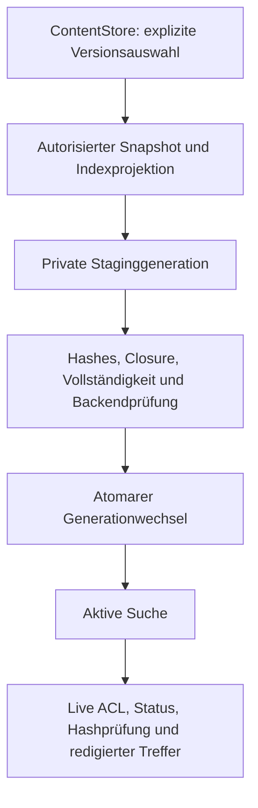

# C24-01: Indexing & Retrieval ADR

18.10.2026 · Entscheidung für die folgenden Implementierungs-PRs · Basis
`master` `95c4c40c1ab738ce1d75ac9ed554a46613419133` nach Merge von [#82](https://github.com/rf-data/Personal_Assistant/pull/82).
C24-01 spezifizierte diese Verträge. C24-02 ergänzte
[Modelle und autorisierte Indexprojektion](index_projection_implementation.md).
C24-03 implementiert darauf [Source-FTS5, Generationen und interne Suche](content_fts_implementation.md).
HTTPsearch, Jobs und Qdrant bleiben außerhalb dieses Implementierungsstands.
C23-06 ist technisch vorbereitet, seine fachliche Realabnahme bleibt blockiert.

## Entscheidung und Autorität

Erster Backendadapter: **SQLite FTS5**, in separaten privaten, neu aufgebauten
Indexgenerationen. Eine FTS5-Datei je Source verhindert, dass BM25-Statistiken
fremder Sources Scores oder Rangfolgen beeinflussen. Derselbe Projektor liefert
alle späteren Backends; kein eigener Transcript-/Materialchunker je Suchtechnik.
Qdrant bleibt optional, hinter demselben Retrievalvertrag austauschbar. Persistenz,
lexikalische Suche und Rebuild benötigen weder Embeddings noch Knowledge.

ContentStore bleibt alleinige Autorität für Identitäten, Originalbytes, Versionen,
Parserkonfiguration, Projektion, Locatoren, Ownership, Grants und Status. Der Index
enthält widerrufbare Kopien. Rechte werden niemals aus Indexmetadaten abgeleitet.
Keine zusätzlichen Tabellen/Trigger in `content-v1`: dessen exakter Schemacheck
würde sie zu Recht ablehnen. Kein Zugriff auf produktive Dateien durch diesen PR.

Verbindliche Details: [Indexrecord-/Retrievalvertrag](index_record_contract.md),
[Umsetzung und Prüfplan](../planning/c24_implementation_plan.md).

## Geprüfter Iststand und Wiederverwendung

| Implementierung auf dieser Basis | Tatsächlich vorhanden | Verwendung / erforderliche Ergänzung |
| --- | --- | --- |
| [Contentmodelle](../../src/content_store/models.py) | `ContentBlock`, `ContentLocator`, Source-/Parsed-Versionen, ParserConfiguration; canonical/fingerprint und deterministische IDs | Direkt wiederverwenden; kein zweites Quellen-/Locator-/ACLmodell |
| [Store](../../src/content_store/store.py), [Reader](../../src/content_store/reader.py) | Live Owner/Grant **und** Course, Hash-/Statusprüfungen, Maintenance-/DBlocks, signed Keysets | Gemeinsame autorisierte Snapshotprojektion ergänzen; kein ungeprüfter direkter SQLexport |
| [C23-04](../api/content_read_v1.md), [read_views](../../src/content_store/read_views.py) | Redigierte DTOs, exakte Codepointfenster, Rawreferenzen und eigene Capability | Locatoren/URLs/Fehler redigieren wie dort; Suchroute noch nicht vorhanden |
| [C10-Handoff](../../src/tools_lecture/material_handoff.py), [Mapping](../../src/tools_materials/mapping.py) | Ausschlüsse und exakte MaterialUnits mit 2.000-Codepointfenstern | Persistierte geprüfte Auswahl lesen; nicht neu heuristisch entscheiden |
| [B-Adapter](../../src/content_store/adapters.py) | Materialprojektion mit aggregation_units/excluded_blocks/alternative_views; SRT-Projektion pro Cue | SourceVersion/Projektion prüfen, Rollen und ursprüngliche Texte erhalten |
| [Transcript-Retrieval](../../src/tools_rag/cs50_retrieval.py) | `TranscriptHit`, `search_cs50_transcripts`, Plan-/Payloadabgleich, optionale Originalprüfung, Kurs/Lecture/Source/Sprache, Cosinescore | Geprüfter Legacy-Pilot; keine ContentStore-ACLs, Parsed-Blockanker oder Cursor. Nicht als neue Content-Suche exportieren |
| [Ingestion](../../src/tools_rag/cs50_ingestion.py), [Collection](../../src/tools_rag/cs50_collection.py), [Indexmodelle](../../src/model_discovery/cs50_index.py) | Explizite Plans, deterministische UUID5-Punkte, Hash-/Konfigurationsprüfung, Upsert/Readback/Resume; timed TranscriptPayload | Betriebs-/Vektorgates übernehmen; Schema lässt sich nicht als ContentRecord v1 umetikettieren |
| [Embeddings](../../src/tools_rag/cs50_embeddings.py) | `LocalEmbedder`, `checked_vectors`, exakte `offset_windows`, `FakeEmbedder` ausdrücklich synthetisch | Lokale Encoding-/Vektorprüfung verwenden. Tokenfenster nur als untergeordnete Anker; Timed-Mapper verlangt echte Zeiten |
| [Orchestrierung](../../src/tools_rag/cs50_orchestration.py), [Transcript-CLI](../../scripts/cs50_transcript_index.py) | Getrennte Download-/Plan-/Embed-/Upload-/Status-/Retrievalschritte und explizite Freigaben | Pilotadapter hier erweitern; keine automatische Contentindexierung oder zweite CS50-Pipeline |
| [Einfache QA-Suche](../../src/tools_rag/text_qa.py) | Substringzählung über Summary/Findings/Entities | Kein Parsedtext, Version-/Anker-/ACLvertrag; kein belastbarer Volltextfallback |
| [Knowledge-Mapping](../../src/tools_rag/cs50_knowledge_index.py) | Read-only `map_knowledge_document`, `execution_supported=false` | Kein Knowledgeindex als Voraussetzung für Parsed-Suche |
| [Legacychunker](../../src/tools_rag/chunk.py), [Chroma-Retrieval](../../src/tools_rag/retrieve.py) | Satzsegmentierung, Mergen/Strip/Headingzusatz und `RetrievedChunk` mit freiem metadata; [create_embeds](../../src/tools_rag/create_embeds.py)/[run_chunk_embed](../../src/run_chunk_embed.py) binden App/Modell/Chroma | Verfehlt den exakten Block-/Offset-/ACLvertrag; nicht für C24 übernehmen. Kein Legacyrefactoring |
| [Legacy-Qdranthelper](../../src/utils/qdrant_helper.py) | Konfigurationsabhängiger Client | Nicht importieren: keine implizite Verbindung/Secretsinitialisierung |
| [Retrievalevaluation](../../src/tools_rag/cs50_retrieval_evaluation.py) | Toy-Arithmetik Recall@k/MRR@k und streng geprüfte reale Transcripturteile | Reine Arithmetik wiederverwenden; unabhängigen blockbasierten Reviewadapter ergänzen |
| [retrieval_metrics.py](../../src/tools_evaluation/retrieval_metrics.py) | Nur Funktionsstümpfe (`return`), keine Metriken | Kein implementierter Precision-/nDCGnachweis |
| [C23-06](../cs50/evaluation/c23_real_material_evaluation.md) | Versioniertes Inventar/Gold/Review, technische Offlineevaluation | Herkunft, Reviewstatus und leere Nenner übernehmen; Parsinggold ist kein Retrievalgold |

Die internen `ContentStore.list_content_blocks` liefern bei mehr als 100 Blöcken
`Unavailable`; sie sind **kein vollständiger paginierter Export**. `ContentReader`
hat paginierte redigierte Reads, aber keine stabile, vollinhaltliche Indexprojektion
über viele Requests. C24-02 ergänzt deshalb genau **eine** transaktionale interne
Export-/Hydrierungsgrenze an den vorhandenen Storeprimitiven. Separate Getter pro
Block oder das erneute Parsen von Raw wären kein gleichwertiger Ersatz.

Historischer [Draft #72](https://github.com/rf-data/Personal_Assistant/pull/72),
18.10.2026 geprüft: offen, draft, Head `3a42b1675dffe823edc179a347fa97dd1a096fd0`.
Phase A teilweise und Phase B vollständig blockiert; keine echte E5-Inferenz,
Qdrant-Upserts oder reale Suchqualität belegt. Canonical-Binding
`data/lectures/Harvard` versus historischer Bestand `data/Harvard` bleibt D06.
Keine Pfadkorrektur, Übernahme oder Pilotfreigabe durch C24-01. Vorhandene
Fragenvorlagen sind Reviewentwürfe, kein unabhängiges bestätigtes Realgold.
Es wurden keine privaten Materialbestände oder laufenden Indexinstanzen geprüft.

## Alternativen und Abwägung

| Option | Speicher / Kosten / Betrieb | Rebuild / Ausfall / Skalierung | ACL, Provenienz und Inhaltseignung | Entscheidung |
| --- | --- | --- | --- | --- |
| Kein Zusatzindex | Kein Textduplikat; jeder Request muss geprüfte Blöcke scannen | Einfach für winzige Fixtures; Aufwand pro Anfrage wächst mit Korpus | Autorisierbar, aber kein belastbarer Ranking-/Pagingvertrag | Nur expliziter Diagnosemodus, kein stiller Suchfallback |
| FTS5 | Textkopien, Postings und zwei Generationen benötigen zusätzlichen Diskraum; kein Dienst oder Modell | Deterministischer lokaler Rebuild; Single-Host, Sourcepartitionen begrenzen Fan-out | Gute lexikalische Baseline; exakte Originalanker. Tokenranking bewertet Code-/Formelsemantik nicht | Erster Adapter |
| Nur Qdrant | Vektoren, Payloads, Index/Instanz, Modellcache und Encodingkosten zusätzlich | SDK/Modell/Netz-/Snapshot-/Restoregates; für größere Vektorkorpora separat zu messen | Payloadfilter helfen, ersetzen keine Live-ACL. Semantik nicht für exakte Code-/Operatorgleichheit geeignet | Optional, ersetzt Volltextkern nicht |
| FTS5 + Qdrant | Summe beider Kosten und zweier Backendbelege | Gemeinsame Contentprojektion; Aktivierung nur vollständiger deklarierter Backendmenge | Rankfusion statt Vermischen von BM25 und Cosine; Qualität erst unabhängig evaluieren | Vertrag vorbereitet; zunächst nicht aktiviert |

Dies sind qualitative Architekturabwägungen, keine gemessenen Durchsatz-/Kosten-
oder Modellqualitätswerte. Bei 768 float32-Dimensionen benötigen allein die
Vektorkomponenten `records × 768 × 4` Bytes, ohne Payload-/Index-/Replikationsaufwand.
FTSbedarf wird erst an autorisierten technischen Korpora gemessen; keine feste
Kompressionsannahme. Mehrhostsuche und öffentliche Mandantenfähigkeit sind offen.

## Lexikalischer Adapter und Scores

FTS5 erhält pro Source eine normale FTS-Tabelle mit **einer** Textspalte und eine
separate Recordtabelle im selben abgeleiteten SQLitefile. Kein external-content-
Verweis in die Contentdatenbank; FTS-Rowid ist nur lokaler Schlüssel. Einfügeordnung
`(parsed_version_id, block_order, start, index_record_id)` und Schema sind fixiert.
Tokenizer v1: `unicode61 remove_diacritics 0`, kein Porter, keine Prefixindizes.
SQLiteversion und Tokenizerparameter werden im Backendfingerprint gebunden.
Keine ladbaren Erweiterungen oder automatische Extensioninstallation.

Die offizielle [FTS5-Dokumentation](https://www.sqlite.org/fts5.html) beschreibt
Tokenisierung, MATCH und BM25; kleinere BM25-Werte stehen dort für bessere Treffer.
Tokenpositionen sind keine Unicode-Offsets. Die Auswahl bewahrt Suchtextbytes,
verspricht aber keine case-sensitive Suche und keine Unterscheidung aller
mathematischen Operatoren. Formeln bleiben strukturierte Referenzen; Code wird
lexikalisch gefunden, niemals ausgeführt. Keine Aussage mathematischer Äquivalenz.

Globale BM25-Statistiken können trotz Sourcefilter nicht sichtbare Inhalte
beeinflussen. Deshalb Sourcepartitionen: BM25 nur innerhalb vollständig aktuell
sichtbarer selektierter Versionen einer Source. Wird eine dieser Versionen
quarantänisiert/tombstoned, ist die **ganze Sourcepartition stale**, bis eine neue
Generation sie ausschließt. Kein stilles Filtern einzelner Dokumente bei weiter
verwendeten Statistikdaten. Fremde Sources werden nicht geöffnet oder gerankt.

Sourceinterne Reihenfolge `(bm25 ASC, index_record_id ASC)`. Zwischen Sources keine
BM25-Normalisierung: Fusion `source_rrf_v1`, `sum(1/(60+rank))`, Rank ab 1,
gleiche Gewichte, stabile ID als Tie-Break. Jeder Record gehört genau einer Source;
das führt bewusst zu einer ausgewogenen, noch zu evaluierenden Sourcereihung.
Rohscore behält seine Sourcepartition und Richtung. Optionales Hybrid verwendet
zusätzlich Backendränge mit gleichem RRF-Prinzip, eigene `ranking_schema`-Version.
Inkompatible Rohscores werden niemals addiert; kein nachträgliches Min-Max anhand
fremder Sources und keine Behauptung einer Wahrscheinlichkeit.

[Qdrant-Filter](https://qdrant.tech/documentation/search/filtering/) unterstützen
Payloadbedingungen. C24-04 muss sie aus den live erlaubten Sources/Versionen und
der aktiven Generation bilden, anschließend Contentanker hydrieren. Für v1 nur
exakte gefilterte Vektorsuche; ANN-Recall/Indexseitenkanäle bleiben spätere Abnahme.
Collection-/Modellfingerprints und endliche Scores verpflichtend. Ein Backend
kann sich nicht selbst als autorisiert deklarieren. Keine Rückgabe alter Pilot-
Payloads über den neuen DTOvertrag und keine Nutzung alter Sammlungen ohne Gate.

## Lebenszyklus und kontrollierte Sichtbarkeit

[Generation-/Fehlervertrag](index_record_contract.md#generation-und-rebuild) gilt
für alle Backends. Alte Generationen sind private sensible Textkopien und keine
Fallbacks. Backup des ContentStores bleibt autoritativ; Indexrestore verlangt
erneute Liveprüfung oder Rebuild, kein automatisches Aktivieren. C22-Verbundbackup,
Retention/Hostfreigabe und Kapazität sind C26, kein neuer Betriebspfad in C24.

## Sicherheits- und Freigabegrenzen

Authentifizierung bleibt C16, Zugriff Course plus Owner/read-Grant pro Source.
Keine neue Administratorrolle. Liveprüfung, Querylimits, Cursor, Lockreihenfolge,
Antwortredigierung und begrenzte Rankingzustände stehen im
[Vertrag](index_record_contract.md#retrieval-und-autorisierung).
Private Indexdaten sind auch nach Widerruf administrativ geschützt aufzubewahren;
Querys dürfen sie nicht ausliefern. Keine Query-/Snippettexte in Logs/Metriklabels.
Ein gemeinsamer Host/UID garantiert keine Abwehr gegen kompromittierte Operatoren.
Auch Sourcepartitionierung ist kein Beweis konstanter Requestlaufzeit: CPU-/I/O-
Timingisolation ist eine ausdrücklich offene Mehrmandanten-/C26-Abnahmegrenze.

D08 wird durch diese Architektur für den technischen FTS5-Kern konkretisiert.
Rechte/D06/D07, Instanz-/SDK-/Modellbereitstellung, Pilot- und Produktionsfreigaben
bleiben offen. Die Entscheidung schafft keinen produktiven Index, HTTPsearch,
UI, automatische Jobs, Embeddings oder neue Downloadrechte.
