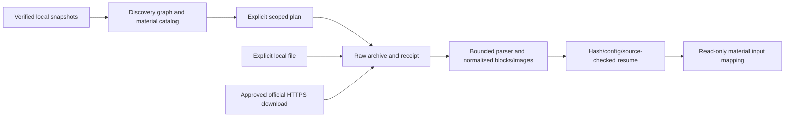

# CS50: Pipeline und Dokumentation

Geprüfte Entwicklungsbasis: master `8ba519ed04c04c92573594ebe74b69a3c00aab1b`.
Alle Abschlussänderungen aus #27–#37 sind enthalten. Der technische Funktionsumfang
ist offline mit echten Kernfunktionen und Fake-HTTP getestet; fachliche Qualität
einer vollständigen LLM-Kursverarbeitung ist damit noch nicht nachgewiesen.

## Architektur und Umfang

Der neue, separat freizugebende Transcript-Suchindex ergänzt diese Pipeline:
[Architektur](operations/transcript_index_architecture.md),
[CLI](operations/transcript_index_cli.md),
[Collectionvertrag](contracts/transcript_index.md),
[Embeddingvertrag](contracts/transcript_embeddings.md),
[Upload/Resume](operations/transcript_ingestion.md),
[Retrieval](operations/transcript_retrieval.md),
[Evaluation](evaluation/transcript_retrieval.md) und
[künftiges Knowledge-Mapping](contracts/knowledge_index.md).
Die [Abschlussbilanz](operations/transcript_index_completion.md) trennt technische
Offline-Nachweise von noch ausstehender Inferenz und fachlicher Evaluation.

Discovery → SRT-first Selection → Lecture-Adapter/Taskplan → kontrollierter
SRT-Download → offizieller Import → geprüfte Knowledge-Eingabebindung → zeitbasiertes
Chunking → isolierte Extraktion → Evidence-Bindung → deterministische Consolidation
→ Quality-/Coverage-Report → hashgebundene Knowledge-Artefakte.

Sechs Kurse, 50 geparste Hauptvorlesungen, 50 englische SRT-Quellen und 100 getrennte
Download-/Importtasks. Original-IDs: `cs50x`, `cs50_python`, `cs50_sql`, `cs50_ai`,
`cs50_web`, `cs50_cybersecurity`. Woche `0`, Abschnitt `ai` und fehlende media_id
bleiben erhalten. HTML-Fixtures, Fixture-Manifest und Kurs-/Taskplan liegen weiterhin
unter [docs/course_sources/cs50](../course_sources/cs50/).

- [Discovery](contracts/discovery.md), [Selection](contracts/selection_policy.md)
  und [Lecture-Adapter](operations/lecture_adapter_report.md).
- [Portable Knowledge-Inputs](contracts/cs50_portable_inputs.md),
  [Checkpointvertrag](contracts/cs50_knowledge_checkpoint.md),
  [dauerhaftes Budget](contracts/cs50_budget_contract.md).
- [Lecture-Runner](operations/cs50_lecture_runner.md),
  [vollständiger Lecture-Abschluss](operations/cs50_lecture_completion.md),
  [Scheduler](operations/cs50_course_scheduler.md),
  [Sechs-Kurse-Batch](operations/cs50_batch_execution.md),
  [gewichtetes Reporting](operations/cs50_schedule_reporting.md).
- [Metadatenvertrag](contracts/transcript_metadata_model_contract.md),
  [Quellenidentität](contracts/knowledge_source_id_contract.md),
  [Metadatenweitergabe](contracts/cs50_metadata_forwarding.md).

## CLI-Einstiege

Alle Befehle werden aus dem Repositoryroot ausgeführt. Pfade für importierte
Quellen, Workspaces und Ergebnisse werden explizit angegeben; produktive Daten
gehören nicht in das Dokumentationsarchiv.

| Einstieg | Aufgabe / Standard | Anleitung |
|---|---|---|
| `python -m scripts.report_cs50_sources` | Offline-Discovery und Previews; Markdown-Ausgabe unter docs/cs50/operations | [Kursübersicht](operations/six_course_overview.md), [SRT-Preview](operations/knowledge_selection_preview.md) |
| `python -m scripts.report_cs50_lecture_plan` | Versionierter Adapter-/Taskplan ohne Ausführung | [Adapter](operations/lecture_adapter_report.md) |
| `python -m src.tools_lecture.execute_cs50` | SRT-Tasks; Dry-Run, Netzwerk erst mit --execute | [Executor](operations/srt_executor_report.md) |
| `python -m scripts.report_cs50_knowledge_input` | Validierte Eingabebindung; portable v2 mit explizitem Workspace | [Inputbindung](operations/knowledge_input_integration_report.md), [v2](contracts/cs50_portable_inputs.md) |
| `python -m scripts.cs50_knowledge_pilot` | Begrenzter Pilot, maximal zwei explizit gewählte Chunks | [Pilotgeschichte](archive/2026-10/llm_pilot_runtime_report.md), [Evidence](evaluation/precise_evidence_comparison_report.md) |
| `python -m scripts.cs50_lecture` | Ein vollständiger Chunkplan, explizite Fenster oder alle Chunks | [Runner](operations/cs50_lecture_runner.md) |
| `python -m scripts.cs50_schedule` | Sequenzieller Kurs-/Sechs-Kurse-Scope, --max-lectures / --audit-only | [Batch](operations/cs50_batch_execution.md) |
| `python -m scripts.cs50_offline_demo` | Synthetische 50-Vorlesungen-Demo mit Fake-HTTP in neuem externem Ausgabeordner | [Demo](operations/cs50_batch_execution.md) |
| `python -m scripts.cs50_review_template` | Leere Reviewfenster aus tatsächlich validierten Cues | [Evaluation](evaluation/cs50_quality_evaluation.md) |

## Tests und Reproduzierbarkeit

Verwende eine bereits bereitgestellte, deklarierte Workerumgebung. Der
[minimale SDK-freie Worker](../../workers/cs50/README.md) hat einen eingefrorenen
Lockgraphen; ein frisches Offline-Sync setzt vollständig gecachte Wheels voraus.
Es gibt keinen automatischen Download fehlender Pakete.

```bash
UV_PROJECT_ENVIRONMENT="$WORKER_VENV" UV_CACHE_DIR=/tmp/cs50-uv-cache \
  CS50_TEST_PROFILE=offline uv run --offline --no-sync python -m pytest tests -q \
  --tb=short --junitxml=/tmp/cs50-offline.xml
```

Baseline: **461 passed, 6 bekannte TXT-Vertragsfehler, 5 skips, 0 Setupfehler**.
Die sechs Fehler bleiben ausdrücklich sichtbar; Details in der
[Testmatrix](operations/cs50_pipeline_test_matrix.md). Die fünf Skips betreffen
optionale lokale Originalpiloten/Workerintegration und das SDK-Konfigurationsprofil.
`CS50_TEST_PROFILE=sdk` setzt separat installierte optionale SDKs voraus und darf
deren Fehlen nicht als Erfolg behandeln. Technische synthetische Aussagen sind
keine Gold-Aussagen oder fachlichen Qualitätsnachweise.

## Sicherheit, API-Freigaben und Resume

Offline ist der Standard. Downloads benötigen `--execute`; echte LLM-Requests
benötigen `--execute-llm`, gültige Konfiguration und die bestehenden isolierten
Workerfreigaben. Dieser Dokumentationsauftrag führt keine davon aus. Keine
Video-/Audio-/Whisper-Fallbacks bei SRT-first. Quellen werden aus expliziten
Bindings und Hashes geprüft, nicht aus Dateinamen geraten.

Request-, Token- und Laufzeitlimits sind Bestandteil der dauerhaften Identität.
Keine automatische Requestwiederholung oder Budgeterstattung bei unklarer
Ausführung. Resume revalidiert Quellen, Belege und Ergebnisartefakte; unknown,
Hash-/Provenienzkonflikte oder beschädigte Dateien blockieren neue Requests.
Eine vorhandene Datei allein reicht nicht. Rohantworten und unvalidierte
Evidence-Kandidaten bleiben vom validierten Knowledge-Ergebnis getrennt.

## Evaluation und offene Grenzen

[segment_v1](evaluation/precise_evidence_comparison_report.md) validiert
statement-/formelspezifische Cue-IDs und leitet Zeiten aus Originalsegmenten ab.
Schema-Validität, Quellenbindung, semantische Belegbarkeit und didaktischer
Lernwert werden [getrennt bewertet](evaluation/cs50_quality_evaluation.md).
Ein echter segment_v1-Qualitätstest und manuell geprüftes Gold-Set bleiben offen;
keine automatische Vollkursfreigabe allein wegen grüner Offline-Tests.

Weitere Aufgaben: TXT mit unbekannten Zeitstempeln; optionales SDK-Testprofil;
sicherer Resume-Vertrag der allgemeinen Legacy-Consolidation. Bestehende
zeitbasierte SRT-/Whisper-Verarbeitung bleibt unverändert. Legacy-Document-,
Visual- und Whisper-Refactorings sind außerhalb dieses Entwicklungsabschnitts.

## Historisches Archiv

Die [öffentliche Konsolidierungszusammenfassung](../project_consolidation_report.md)
führt Vorgehen, Offline-Regression und Sicherheitsgrenzen auf. Private lokale
Inventare sind darin nicht enthalten.

[archive/2026-10](archive/2026-10/) enthält Entwicklungsberichte mit ihren
damaligen Commit-/Testständen, einschließlich der vormals unversionierten
Abschlussanalyse und des inzwischen behobenen Integrationsblockers. Historische
Testergebnisse und Kommandos sind keine aktuelle Betriebsfreigabe. Inhalte wurden
erhalten; Links und persönliche Maschinenpfadbeispiele wurden portabel gemacht.
Die [Archivierungs- und Bereinigungsbilanz](operations/archive_cleanup_report.md)
führt die tatsächlich ausgeführten Schritte und verbleibenden Kandidaten auf.


## Course materials (offline-first)

- [Snapshot inventory and gaps](operations/material_gap_analysis.md), [coverage](operations/material_coverage.md).
- [CLI / manual download release / demos](operations/material_ingestion.md).
- [Resource and normalized document contract](contracts/material_artifacts.md),
  [download](contracts/material_download.md), [processing/resume](contracts/material_processing.md),
  [code](contracts/material_code.md), [future material mapping](contracts/material_mapping.md).
- [Parser support/quality limits](evaluation/material_parser_matrix.md),
  [offline regression matrix](evaluation/material_tests.md),
  [completion and remaining release gates](operations/material_completion.md).

This additive path prepares structured source blocks. Existing transcript Knowledge,
Whisper, extraction prompts, collections and production artifacts remain unchanged.




Material mapping does not execute Knowledge extraction or upload vectors.
