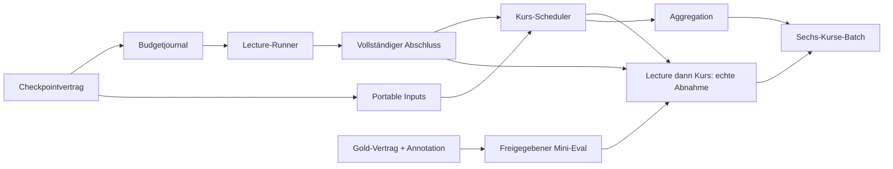

# CS50-Pipeline: priorisierter Abschlussplan

Stand: 14. Oktober 2026; Basis und Nachweise im
[Abschlussaudit](cs50_pipeline_completion_audit.md). Dies ist ein Implementierungs-
vorschlag, keine Ausführungsfreigabe. Heute keine Produktionsänderungen, neuen
Downloads, API-Aufrufe oder Merges.

## Zielbild und kleinster notwendiger Umfang

Ziel: bestehende sechs Discovery-Kurse/50 SRT-Bindungen ohne Video/Whisper über
kontrollierte Jobs zu vollständigen, quellengestützten Knowledge-Dokumenten
verarbeiten. Vorhandene fachliche Modelle und den SRT-Executor weiterverwenden.
Der heutige ein-/zwei-Chunk-Pilot bleibt als unveränderte sichere Probe erhalten.

**Zunächst eine vollständige Python-Vorlesung:**

1. Erfolgreichen Import mittels bestehendem Inputbinder erneut prüfen.
2. Alle echten Chunks vorab planen, inklusive eindeutiger Job-/Chunkfingerprints.
3. Dauerhafte Checkpoints und globale Request-/Token-/Laufzeitreservierung.
4. Eigener expliziter Lecture-Runner mit Offline-Default, isoliertem HTTP-
   Provider und Freigabe für genau diesen Input; keine automatische Retry-Welle.
5. Vollständigkeitsprüfung über sämtliche geplanten Chunks einschließlich
   irrelevanter/leer extrahierter Ergebnisse; Gesamt-TranscriptKnowledgeDocument,
   deterministische Consolidation und Quality atomar fertigstellen.
6. Vor dem echten ganzen Lauf: klein freigegebene segment_v1-Qualitätsprobe und
   manuelles Quellen-/Lernwert-Review; Schemaerfolg allein genügt nicht.

Nicht dafür erforderlich: TXT, Video, Whisper, semantische LLM-Consolidation,
Visual-Rebuild, neue fachliche Ergebnismodelle oder ein generischer Legacy-Runner.
Die aktuelle CS50-Bindung trägt Metadaten bereits direkt in die deterministische
Consolidation; die geplante allgemeine PR-#26-Weitergabe blockiert diesen Weg nicht.

**Danach ein ganzer Python-Kurs:** derselbe überprüfte Lecture-Job für zehn
explizite Bindungen, kursweiter Scheduler/Status/Budget und Quality-Aggregation.
Bestehender Executor kann die zehn SRTs sequenziell beziehen und resumieren;
Netzfreigabe bleibt getrennt von LLM-Freigabe. Zunächst concurrency=1.

**Schließlich alle sechs Kurse:** derselbe Kursrunner für sechs explizite
Kurspläne/50 Sources, mit zusätzlichem gemeinsamen Batchbudget und eindeutiger
Coverage. Keine sechs frei startbaren Parallelprozesse mit jeweils neuem Budget.

## Priorisierung und Codex-Eignung

P0 = Sicherheits-/Vollständigkeitsvoraussetzung für einen größeren echten Lauf;
P1 = Voraussetzung für reproduzierbaren Kursbetrieb oder belastbare Qualität;
P2 = spätere Ergänzung, kein Blocker des SRT-first-Mindestwegs.
Codex 5 = überwiegend deterministisch gut umsetzbar; 1 = wesentliche fachliche
oder kostenpflichtige Arbeit erfordert Menschen. Umfang umfasst Code und Tests,
keine numerische Zeit-/Kostenprognose. Jeder Tabellenpunkt ist ein eigener kleiner
PR, soweit ausdrücklich nicht weiter unterteilt.

## A. Fehlerbehebung und Stabilisierung

| ID / PR | Stufe | Konkretes Problem und notwendige Änderung | Priorität | Codex | Umfang | Abhängigkeit | Eindeutige Abnahme |
|---|---|---|---|---:|---|---|---|
| A01 – Knowledge-Checkpointvertrag | Knowledge-Persistenz/Resume | Pilot-JSONs sind exklusiv, aber nicht atomar; kein sicherer Resume. Kleine versionierte Job-/Chunk-Ausführungsbindung mit Source-/Transcript-/Chunkplan-/Prompt-/Evidence-/Providerfingerprint, Artefakthashes, atomic save und Completion-Zuständen. Bestehende Ergebnismodelle unverändert. | P0 | 5 | mittel | #25 integriert; vorhandener CS50-Inputbinder | Fake-Provider-Abbrüche vor/nach Publikation; nur validierte identische Ergebnisse übernommen; kaputte JSONs, falsche Hashes und fremde Jobkonfigurationen als Konflikt; keine produktiven Source-Artefakte geändert. |
| A02 – Dauerhafte Budget-/Versuchsbindung | Provider/Isolation | RequestBudget nur 1/2 und pro Prozess flüchtig; Kill kann eine kostenpflichtige Anfrage ungewiss lassen. Reservierung vor Dispatch persistieren, Request-/Tokenlimits über alle Chunkworker, unbekannte Versuche nicht automatisch wiederholen. Optional Preisbuch/Modell-Allowlist und Geldobergrenze explizit konfigurieren. | P0 | 4 | mittel | A01 | Fake-HTTP 429/5xx/Timeout/Crash verbraucht einen Versuch; Neustart setzt Zähler nicht zurück; keine Überschreitung nach zwei Prozessen; unknown erfordert ausdrückliche Auflösung. Pilot-Defaults 1/2 und null Retries bleiben bestehen. |
| A03 – Portable gespeicherte Inputreferenzen | Inputmanifest/Workspace | Generierte CS50KnowledgeInputs tragen absolute Artefaktpfade; CLI nutzt cwd. Explizite Workspace-Auflösung und versionierter relativer Persistenzvertrag bei unverändertem Identitäts-/Hashvergleich, keine Dateisuche. | P1 | 5 | klein–mittel | A01 | Derselbe Sourcebestand an zwei Temp-Roots importiert/verschoben und geprüft; identische Source-/Provenienzinformation, keine ungeprüfte Adoption; Traversal/Symlink-Konflikte; v1-Inputs weiterhin explizit lesbar. |
| A04 – Allgemeine Metadatenweitergabe (vorgesehenes #26) | Extraction/Semantic-Ergebnis | Zwei verbleibende Tests: allgemeiner Runner und beide semantische Ergebniskonstruktoren lassen nun unterstützte Metadaten weg. Geprüfte Werte weitergeben, keine neuen Identitäten herleiten. | P1 | 5 | klein | #25 integriert | Beide bestehenden Integrationstests ohne Skip grün, Legacy-ID-/CS50-Regressionen unverändert; kein echter LLM. Parallel möglich, kein Blocker von B01/B02. |
| A05a – Reproduzierbares Worker-Profil | Umgebung | Vorhandene Worker-.venv ist getestet, frischer Offline-Rebuild durch früheren spaCy-Metadatenbefund nicht nachgewiesen. Kleinsten CS50/Knowledge-Worker aus bestehenden deklarierten Versionen reproduzierbar aufsetzen und Lock-/Cachevoraussetzungen dokumentieren. | P1 | 4 | mittel | keine SDK-Installation als Lazy-Fix; #24 integriert | Saubere Installation aus zulässigem Cache/Lock ohne ungefragte Upgrades; Discovery/Executor/HTTP-Fake/Evidence ohne LLM-SDK; keine Secrets oder Originalpilot-Dateien nötig. |
| A05b – Optionales SDK-Testprofil | Tests/CI | Ein Smoke-Test verlangt das nicht installierte OpenAI-SDK. SDK-Tests bewusst optional markieren und eine getrennte installierte Profilmatrix führen, ohne echte API-/DB-Initialisierung im deterministischen Profil. | P1 | 5 | klein | A05a, #24 | SDK-freie CI hat explizite nachvollziehbare Optional-Skips statt Produktionsfehler; SDK-Profil prüft echte Konfiguration offline. Kein xfail für echte Modellfehler. |
| A06 – Diagnostik/Planstatus aktualisieren | Planung/Status | planned_only/execution_supported-Literals und integration_pending/future-handler-Texte beschreiben einen alten Stand. Laufplan und Ausführungscapability eindeutig dokumentieren; sichere Fehlercodes pro Source/Chunk/Phase ohne Keys/HTTP-Bodies. | P1 | 5 | klein | A01; SRT-Executor bereits vorhanden | Preview behauptet weder Ausführung noch fehlenden Handler; Runstatus unterscheidet geplant, validiert, fertig, fehlerhaft, ungewiss. Legacy-Planversion bleibt lesbar, keine Taskausführung durch Reports. |

Keine allgemeine Legacy-Überprüfung als Voraussetzung einschieben. Der bekannte
existenzbasierte Skip in run_knowledge_consolidation bleibt ein dokumentiertes
separates Problem; CS50 erhält seinen eigenen sicheren Resume-Vertrag A01.

## B. Fehlende End-to-End- und Batch-Funktionen

| ID / PR | Stufe | Konkretes Problem und notwendige Änderung | Priorität | Codex | Umfang | Abhängigkeit | Eindeutige Abnahme |
|---|---|---|---|---:|---|---|---|
| B01 – Vollständiger Lecture-Job | Chunk-Dispatch/LLM | Pilot ist auf Python 0 und max. 2 begrenzt. Eigener CS50-Lecture-Einstieg für exakt einen geprüften Input aller sechs Kurse, vollständigen explizit freigegebenen Chunkbereich, Offline-Default und isolierten openai_http. Vorhandene Provider/Binder/Evidence-Modelle verwenden, Pilot nicht still erweitern. | P0 | 4 | mittel | A01, A02; A03 für portable gespeicherte Jobs | Lange synthetische Source >2 Chunks; Fenster/alle Chunks; max_requests/global budget; Abbruch-/Resume-Tests; jeder Chunk erhält echte Source-Provenienz; Cybersecurity media_id=None und ai/0 funktionieren; kein SDK/API in Offline-Tests. |
| B02 – Vollständiger Lecture-Abschluss | Assembly/Consolidation/Quality | Teilresultate sind heute zulässig, Gesamtvollständigkeit nicht bewiesen. Alle ledger-validierten erwarteten Chunks in Quellreihenfolge regulär als TranscriptKnowledgeDocument laden, deterministisch konsolidieren und atomar abschließen. | P0 | 5 | klein–mittel | B01 | Fehlender/duplizierter/fremder Chunk verhindert complete; irrelevanter Chunk mit extraction=None zählt als verarbeitet; mehrere Belegstellen/Formeln bleiben erhalten; alle fachlichen/externalen JSONs roundtrip; Teiloutputs werden niemals als fertig markiert. |
| B03 – Kurs-Scheduler | mehrere Lectures | Kein Knowledge-Kursloop/Batchmanifest. Versionierter Kursauftrag für explizite Bindungen, sequenzieller Dispatch, next-pending-Auswahl, failed/unknown-Policy, globale Caps und reproduzierbare Zusammenfassung. | P1 | 4 | mittel | B02, A03, C01/C02 vor echten Kurscalls | Zehn synthetische Python-Lectures, Unterbrechung mitten in Kurs, validierter Resume ohne Doppelrequests; eine ungültige Source isoliert und sichtbar; kein unkontrollierter Fallback; gemeinsame Budgetgrenze trotz Neustart. |
| B04 – Kursweiter Quality-/Coverage-Report | Reporting | Nur Runreport, kein kursweiter Nenner/Download-/Import-/Knowledge-Status. Reports aus geprüften Manifesteinträgen aggregieren, Rohmetriken gewichten statt Quoten mitteln. Keine fachliche Source-übergreifende Konsolidierung. | P1 | 5 | klein | B03; A01-Reportvertrag | Geplant/erfolgreich/fehlend/fehlgeschlagen/unknown vollständig gezählt; synthetic getrennt von LLM; Evidence-Scopes/Usage/Topics/Duplikate plus Quellenlinks; kaputte/fremde Reports klar abgewiesen. |
| B05 – Sechs-Kurse-Batchfreigabe | Gesamtbatch | Kursjobs allein haben keine gemeinsame Obergrenze. Dünner Multi-Kursauftrag mit expliziten sechs IDs, 50 Sources, Joblinks, gemeinsamer Budget-/Zeitobergrenze und concurrency=1. | P1 | 4 | klein–mittel | B03, B04; C03 | Offline alle 50/100 Source-Tasks und Knowledge-Sources integriert; Skip/Resume über Kursgrenzen; eine offene API-Anfrage blockiert automatischen Retry; keine ID-/Pfadkollisionen; Batchbericht zählt exakt 50 logische Lectures. |

B01 darf nicht bloß max-chunks erhöhen oder die Pilotprüfung entfernen. Die
Schutzmechanismen A01/A02 sind zuvor nötig. Die minimalen neuen Strukturen sind
versionierte Ausführungs-/Budgetwrapper; Lecture-/Transcript-/Knowledge-
Geschäftsmodelle müssen dafür nicht ersetzt werden.

### Vorgeschlagener Ausführungsvertrag für A01/A02/B01

- Jobidentität: explizite bestehende course/section/lecture/resource/source IDs,
  Transcript-/Raw-SHA, Chunkplan-Konfiguration und -Digest, Prompt-Hash/-Version,
  Evidence-Modus/-Version, Provider/Modell und Ausgabe-Schema-Version.
- Chunkzustände: pending, request_reserved, in_flight, validated/prepared, done,
  failed, unknown. Erfolg verlangt passende Raw-/normalisierte Provider-Sidecars,
  validierte Evidenz und atomar publizierte Hashes. Unknown ist kein neuer pending.
- Requestversuch vor HTTP-Dispatch persistent; tatsächliche Usage zusätzlich
  speichern. Nach Kill kann exaktes Abrechnungswissen fehlen: Reserve bleibt
  konservativ verbraucht, keine automatische Wiederholung. Kein Versprechen
  einer Exactly-once-API, wenn der Provider keine solche Garantie liefert.
- Source-Dateien bleiben read-only; sicherer exklusiver Knowledge-Outputroot.
  Prozessgruppen-Timeout wird weiterverwendet. Geldbudget nur mit ausdrücklich
  festgelegtem Modell/Preisstand; keine unüberprüfte Preisannahme im Code.
- Abschlusscommit für Doc/Consolidation/Quality mit Hashes/Coverage-Marker;
  bloße Dateiexistenz oder eine teilgeschriebene worker_result-Datei genügt nicht.

## C. Knowledge-Qualität und Evaluation

| ID / PR | Stufe | Konkretes Problem und notwendige Änderung | Priorität | Codex | Umfang | Abhängigkeit | Eindeutige Abnahme |
|---|---|---|---|---:|---|---|---|
| C01a – Gold-Vertrag/Evaluator | Evaluation | Regex-Proxys sind keine Relevanz-/Entailment-Wahrheit. Kleinste Datenspezifikation und deterministische Auswertung für vier getrennte Achsen, Quellenhashes und Reviewer-Urteile. | P1 | 5 | klein | vorhandene Source-/Evidence-Modelle | Keine erfundenen Goldaussagen; Fixtures nur als technische Samples markiert; invalid Source/Hash/Cues abgewiesen; Schema, Quellenbindung, semantische Bewertung und Didaktik getrennt berichtet. |
| C01b – Fachliche Gold-Annotation | menschliche Qualität | Keine handgeprüften Referenzen für Konzept-/Negativ-/Grenzfälle. Acht echte Python-0-Fenster zuerst, danach 24 Fenster über sechs Kurse; tatsächliche Belege, Aussagen, Typen, Negativgründe und Lernwert annotieren. | P1 | 2 | mittel | C01a, geprüfte echte SRTs; neue Downloads erst separat autorisiert | Reviewer/Adjudikation dokumentiert; minimale/zulässige Belegmengen; keine künstlichen Fakten/Formeln; Quellversionen und Uneinigkeit nachvollziehbar. |
| C02 – Freigegebener präziser Mini-Eval | segment_v1/Modell | ID-Validität ist noch kein nachgewiesener fachlicher Fortschritt; erster echte Lauf nur Intro/Legacy. Explizit freizugebende ein-/zwei-Chunk-Vergleiche mit Raw-Sidecars und denselben geprüften Fenstern. | P1 | 2 | klein | C01b; vorhandener Pilot; A01 für langlebige Belege | Keine automatische API-Freigabe; Modell/Prompt/Input/Usage dokumentiert; alle vier Achsen ausgewertet; falsche, überbreite und unvollständige Belege bewertet; kein Promptwechsel vor Befund. |
| C03 – Vollvorlesungs-/Kurs-Abnahme | Qualität und Betrieb | Kleine Qualitätssamples beweisen noch keine vollständige Lecture. Zuerst eine Python-0-Lecture mit konservativem Cap, manuelles Stichprobenreview; dann ein Python-Kurs; erst danach sechs Kurse. | P1 | 2 | mittel | B02/B03/B04, C02 | Vollständigkeitsmarker, überprüfbarer Quellenpfad, Budget-/Statusbilanz; vorab festgelegte Qualitätsgrenzen/Fehlerpolitik; ungelöste Visual-/Formel-Fälle bleiben als offen markiert und erzeugen keinen Video-Download. |

Numerische Qualitätsgrenzen müssen vor dem echten Experiment mit den Reviewern
festgelegt werden. Heute liegen keine belastbaren Entailment-/Didaktikquoten
vor. Optionales Prompt-Tuning kommt erst nach C02 und als eigener kontrollierter
Vergleich; kein automatisches Löschen didaktisch schwacher Statements durch
Regex-Regeln. Gold- und Evaluationsarbeit kann parallel zur technischen
Checkpoint-/Runner-Implementierung erfolgen.

## D. Optionale spätere Erweiterungen

| ID / PR | Stufe | Problem / begrenzte Änderung | Priorität | Codex | Umfang | Abhängigkeit | Abnahme |
|---|---|---|---|---:|---|---|---|
| D01 – TXT-Zeitvertrag | optionaler Import | Sechs bekannte Tests verlangen unbekannte Zeiten; aktuelle Segmente erzwingen float. Nullable Zeitvertrag gezielt prüfen, zeitbasiertes Chunking explizit ablehnen; zeitlosen Knowledge-Pfad separat entscheiden. | P2 | 5 | klein | Model-Kompatibilitätsanalyse, kein SRT-Fallback | Sechs TXT-Fälle grün, keine künstlichen Zeiten, Whisper/SRT unverändert. Nicht Voraussetzung für 50 en-SRTs. |
| D02 – Allgemeines Consolidation-Resume | späterer Legacy-Auftrag | Existenzbasierter Skip übersieht leere/kaputte Ausgaben. Typ-/Identitätsvalidierung und sichere Konfliktpolitik nur im separaten begrenzten Legacy-PR. | P2 | 4 | klein | eigene Legacy-Priorisierung | AST-Probe und echte Offline-Tests für gültig/leer/kaputt/fremd; kein Überschreiben oder automatische Migration. CS50 bleibt bei A01. |
| D03 – Offline-Profiling großer Sources | Performance | SRT-Reimport/Hash-/Dokumentprüfung mehrfach je Chunk. Messen, erst dann ggf. geprüften unveränderlichen Snapshot + Mutationschecks wiederverwenden. | P2 | 4 | klein–mittel | B01; reproduzierbare Fake-Source | Messbarer Gewinn; alle Hash-/Provenienz-/Mutationskonflikttests weiter grün. Kein Refactor allein wegen ähnlicher Funktionnamen. |
| D04 – Weitere Materialien/Sprachen | Sources | Notes/Source Code/Assignments/VTT und Nicht-en-Fallbacks sind außerhalb des SRT-first-Mindestwegs. Nur nach konkreter Lern-/Datenanforderung ergänzen. | P2 | 3 | mittel | erfolgreicher sechs-Kurse-SRT-Pfad | Rollen/Sprachen/Provenienz erhalten; zusätzliche Netzfreigabe und eigene Fixtures; keine stille Video-/Whisper-Aktivierung. |
| D05 – Semantische/visuelle LLM-Stufen | spätere Knowledge-Erweiterung | Zusätzliche Qualität/Formula-Recovery könnte nützen, ist aber heute kein Mindestweg. Erst Evaluation und eigene Kosten-/Evidence-Gates. | P2 | 2 | groß | C03; separates Architektur-/Budgetvotum | Eigene menschliche Abnahme und Provenienz; keine Wiederverwendung unsicherer Legacy-Resume-Heuristik. Keine allgemeine Visual-/Whisper-Refaktorierung in CS50-PRs. |

## Reihenfolge und Freigabepunkte

A04 (geplantes #26) und A05 können unabhängig parallel bearbeitet werden. Es
gibt keine fachliche Begründung, TXT, die komplette Legacy-Pipeline oder ein
Marvin-/SQLite-Setup vor einen SDK-freien CS50-SRT-Kurslauf zu stellen.

**Einzelner nächster PR: A01, der CS50-Knowledge-Checkpointvertrag.** Er bringt
den fehlenden belastbaren Wiederverwendungsnachweis und atomare Outputs, ohne
API-Betrieb auszuweiten. Dadurch werden A02 und der vollständige Lecture-Runner
klein, sicher testbar und kostenbewusst erweiterbar. Einfach zuerst die
Zwei-Chunk-Grenze zu entfernen wäre zwar kürzer, ließe aber gerade die bei
größeren Läufen relevanten Abbruch-, Doppelrequest- und Teilartefaktrisiken offen.
