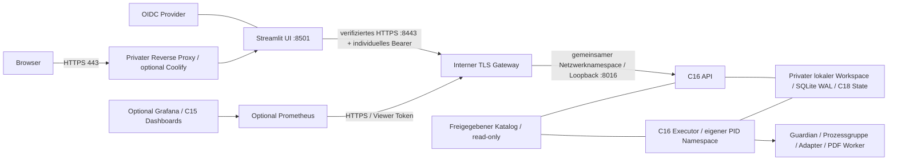

# C22 Deploymentarchitektur und Inventar

Stand: 17.10.2026. Grundlage Backend master `01cbf3d6`, UI main
`4e162626`. Keine laufende Serverkonfiguration wurde ausgelesen oder verändert.
Das Production Template ist ein gesperrter Vorbereitungsschritt; die noch offenen
Laufzeitprüfungen stehen in [c22_validation.md](c22_validation.md).

API und Executor brauchen denselben Linux-Host, lokalen Dateisystem-Mount,
Containerpfad `/var/lib/personal-assistant/private`, UID/GID 10001 und identische
Katalogpfade. SQLite-WAL/SHM, `flock`, atomare Umbenennung und Dateisynchronisierung
sind erforderlich. NFS/SMB, replizierte Volumes und verteilte Queues sind nicht
freigegeben. Der lokale Test beweist die Semantik seines Testdateisystems, nicht
die eines späteren Hetzner-Volumes: dort ist `deployment probe` erneut auszuführen.

API und Executor teilen **keinen PID-Namespace**. Cancel setzt den bestehenden
DB-Zustand; die API signalisiert keine gespeicherte PID. Nur der Executor startet
seinen Guardian. Guardian, Adapter und nativer PDF-Prozess bleiben im gemeinsamen
Executor-PID-Namespace. C19 `PR_SET_PDEATHSIG`, Subreaper, Session/Prozessgruppe und
Cleanup werden unverändert verwendet. Der direkte Python-Entrypoint empfängt
SIGTERM; kein Shell-Wrapper oder zusätzlicher Supervisor wird eingeschoben.
Der Docker-Nachweis dieser Annahmen ist noch blockiert.

Die API bindet weiterhin ausschließlich an 127.0.0.1. Ihr Netzwerknamespace wird
mit dem internen TLS-Gateway geteilt (`network_mode: service:api-gateway`). Der
Executor hat `network_mode: none`. Die UI hat nur private API- und bestehende
Ingress-Netze, keine Workspace-/SQLite-Mounts, Hostports oder Docker-Sockets.
Ein Gateway-Neuanlegen verlangt auch ein API-Neuanlegen; normales API-Restart
benötigt keinen Gateway-Restart.

| Vorhandener Pfad | Tatsächliche Funktion / Entscheidung |
| --- | --- |
| `scripts/job_control.py`, `src/job_control/` | C16 API/Executor, auth, Queue, persistente Jobs; wiederverwendet |
| `src/workflows/`, `scripts/cs50_workflow_demo.py` | C18/C19 Offline-Stages und explizites Resume; wiederverwendet |
| `api/Dockerfile` | ältere FastAPI auf 8001/Python 3.11; kein C16-Einstieg; behalten |
| `docker/DockerFile.worker` | älterer breiter Lecture-Build, ungepinntes uv, `sleep infinity`; kein C16-Rollenstart; behalten |
| `docker/docker-compose.ml.yaml` | MLflow/Postgres, eigene Daten/Ports; nicht Teil von C22 |
| `docker/docker-compose.monitoring.yaml` | C15; Dashboard-/Rule-Quellen wiederverwendet, Host-Exporter/Portainer separat und sensibel |
| `monitoring/prometheus.yaml` | bisheriger File-SD-Scrape ohne C16-Bearer-Konfiguration; C22 ergänzt expliziten HTTPS-Scrape |
| `scripts/backup_hetzner.sh` | rsync mit festem Remoteziel, standardmäßig aktiv; **nicht ausgeführt**, keine SQLite-Konsistenzgarantie |
| UI `docker/DockerFile.UI` | kanonisch `app_admin.py`; C22 ersetzt ungepinntes pip durch vorhandenes uv.lock |
| UI `docker/docker-compose.ui.yaml` | lokaler gesperrter Serverstart; keine Job-/OIDC-Aktivierung |
| Coolify | keine versionierte C16-Deploymentkonfiguration gefunden; optional nur Standard-Compose/Ingress-Verwaltung |
| Qdrant / C21-Q PR #72 | nicht gemergter separater Pilot; keine Voraussetzung und kein Dienst dieses Profils |

C22 ergänzt nur Betriebsvertrag/Launcher, Offline-Snapshotwerkzeug und Templates.
Queue, DB-Schema, Fachmodelle, Parser und Knowledge-Objekte werden nicht migriert.
Das minimale Runtime-Lockfile wird mit dem bestehenden
`workers/cs50/lock_from_repository.py --project deployment/runtime` aus dem Root-Lock
projiziert. PyMuPDF wird aus derselben bereits gepinnten Repository-Version
übernommen; keine neue Laufzeitabhängigkeit oder Auflösung.

Planungsbudget bei `max_parallel=1`: mindestens 2 vCPU, 4 GiB RAM und 10 GiB freier
lokaler Datenträger plus dimensionierter Artefakt-/Backupbedarf. Dies ist eine
Startkonfiguration, kein Lasttest: Executor 1.5 GiB/2 CPU/512 PIDs, API/Gateway je
512 MiB/1 CPU/128 PIDs, UI 768 MiB/1 CPU/128 PIDs, Monitoring optional je 512 MiB.
Die Summe der Limits ist keine RAM-Reservierung. Die 512-MiB-Freiplatzprüfung ist
eine Start-/Health-Schwelle, keine Diskquota. Datenträgerquote separat einrichten.
