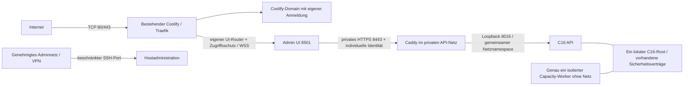

# C26 – Vorbereitung der Hetzner-/Coolify-Betriebsabnahme

Prüfstand **24.10.2026, Europe/Berlin**. Read-only/offline Gap-Analyse, keine
Inbetriebnahme. Dieser Bericht konsolidiert die bestehenden
[HTTPS-Unterlagen](https.md), [C22-Architektur](architecture.md),
[Sicherheitsgrenzen](security.md) und [Backupvertrag](backup_restore.md).
[Kopierbare Prüfkommandos](c26_operations_checks.md) und
[maschinenlesbarer Prüfbeleg](c26_operations_validation.v1.json) gehören dazu.
Keine Änderung an C27 #158/UI #21, Produktionskonfiguration oder Infrastruktur.

## Entscheidung und Belegklassen

| Teilabnahme | Ergebnis jetzt | Konkreter Grund / nächster Nachweis |
|---|---|---|
| Infrastruktur | **HOLD** für vollständige Betriebsabnahme; GO für lesende Inventur | Erreichbarkeit 8000/6001/6002 ungeklärt; Cloudregel-/Ziel-/IPv4-/IPv6- und externer Negativnachweis sowie Backup-/Rettungsweg fehlen. Das ist keine Aufforderung, bestehende Dienste abzuschalten. |
| Admin-App | **HOLD** für Domainfreigabe | Domain nicht zugeordnet; laufender Image-/Launcher-/Health-/OIDC-/Rollen-/Proxy-/Backendstand unbekannt. Bestehender Quellcode ist kein Nachweis des laufenden Containers. |
| Produktive C26-Runtime | **HOLD** | v2-Scope nicht im Gate erzwungen, Livecollector/Koordinator/Driver und unabhängige Image-/Build-/Trigger-/Writer-/Mount-/Restorebelege fehlen. |

**O = Betreiberbeobachtung**, vom Auftrag übernommen, hier nicht nachgemessen.
**L = lokal geprüft**, mit unten genannten Gitständen/Dependencies/Mockdaten.
**S = Soll/Plan**, benötigt spätere Betreiberentscheidung und Abnahme.
**U = ungeprüft/fehlend**. Ein O- oder L-Befund wird nicht zu einem aktuellen
Serverbeweis hochgestuft. Kein GO bedeutet Deployment-, Merge- oder Jobfreigabe.

| Eingangsbefund | Klasse | Einordnung |
|---|---|---|
| Hetzner, Ubuntu 24.04.5 LTS, 2 vCPU / 4 GB RAM; Docker/Coolify laufen | O | Aktuelle Versions-/Rollen-/Containerzuordnung bleibt U. Frühere Docs nennen andere Coolifyversionen; keine davon wird als heutige Hostversion angenommen. |
| Root 18 GB frei / 52 % belegt; kein akuter RAM-/Swapdruck | O | Kein Last-/Quota-/Backupbudgetnachweis; aktuelle Messung später wiederholen. |
| `coolify.franke-data.dev` mit gültigem Let's Encrypt erreichbar | O | Exakte Zertifikatslaufzeit, IPv6, WebSocket/Terminal und Erneuerung bleiben U. |
| `admin.franke-data.dev` zeigt auf Server, ist keiner App zugeordnet | O | DNS allein belegt weder Route, Zertifikat noch Zugriffsschutz. |
| Streamlit intern 8501, kein Docker-Healthcheck | O | Repo enthält inzwischen Healthchecks; Abweichung deutet auf unbekanntes Image/Startkonfiguration hin, beweist aber keine bestimmte Ursache. |
| Cloud-Firewall aktiviert; 8000/6001/6002 aus Betreibernetz erreichbar | O | Vollständige Cloudzuordnung/Regeln, tatsächliche Zieladresse und Messnetz fehlen. P0-N1. |
| Älterer Fehler in `cloud-init-hotplugd.service` | O | Keine belegte Ursache der offenen Ports. Nicht neu starten, maskieren oder reparieren. |

Codex hat **keine Verbindung** zu den drei Domains, Server-IP, SSH, Coolify-/Cloud-
API oder Produktionsdiensten aufgebaut. GitHub-Quellen und öffentliche Hersteller-
Dokumentation wurden gelesen; die Netz-/Hostkommandos wurden nur syntaktisch geprüft.

## Geprüfte Gitstände und Integration

| Stand | Commit / aktueller GitHubstatus |
|---|---|
| Backend `master` | `e68275205fefb7a5f6db42bc45060e505bfcefb5` |
| #156 | gemergt; Merge `ce8dd5ad12dfb5e66f7f165d20601b1d4419b028` |
| #149 | gemergt; Merge `29114d2e2877cee9c434f620da852313963e3a01` |
| #148 | offen/Draft, Head `f98eedd671c8a9d9eb58a3b957eda1a91713844d`, GitHub mergeable |
| #157 | offen/Draft, Head `80c31e52f76c1f3f62102b6884752b722f796e7c`, GitHub mergeable |
| UI `main` / #20 | `ba34e98c14e66921bf9c515c82a16201bc8baa1a`; #20 gemergt, ausschließlich Dokumentation |

Die älteren [#157-Konsolidierungsberichte](https://github.com/rf-data/Personal_Assistant/blob/80c31e52f76c1f3f62102b6884752b722f796e7c/docs/deployment/c26_runtime/draft_consolidation_report.md)
mit „fünf offene Drafts“ sind historisch: #156/#149/UI #20 müssen nicht erneut
integriert werden. #148 hat Merge-Base `e581e201ef6b3d6c06aca14de845e0687d213b37`,
#157 `e502aa915ad0e928dbe7e92eacd44fff0152912b`. #157 liegt gegenüber geprüftem
master sieben Commits voraus und sechs zurück. Mergeability ist kein Review-/CI-
oder Produktionsbeweis.

**Frischer dateibasierter Dreiwegevergleich, ohne Mergecommit/Branchmerge:**
aktueller master → Produktdateien #148 → Produktdateien #157, in einem eigenen
temporären Quellsnapshot. Alle zehn Vergleiche überlappender Dateien konfliktfrei.
Insbesondere bleiben #156s begrenzter SQLite-Setupretry **und** #148s Gatepflicht
im Store erhalten; im Dockerfile beide CLIs. 38 neue #157-Dateien wurden über den
GitHub-Connector gelesen und bytegenau gegen die Blob-SHAs des gepinnten Trees
geprüft; auch die zwei modifizierten Dateien wurden vor dem Vergleich gegen ihre
PR-Blob-SHAs geprüft. Keine bestehende Arbeitskopie wurde dafür umgeschrieben.
UI-Quellbaum `e4be7a2` wurde mit dem aktuellen Main-Tree verglichen: einzig
`docs/c26_https.md` unterscheidet sich. Darauf beruhen die aktuellen UI-Codeprüfungen.

**Reihenfolge später:** (1) bereits integrierte #156/#149/UI #20 als Basis;
(2) #148 reviewen, insbesondere Admission/Dispatch/Restore und Default-false;
(3) #157 darauf prüfen, beide CLIs und Gate-/Retryguard erhalten;
(4) wirksamen v2-Approval-/Permit-/Journalvertrag ergänzen und negativ testen;
(5) authentifizierten unabhängigen Collector/Koordinator, danach einen einzigen
permitpflichtigen Driver abnehmen; (6) nach Backup-/Trigger-/Hostabnahme gesonderter
geschlossener Bootstrap, erst später separate Resume-/Pilotfreigabe.
Ein rein technischer Merge deaktivierter Komponenten wäre eine eigene Entscheidung,
keine Produktionsfreigabe. **Hier kein Merge, Rebase, Ready-Wechsel oder Gate-Enable.**

## Sollarchitektur für Netzwerk und Dienste

Keine neuen Dienste oder Netze werden durch diesen Bericht gestartet. Das bereits
vorhandene Demoangebot bleibt eine eigene geschützte Ressource, kein Synonym der
Admin-App. Admin/UI und neue Runtime teilen keinen Docker-Socket und keine SQLite-
Dateifreigabe. API und Worker bleiben getrennte PID-Namespaces; API teilt nur den
Netznamespace des Gateways. Kein Hostnetz oder Host-PID-Zugriff.

| Port / Pfad | Tatsächliche Repoverwendung / S-Ziel | Öffentliche Freigabe |
|---|---|---|
| TCP 80 | bestehender Traefik: HTTP→HTTPS und ggf. genehmigtes ACME HTTP-01 | Für vorhandenen Zertifikatsweg nötig; nicht jetzt abschalten. Alternative DNS-01 wäre gesondert zu entscheiden. |
| TCP 443 | Browser-HTTPS/WSS für freigegebene Domains | Ja für bestehende öffentliche Routen; Admin-Zugang separat je UI-Router einschränken. UDP 443 ist für dieses WSS-Ziel keine Voraussetzung. |
| SSH, üblicherweise TCP 22 | bestehende Host-/Coolify-Administration | Nur bestätigte Admin-/Coolify-Quellen; tatsächlichen Port und Rettungskonsole zuerst prüfen, keine Regeln ändern. |
| TCP 8000/6001/6002 | Coolify-Direktdashboard / Echtzeit / Webterminal | Im Ziel nicht allgemein öffentlich. Erst nach Prüfung aller Funktionen über die bestehende Domain gesondert beschränken; internes Listening darf bleiben. |
| TCP 8501 | Streamlit Admin-App, `expose`, keine aktiven `ports` in geprüften UI-Templates | Nur Proxy→UI im bestätigten Ingressnetz; kein Hostport und keine direkte öffentliche Route. |
| TCP 8443 | Caddy→C16 mit privater CA/SAN | Nur UI/ausdrücklich erlaubtes Monitoring im privaten API-Netz, keine öffentliche Domain/Hostbindung. |
| TCP 8016 | C16 API auf `127.0.0.1` im Gatewaynamespace | Nicht veröffentlichen. |
| TCP 8001 | älteres `api/Dockerfile` mit eigenem FastAPI-Einstieg | Kein C16-Ersatz; nicht für C26 freigeben. |
| 5000, 5433→5432 | altes MLflow-/Postgres-Compose, Hostports vorhanden | Nicht für C26 benötigt. Ob es läuft, bleibt U; keine Entfernung/Aktivierung. |
| 9090/9093, 3000, 8080 u.a. | optionales Monitoring; alte Dockerdatei teils Loopback, C22-Companion ohne öffentliche Ports | Kein öffentliches Monitoring/Docker-Socketangebot. Tatsächliche Portbindings später inventarisieren. |
| Worker | #157 `network_mode: none`, genau eine Instanz | Kein Listener/Ingress/Egress; Materialien vorher separat freigegeben bereitstellen. |

Die [Coolify-Portdokumentation](https://coolify.io/docs/core/infrastructure/servers/firewall)
ordnet die drei Direktports den genannten Funktionen zu. Vor Beschränkung über
die Domain neben Login auch Echtzeit und Terminal prüfen. HTTP 200 beweist keine
funktionierende WSS-Verbindung. Ausgehende Verbindungen getrennt erfassen:
Host/Gateway/UI benötigen nur tatsächlich genehmigte DNS-/Zeit-/OIDC-/TLS- und
ggf. Registrywege; kein pauschaler Download-/LLM-Zugang und keine neue Egressregel.

### Warum die drei Ports erreichbar gewesen sein könnten

**Keine der folgenden Ursachen ist bestätigt.** Erforderlich sind neue TCP-
Verbindungen aus **einem zweiten externen Netz außerhalb erlaubter Admin-CIDRs**,
ohne VPN/Proxy; IPv4 und vorhandenes IPv6 getrennt und mit bestätigter Origin-IP.

| Hypothese | Benötigter lesender Gegenbeleg |
|---|---|
| Firewall nicht am tatsächlichen Server / falscher Labelselector | In Hetzner-Konsole Zuordnung zur genauen Server-ID und allen öffentlichen Zieladressen ansehen; nichts speichern. |
| Zusätzliche Firewall oder breite TCP-/Portbereich-/Quellregel erlaubt Zugriff | Alle zugeordneten Regelsätze zusammen prüfen. Regeln mehrerer Hetzner-Firewalls werden kombiniert; kein angenommenes „Deny gewinnt“. |
| Messung stammt aus erlaubtem Netz, VPN/privatem Cloudnetz oder trifft anderes Ziel/CDN/NAT | Quelle, Route, DNS A/AAAA und direkt getestete Origin-IP getrennt protokollieren. Eine lokale Hostprobe prüft keine Cloudkante. |
| Vor Aktivierung etablierte Verbindung wurde weiterverwendet | Frische einzelne TCP-Verbindungen statt bestehender Browser-/WSS-Sitzung. |
| IPv4-/IPv6-Ziel oder erlaubte Quellbereiche unterscheiden sich | Beide Familien und alle bestätigten Zieladressen prüfen; kein pauschal behaupteter IPv6-Bypass. |
| Verwechslung mit UFW-/Host-Firewall | Docker-Publishing und NAT/Forwardingregeln lesen. Docker kann UFW umgehen, aber daraus folgt keine Umgehung einer korrekt vorgeschalteten Cloud-Firewall. |

Die [Hetzner-FAQ](https://docs.hetzner.com/cloud/firewalls/faq/) beschreibt
Statefulness, Fortbestand etablierter Verbindungen, kombinierte Regeln und die
Grenze bei privaten Cloudnetzen. [Docker dokumentiert die UFW/NAT-Grenze](https://docs.docker.com/engine/network/packet-filtering-firewalls/#docker-and-ufw).
Bei widersprüchlichen frischen Originmessungen trotz korrekter Konsole: HOLD und
redigierte Zeit-/Quell-/Ziel-/Familienbelege für den Anbieter sammeln, keine
spontane Firewallumschreibung. `cloud-init-hotplugd` ist zunächst ein separater
historischer Befund; erst aktuelle Interface-/Routen-/Dienstbelege bewerten.

## Admin-App: vorhandener Vertrag und spätere HTTPS-Anbindung

| Aspekt | L: vorhandener Quellcode | U / späterer Abnahmeschritt |
|---|---|---|
| Einstieg | UI `docker/DockerFile.UI`: `python -m admin_ui_package.container_runtime`; kanonisch `app_admin.py` | Installierten Digest, Buildpfad, OCI-Revision und tatsächlichen Launcher zuordnen; Label allein kein Buildbeweis. |
| HTTPS-Start | Bei `C26_HTTPS=1` geschützter Launcher/ASGI-Grenze; alter CLI-/Kompatibilitätsstart verweigert | Bestehende App nicht bloß per Domain öffentlich durchreichen. |
| Auth/Rollen | Streamlit-OIDC, exakter Issuer/Subject, Sitzungsalter, disjunkte Operator-/Viewer-Allowlisten; individuelles C16-Tokenbinding und Backendrollenprüfung | Echter IdP, Callback `https://admin.franke-data.dev/oauth2callback`, Login/Logout/Ablauf/Viewer-/unbekannter Subject testen; kein gemeinsames Operatortoken. |
| Dependency | Authlib **1.9.1 ist im geprüften UI-Lock und Test-Venv vorhanden** | Ältere C22-Aussage „Authlib fehlt“ ist überholt; der installierte Hostcontainer bleibt ungeprüft. |
| Health | Dockerfile und `coolify.ui.compose.yaml` haben Probe `container_runtime health`, GET Loopback `/_stcore/health` | Gemeldeter laufender Container ohne Probe widerspricht dem Soll; Build-/Konfigurationsstand klären. Nicht jetzt neu starten. |
| Readiness | `container_runtime ready` prüft zusätzlich authentifizierte C16-Capabilities einer gebundenen Identität | Health allein prüft weder alle Subjects noch alle Rechte/Jobs. Dieses aktive Kommando wurde nicht am Server ausgeführt. |
| Proxy | Validierter Proxy-Socket, exakter Host/Forwarded-Host/-Proto/Origin, WSS, sichere Cookies, kein Header-Identityvertrauen | Tatsächliche Traefik-IP/-CIDRs, Router, Middlewares, Timeouts, Reconnect und Upgrades prüfen. |
| Netze | UI-Compose: bestehendes Ingressnetz plus separates Backendnetz; keine Daten-/Queue-/Socketmounts | Reale Netzmitglieder und Nebenrouten inventarisieren. `expose` ist keine Zugriffskontrolle zwischen Netzmitgliedern. |

**Sichere spätere Reihenfolge, hier nur Plan:**

1. Bestehende Ressourcen-/Router-/Digest-/Rollbackzuordnung und manuellen
   Rettungsweg bestätigen; alle UI-/Backend-/Pilottrigger einschließlich wartender
   Deployments klären. Kein Ersatzstack neben der vorhandenen Application.
2. Profilentscheidung festhalten. Vorhandenes Private-HTTPS-Profil zuerst
   bevorzugen; VPN/Quell-IP-Erhalt/Allowlist müssen tatsächlich abgenommen sein.
   Public-HTTPS wäre eine eigene ausdrückliche Entscheidung mit unverändertem
   OIDC-/Rollenvertrag. DNS allein gewährt keinen Zugriffsschutz.
3. Freigegebenes Image und private Secret-/CA-Dateibindings vorbereiten, exakte
   Issuer-/Callback-/Subjectbindungen und Rollen offline prüfen. Nichts im Repo
   befüllen, keine Hostsecrets lesen/kopieren. C26-Launcher verlangt den bereits
   verifizierten privaten HTTPS-Backendpfad; keinen Demo-/disabled-Bypass einführen.
4. Erst nach gesonderter Änderungsfreigabe **derselben vorhandenen UI-Ressource**
   Domain `admin.franke-data.dev`, Serviceport 8501 und Profil zuordnen. Nur deren
   Router/Middleware ändern, keine globale Traefik-Allowlist. Private Middleware
   an **alle** generierten UI-HTTPS-Router anhängen, sonst Bypassrisiko.
5. Zertifikat/SAN/Kette, HTTP-Weiterleitung und WSS sowie autorisierte/unberechtigte
   Zugriffe aus zwei Netzen und beiden Familien abnehmen. `/_stcore/health` ist
   keine Nutzerauthentifizierung; die öffentliche Adminroute darf keine
   ungeschützten Daten anzeigen. Nicht auf allen Routerpfaden nur `/` testen.
6. IdP, sichere Cookies, Redirect, Sessionablauf/Entzug, Viewer-Negativtests und
   individuelle Backendrechte prüfen. Kein Jobstart als bloßer Healthtest.
7. Fehler: zuvor gesicherte UI-Version mit passenden Routing-/Secretversionen
   kontrolliert wiederherstellen oder UI-Route geschlossen halten. Kein Rückfall
   auf öffentliches HTTP/Demo, keine Reaktivierung widerrufener Tokens und kein
   automatischer Datenrestore. Bestehende Coolify-/Demo-Routen müssen bleiben.

## C26-Funktions- und Nachweismatrix

| Bereich | master / #148 / #157 | Fehlender Beleg oder Funktion | Risiko / notwendige Aktion |
|---|---|---|---|
| Integrationsabhängigkeit | #157 importiert #148s `Plan`/Imagevertrag und verlangt dessen Settings-Feld | Textuell mergebar heißt nicht allein lauffähig auf master | #148 vor #157; die 166 Fälle liefen auf dem dateibasierten gemeinsamen Snapshot, nicht auf einem isoliert aktivierten #157. |
| Admission/Dispatch | master ohne Pflichtgate; #148 ergänzt gemeinsamen Lock, Gateflag default false, existierende Queue zwingend | Aktive Rolle, alle Writer und gleiches Lock-/Rootobjekt am Host U | P0: keine Annahme-/Dispatchfreigabe aus Idle-Dashboard ableiten. |
| Plan/Approval | #148 Plan v1: Ressource/Rolle, alte/neue SHA+Image, Settings/Persistenz/geschützte Ressourcen; zeitlich begrenzte Aktionen | #157 Operationsumschlag v2 bindet drei Rollen/Gateway/Caddy/Netze/Trigger zusätzlich, wird von v1 **abgelehnt** | P0: v2 muss vor Seiteneffekt und bei Resume im Gate, Approval, Permit und Journal erzwungen werden. Kein stilles Zusatzfeld/konstanter Hash. |
| Permit/Journal | #148 begrenztes hashverkettetes privates Journal, exklusive Koordinatorsitzung; CLI mintet kein freies Permit | Kein tatsächlicher Mehrrollen-Driver und keine externe Koordinatorbereitstellung | P0: genau ein unabhängiger vertrauenswürdiger Koordinator außerhalb ersetzbarer Container; Hashkette allein ist keine Betreiber-Authentifizierung. |
| Collector | #157 zwei feste GET-Projektionen, injizierter Metadatenadapter, Größen-/Freshness-/Identity-/Scopeprüfungen | Kein authentifizierter Live-Hosttransport, Rechte-/Vollständigkeits-/Replaybeweis | P0: Offlineadapter und erfolgreiche Replays bleiben `verified_offline`, `deployment_permitted=false`. |
| Build/Image | Compose bindet Digestsyntax; Observer verlangt zusätzlich lokale Image-ID, RepoDigest, unabhängige Buildreceipt und SHA | Reale Images, Registry-/Buildprovenienz, gepinnter Lock-/Caddy-/Coolifyparserlauf U | P0: OCI-Label oder Image-ID nicht als Registrydigest/Buildbeweis akzeptieren. Keine neuen Builds/Pulls hier. |
| Health/Readiness | Gateway prüft TLS und erwartete 401; API-/Workerhealth vorhanden; UI health/ready getrennt | 401 oder laufendes `sleep infinity` beweist keine betriebsbereite C16-Runtime | P0: Rollenprozess, echte Readiness, genau ein Worker und frischer Heartbeat getrennt belegen. |
| Root/Queue | #157 schlägt separaten Runtime-Bind vor; Controller deaktiviert/leer, alle Joblimits 1; gate required | Existierender richtiger Mount/Policy/UID/Inodes, Erstprovisionierung und Queuezustand U | P0: keine historischen CS50-Queues übernehmen, keine fehlende Queue automatisch erzeugen. Keine Mountpolicy abschwächen. |
| Rollback/Recovery | #148 hält nach Fehler/Prozessverlust geschlossen; neue Aktionen brauchen eigene Approval; Restore erhält Gatehistorie und hält Kopie geschlossen | Mehrrollenadoption/Rückweg und Buildtypwechsel derselben App nicht real getestet | P0: Kein automatisches Rollback/Resume und keine ungeprüfte Queuekopie. |
| Trigger | Templates keine Watcher, #157 gesperrte Profile; alte Betreiberangaben Manual only / Previewanzeige None | Alle API-/Webhook-/Registry-/Scheduler-/Previewakteure, ausstehende Deployments und exklusive Sperre U | P0: Profile verhindern nicht jede Coolify-Deploy-Nebenwirkung. Merge oder Manual only ist keine Freigabe. |
| Kapazität | 2 vCPU/4 GB ist Planungsgröße; Runtime-Limitvorlage fordert 5,703125 GiB freie Vollreserve | Reale Cgroups, Mitverbrauch Coolify/DB/Redis/Proxy, Images/Backup/Quota/Logs/Alarme U | P1: 18 GB frei reicht nominell für die Basisreserve, beweist keine Dauer-/Last-/Restorekapazität. |

Geprüfte #157-Rollenlimits: API/Gateway je 256 MiB/0,25 CPU, Capacity-Worker
1.024 MiB/1 CPU, UI-Vorlage 768 MiB/0,75 CPU. Summe 2.304 MiB/2,25 CPU **als
Limits, nicht Reservierungen**, ohne Host/Coolify und optionale Dienste. Auf
2 vCPU/4 GB nur Ein-Job-Betrieb planen; keinen Lasttest oder OOM-Sicherheitsbeweis
aus dieser Rechnung ableiten. Die Reserve 6.123.683.840 Bytes schützt nicht vor
unbegrenzten Backups/Images; weder Dateisystemquota noch Alarm ist damit eingerichtet.

**Triggerprüfung L:** In den geprüften Backend-/UI-Gitbäumen keine
`.github/workflows`-Dateien. GitHub-Runmetadaten: Backend genau ein historischer
`dynamic`-Run (11.05.2026, `failure`), UI null Runs. Kein CI-Erfolg. Die separate
Workflowlisten-API wurde vom Connector nicht unterstützt und daher nicht als
frisch abgefragt behauptet. Externe GitHub-Apps/Webhooks, Coolifytoken, Scheduler
und Pending Deployments bleiben U. Kein Cloud-/Coolify-API-Test.

## Backup und späterer isolierter Wiederherstellungstest

| Sicherungsbereich | Vorhandener Vertrag / konkrete Lücke |
|---|---|
| Legacy `scripts/backup_hetzner.sh` | Festes Remoteziel, root/SSH, rsync von Daten/Logs in feste lokale Zielordner; standardmäßig aktiv. Auch `--dry` ruft SSH auf und erzeugt lokale Verzeichnisse. Kein versionierter Snapshot, Manifest, SQLite-Konsistenz-/Offsite-/Restorebeweis. **Nicht ausführen, auch nicht mit `--dry`.** |
| C22-Anwendungsbackup | `scripts.deployment backup/restore`, `src/job_control/operations.py`: gestoppte verwaltete Writer, exklusiver Wartungslock, terminale Jobs/Heartbeat 0, SQLite-Backup-API, Manifest/Hashes/Dateilimits, private neue Ziele | Nicht für ungeprüfte externe Writer oder laufendes Live-rsync. Keine neue Sicherung oder Restore in diesem Auftrag. |
| #148-Ergänzung | Zusätzliche Gate-Locks auslassen; Journal erhalten, Restorekopie geschlossen setzen | Erst nach Integration und isoliertem erneuten Restoretest des tatsächlich gebauten Stands abnehmen. |
| Coolify-Kontrollebene | Instanzdatenbank/Projekt-/Ressourcen-/Credentialkonfiguration | Instanzbackup enthält **keine** Appdaten/Volumes. Separat geschützten `APP_KEY`, passende Version und ggf. SSH-Schlüssel sichern; niemals im Bericht ausgeben. |
| Anwendung/Legacy-Daten | C16/C18-Root, deklarierter Katalog, separat registrierte Daten-/Log-/Cache-/weitere Appvolumes | C22 erfasst nur Workspace, Config und deklarierte Kataloginputs; nicht automatisch alle historischen Lecture-/MLflow-/Monitoring-/Coolify-Daten. Vollständige explizite Zuordnung fehlt. |
| Secrets/Proxy/Netz | OIDC-/Cookie-/Bearer-/TLS-Schlüssel, CA, Traefik-/ACME-/Domain-/Netz-/Firewall-/IdP-Konfiguration | Getrennt verschlüsselt und versionsgebunden; keine Rohwerte im Repo/Manifestbericht. Nicht aus altem Backup widerrufene Identitäten reaktivieren. |
| Offsite/Retention | C22 schlägt 7 tägliche + 4 wöchentliche verschlüsselte Kopien und monatlichen Restoretest vor | Kein Scheduler, unveränderliches externes Objekt oder erfolgreicher Restore hier belegt. Google-Drive-Zielname allein beweist keine Versionierung/Unabhängigkeit. |

Der [Coolify-Backupvertrag](https://coolify.io/docs/core/backup-and-recovery/instance-backup)
und [Restorevertrag](https://coolify.io/docs/core/backup-and-recovery/instance-restore)
trennen die Kontrollebene von Anwendungsdaten. Schon ein erstmaliges
„Configure backup“ kann einen Zeitplan anlegen: jetzt nur vorhandene Metadaten
ansehen, keine Backup-/Download-/Save-/Restore-/Validate-Aktion auslösen.

**Abnahmecheckliste, vollständig offen bis zum Betreiberbeleg:**

- [ ] Alle Ressourcen, Mountquellen/-ziele, Verantwortliche und Sicherungsklassen
  einschließlich ausgeschlossener Daten schriftlich zuordnen. Secrets getrennt.
- [ ] RPO/RTO und Kosten bestätigen. Vorschlag: RPO 24 h, RTO 4 h,
  7 tägliche/4 wöchentliche Kopien, monatliche Restoreprobe; keine Zusage oder
  installierte Automatik. Platz für Quelle, Snapshot, externe Kopie und Restore
  bemessen; dieselbe kleine Rootdisk ist kein unabhängiges Sicherungsziel.
- [ ] Bestehende letzte erfolgreiche Sicherung anhand Zeit, Größe, Scope,
  Version/Digest, Manifest und externer Verfügbarkeit beurteilen; keine Sicherung
  zum Erzeugen eines grünen Befunds starten. Nur redigierte Metadaten melden.
- [ ] Verschlüsselung, getrennte Schlüsselablage, Eigentümer/0600/0700,
  Integrität/Authentizität und Offsite-Zugriff prüfen. SHA allein authentifiziert
  kein manipuliertes Manifest. Keine Secret-/Tokenhashsammlung veröffentlichen.
- [ ] C22-Writerstillstand, gleiche Linux-/Filesystem-/Locksemantik und terminale
  Zustände vor einer späteren Sicherung sichern; Fremdwriter ausdrücklich erfassen.
- [ ] Coolifybackup **plus** APP_KEY-/SSH-/Proxy-/TLS-/IdP-/Appdatenplan zusammen
  prüfen; der Verlust einer Klasse darf nicht als durch eine andere abgedeckt gelten.

**Späterer isolierter Restoretest, eigener Änderungs-/Datenfreigabeschritt:**

1. Verantwortlichen, Zielhost, genehmigtes verschlüsseltes Snapshotset, RPO/RTO-
   Startzeit und Abbruchregeln festlegen. Zunächst synthetische/Testdaten nutzen;
   Produktivdatenkopie gesondert freigeben. Keine Verbindung zum produktiven
   Dockerdaemon, Mount, Queue, Netzwerk, Coolifykonto, IdP oder Trigger.
2. Passende genehmigte Images/Versionen und privaten neuen Zielroot bereitstellen.
   Manifeste/Hashes/Größen/Pfadsicherheit vor Zielerzeugung prüfen; Test einer
   manipulierten Kopie muss verweigern. Snapshot unverändert behalten.
3. C22 in **abwesenden neuen isolierten Pfad** wiederherstellen, keine Dienste
   oder Jobs starten. Gatehistorie bleibt geschlossen, Quarantäne/interrupted/
   Idempotenz-/Artefakt-/Sourcebezüge bleiben erhalten. Absolute Katalogbindungen
   bewusst im isolierten Namespace passend bereitstellen, nicht automatisch
   auf produktive Pfade umschreiben.
4. DB-/Artefakt-/Katalogkonsistenz und Sample-SHA, Rechte, Lock-/WAL-Semantik,
   gleichzeitige Writerverweigerung und explizites Resume testen – erst im
   separat freigegebenen Testlauf. Diese mutierenden Prüfungen wurden hier
   **nicht** ausgeführt. Keine automatischen externen Aufrufe/Downloads.
5. Coolify-Kontrollebene separat in isolierter Testinstanz mit passender Version
   und verschlüsseltem Secretset wiederherstellen; keine echten Deployziele
   anbinden und keine Produktionscredentials ins Testprotokoll übernehmen.
6. Gemessene Dauer/Datenverluste gegen RTO/RPO, Fehltests, Schlüsselzugriff und
   Rollback festhalten; Freigabe erst nach Review. Originale behalten; keine
   automatische Löschung des Testbestands oder produktiver Restore.

## Priorisierte Risiko- und Blockermatrix

| ID | Priorität / Bereich | Status / geforderter Abschlussbeleg |
|---|---|---|
| N1 | P0 Infrastruktur | Drei Direktports extern erreichbar (O), Ursache U. Cloudzuordnung und frische IPv4-/IPv6-Origin-Negativtests aus zweitem Netz. |
| A1 | P0 Admin-App | Image/Launcher/Health/Auth/Router U, Domain unzugeordnet (O). Vollständige HTTPS-/WSS-/OIDC-/Rollen-/Negativabnahme vor Domainfreigabe. |
| R1 | P0 C26 | v2 nicht in Approval/Permit/Journal erzwungen (L). Implementierung plus Negative-/Recoverytests, kein Workaround. |
| R2 | P0 C26 | Vertrauenswürdiger Livecollector, unabhängiger Koordinator und permitpflichtiger Driver fehlen (L/U). Getrennter Vertrags-/Rechte-/Hostnachweis. |
| R3 | P0 C26 | Reale SHA↔Buildreceipt↔RepoDigest↔Image-ID-/Caddy-/Mount-/Namespacebindung U. Tatsächlich gebautes Image/Lock/Host getrennt abnehmen. |
| T1 | P0 alle Rollouts | Exklusive Trigger-/Writer-/Intakekontrolle einschließlich Pending Jobs/Deployments U. Manual only und Preview None genügen nicht. |
| B1 | P0 produktive Freigabe | Vollständiger verschlüsselter Offsite- und isolierter Restorebeleg fehlt. Unterschied Kontrollebene/Appdaten/Secrets abnehmen. |
| C1 | P1 Betrieb | Hostkapazität, Image-/Backup-/Quota-/Log-/Alarmbudget und Rückweg nicht real geprüft. Keine neue Installation/Lastprobe hier. |
| I1 | P2, ggf. höher bei aktuellen Symptomen | Historischer cloud-init-hotplugd-Fehler. Zeitpunkt/Exitcode/Interface/Routen lesen; kein belegter Zusammenhang zur Portfreigabe. |

## Tatsächlich erledigt und verbleibende Nachweise

**L:** Quellen-/Konfigurationsreview, aktuelle PR-/Defaultbranch-/GitHub-Runmetadaten,
Blobprüfung, zehn konfliktfreie Dateivergleiche, UI-Codegleichheit, **166 Backendtests**
(69 Readclient, 66 Observer, 30 queuefreie Preflights, 1 statischer Composevertrag)
sowie **20 UI-Tests + 9 Untertests**. Netzwerk- und SQLite-Verbindungen waren in
den Testprozessen verboten; nur neue synthetische Dateien in eigenen temporären
Prüfpfaden. Keine Gate-/Queueinitialisierung, Backup-/Restore-/Volumeprobe,
Container-/Browserinstallation oder vollständige Regression.

Dependencies wiederverwendet: Backend Python 3.12.12, SQLitebibliothek 3.50.4,
pytest 9.1.1, Pydantic 2.14.1/core 2.50.1, HTTPX 0.28.1, PyYAML 6.0.3,
PyMuPDF 1.27.2.2. Runtime-Lock fordert Pydantic 2.13.4/core 2.46.4 und
PyMuPDF 1.28.2; deshalb **keine exakte Runtime-Lock-/Imageabnahme**.
UI: Streamlit 1.65.0/Authlib 1.9.1/Pydantic 2.14.0/core 2.50.0 entsprechen den
geprüften UI-Lockständen; pytest nur aus vorhandenem Backend-Venv ergänzt.

Reproduktion im **vorher quellengeprüften gemeinsamen Snapshot**, nicht gegen
Produktionspfade: Backend `test_coolify_readiness.py`, `test_coolify_observer.py`,
`test_c26_runtime_preflight.py` und ausschließlich
`test_c26_runtime_bootstrap.py::test_candidate_preserves_loopback_namespace_and_single_capacity_worker`;
UI `test_https_security.py` und `test_container_runtime.py`. Jeweils Python `-B`,
`PYTHONDONTWRITEBYTECODE=1`, `PYTEST_DISABLE_PLUGIN_AUTOLOAD=1`, pytest
`-q -p no:cacheprovider` und eigener neuer `--basetemp`. Vor pytest wurden
`socket.socket.connect` und `sqlite3.connect` auf eine Funktion gesetzt, die
`AssertionError` wirft. Der vorhandene Prüf-Runner ist im Belegpfad
`/tmp/c26-operations-run-tests-final-20261024.py` erhalten. Kein allgemeiner
Aufruf der ganzen Bootstrap-/Gate-/Deploymenttests: diese enthalten ausdrücklich
schreibende Queue-/Lifecycle-/Backup-/Restorefälle und waren hier ausgeschlossen.

Erster UI-Snapshotlauf hatte zwei fehlende Kompatibilitätseinstiege im eigenen
Quellpaket, dadurch zwei fehlgeschlagene Untertests. Beide Dateien wurden aus dem
gleichen gepinnten Commit ergänzt; abschließender vollständiger gezielter UI-Lauf
grün. Kein Produktfix oder verschwiegenes Hostproblem. Frühere 604/135-/Browser-
Ergebnisse aus #157 bleiben historische Belege und werden nicht als neue Tests addiert.

**Nur spätere Betreiberabnahme:** alle neuen DNS/TLS-/Firewall-/Portmessungen,
Cloud-/Coolify-Zuordnung und Version, Rettungsweg, echte OIDC-/WSS-/Readiness-
und Rollentests, Build-/Digest-/Mount-/Queue-/Worker-/Triggerbelege, Kapazität,
Backup/Restore und Rollback. Der Auftrag erteilt dafür keine Änderungserlaubnis.
Ein geplanter lesender Git-Fetch wurde wegen Nutzungslimit der automatischen
Freigabeprüfung nicht ausgeführt; der geprüfte #157-Quellstand wurde stattdessen
über den read-only GitHub-Connector vollständig blobverifiziert. Kein offener
Quellzugangsblocker, keine Umgehung eines Produktivzugriffs.

Dieser Bericht und die gezielte Korrektur der veralteten Authlib-Dokumentation
werden in einem **separaten Dokumentations-Draft** vorbereitet. #148/#157 bleiben
unverändert, ebenso C27 #158/UI #21. Neuer eigener Auditbranch/Worktree bleibt
wegen Mergeverbot fürs Review erhalten; keine Integration in master behauptet.
