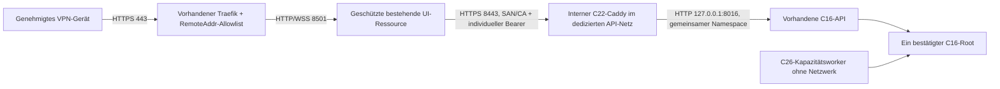

# C26 Runtime Bootstrap und privater HTTPS-Transport — 23.10.2026

**GO für Review und lesende Betreiberinventur. NO-GO für Merge, Rollenstart,
Coolifyänderung, Netzwerkänderung, Deployment und produktiven Pilot.**
Die Betriebsdefinition ist ein gesperrter Reviewkandidat, kein Installationsbefehl.
Keine SSH-, Docker-, Coolify- oder Hostaktion wurde durch Codex ausgeführt.

## Verifizierte Quellen und tatsächlicher Bestand

Backend-Master `e502aa915ad0e928dbe7e92eacd44fff0152912b` enthält #155/#147.
UI-Main `e4be7a2fbf5b20beda0db854462dd2d70c2c93ff` enthält #19.
Geprüfte offene Draft-Heads: #156 `c77128b14e60b78a546fd804507ff255d4833759`,
#149 `58aec7da3c2e3c1e9ab2bd1e1761ef8569811edb`,
#148 `f98eedd671c8a9d9eb58a3b957eda1a91713844d`,
UI #20 `6b84e3c09f877309a3fd1c6f9cbcf61bb9f46788`.
Keine eingereichten Reviews oder Check-Runs an diesen Heads; Commitstatus
`pending` ohne Kontexte ist kein CI-Erfolg. Kein bestehender Draft wurde verändert.

Die vom Betreiber am 23.10. direkt erhobenen Befunde stehen in
`operator_inventory.v1.json` ausdrücklich als **operator_observed**. Unbekanntes
bleibt **unverified**. Backend: `sleep infinity`, kein Healthcheck, keine
deklarierten ExposedPorts, Netzwerk `coolify`; im gemeldeten Container nur Sleep
beobachtet. UI: alter direkter Streamlitstart, eigenes Netzwerk. Traefik ist mit
beiden Netzen verbunden. Daraus folgt keine private API-Erreichbarkeit und keine
Aussage über andere Container, Runner, Hostprozesse oder Jobroots.

Image-Tag und Containername sind keine verifizierte Git-SHA-/Digestbindung.
Application-/Compose-Labels sind inzwischen als Betreiberbefund erfasst.
Runtimeconfig, Limits, Queue-/Workerzuordnung, Buildtyp und Trigger bleiben offen.
Die gemeldeten `c26_week0_*.paths.json` mit `repository`, `roots`, `schema_version`
sind **keine C16-Settings**; auch ihre Gültigkeit als Mountpolicy ist ungeprüft.

**Speicher getrennt bewerten:** Betreiberbefund Hetzner: ext4 `/dev/sda1`,
38 GiB gesamt, circa 20 GiB frei, circa 91 % Inodes frei. Die lokale
Entwicklungsmessung aus #156 mit circa 3,54 GiB ist nicht der Produktionsworker.
20 GiB erscheinen für das bisherige konservative Ein-Material-Budget von circa
7,02 GiB einschließlich 5-GiB-Reserve ausreichend; neue Images, Backups,
zwischenzeitliches Wachstum und RAM/CPU sind damit nicht budgetiert oder geprüft.
Es wurde keine neue Hostmessung vorgenommen und kein bestehendes Limit verändert.

## A: Rollen aus dem vorhandenen Code

| Rolle | Tatsächlicher Einstieg / Zustand | Persistenz und Schutz |
| --- | --- | --- |
| C16-API | `python -m scripts.deployment api --config … --port 8016`; `HTTPServer(("127.0.0.1", port), …)` | Bestehender Controller; Authentifizierung vor Routing, individuelle Role/Course/Owner- und Sourcegrenzen; startet keinen Executor |
| C26-Kapazitätsworker | `python -m scripts.cs50_worker --config … --limits …` | `CapacityExecutor(Executor)`, keine zweite Queue; freie Reserve vor jedem Step, begrenzter Jobtree circa jede Sekunde; genau ein aktiver Job |
| C16-Worker | `scripts.deployment worker` | Derselbe Executor; Alternative zum Kapazitätsworker, niemals parallel dazu auf demselben Root |
| Guardian/Adapter | Feste interne Pythonmodule, keine beliebigen Betreiberkommandos | Pro Job Lifecycle-Lock, Prozessgruppe, Parent-Death-Signal/Subreaper, RLIMITs und bestätigtes Cleanup vor Terminalstatus |
| Interner TLS-Gateway | Bestehendes `deployment/Caddyfile` und `gateway.Dockerfile` | TLS 8443 zum API-Loopback im gemeinsamen Namespace; kein Hostport, keine öffentliche Route |
| UI | `python -m admin_ui_package.container_runtime` | Geschützter HTTPS-/OIDC-Launcher aus #19; der gemeldete direkte `streamlit run app_ui.py`-Start muss separat genehmigt ersetzt werden |

API und Worker verwenden denselben absoluten `Settings.root`, denselben
hashgebundenen Katalog und dieselben Settings. `jobs.sqlite3` enthält Queue,
Events und Workerheartbeat; keine externe Queue wird ergänzt. `worker.lock`
verweigert einen zweiten Executor; `.operations.lock` schützt Wartung gegen
verwaltete Rollen. Unter #148 kommen Gate-Admission-/Owner-/Workerlease hinzu.
Diese lokalen Linux-Locks ersetzen keine Inventur unabhängiger Pilotwriter.

`SIGTERM` beendet die API kontrolliert und schließt ihren Wartungsfence.
Der Worker beendet seinen Serve-Loop, räumt direkte Guardian-Kinder auf und setzt
Heartbeat null. Unbestätigtes Cleanup/Guardianverlust quarantänisiert den Root.
Reconciliation startet keine unterbrochenen Jobs automatisch neu. Nie Lock- oder
Quarantänedateien löschen, um einen Neustart zu erzwingen.

## B: Gewählter privater Transport

Die bereits vorhandene C22-Kopplung wird wiederverwendet: **Caddy intern,
API im Namespace des Gateways**. Caddy ist hier ausschließlich der interne
TLS-Adapter; der vorhandene Traefik bleibt einziger öffentlicher Ingress.
Ein auf dem Host bereits laufender Caddy-Gateway ist damit nicht nachgewiesen.

| Möglichkeit | Ergebnis |
| --- | --- |
| Aktueller Traefik über gemeinsames `coolify`-Netz direkt zur API | Erreicht fremdes Container-Loopback nicht; Netzverbindung allein ist kein Transportbeleg |
| Vorhandener interner HTTPS-Mechanismus | Im Repository vorhanden, auf dem Host nicht belegt; bei passendem Bestand genau diesen wiederverwenden |
| API + interner C22-Gateway mit `network_mode: service:api-gateway` | Gewählter Reviewkandidat: Loopback bleibt erhalten; nur der Gateway bekommt das dedizierte private Netz |

Compose erlaubt bei `network_mode` kein zusätzliches `networks` am API-Service;
Aliases sind netzgebunden. Daher keine dynamischen Container-IPs oder Bindung an
`0.0.0.0` ergänzen. [Compose-Spezifikation](https://docs.docker.com/reference/compose-file/services/#network_mode).
Das Backendnetz muss tatsächlich dediziert und intern sein, mit ausschließlich
bestätigten Mitgliedern UI/Gateway. Die beiden gemeldeten Netze erfüllen diese
Eigenschaft nicht nachweislich. Ein neues Netz benötigt eigene Genehmigung.

UI: `JOB_API_URL=https://<bestätigter-API-DNSname>:8443`, exakter SAN und
vertrauenswürdige CA über die vorhandenen UI-Settings. Das CA-Bundle muss auch die
benötigten OIDC-Ausstellerwurzeln erhalten. OIDC-, Bearer-, Origin-, Cookie- und
WebSocket-Verträge bleiben unverändert. Kein `verify=False`, Token-Proxy oder
Basic-Auth-Ersatz. Caddys vorhandene Weiterleitung schafft keine neue Identität.
[Caddy-Reverse-Proxy-Vertrag](https://caddyserver.com/docs/caddyfile/directives/reverse_proxy).

## C/D: Betriebsdefinition und konkrete Grenzen

Reviewdatei: [coolify.runtime-bootstrap.compose.yaml](../../../deployment/coolify.runtime-bootstrap.compose.yaml).
Nur drei logische Rollen; keine UI-Duplikation, kein Downloader/Importer und keine
zweite Queue. API/Worker referenzieren dasselbe digestgebundene Backendimage.
Das Profil ist standardmäßig inaktiv, Pflichtwerte sind ungefüllt und
`pull_policy=never`. Die Beispieldatei
[c26-runtime.controller.json.example](../../../deployment/c26-runtime.controller.json.example)
bleibt ohne Identitäten/Katalog und mit deaktivierter Execution gesperrt.
Die tatsächliche Sperr-/Namespacewirkung unter Coolify 4.4.7 muss noch am
gerenderten Bestand bestätigt werden; Vorlage jetzt nicht importieren/starten.

Die vier gemeldeten Mountziele bleiben identisch: `/app/data`,
`/app/configuration`, `/app/logs`, `/app/.cache`; API und Worker sehen dieselben
Hostquellen, Config ist read-only, kein Hostpfad wird angelegt. Die neuen Namen
unter `/app/configuration/c26-runtime/` sind **vorgeschlagene Zielpfade**, keine
behaupteten vorhandenen Dateien. Keine Pilotdaten, Loviscach-Dateien oder alten
Konfigurationen verschieben, übernehmen, rekursiv umberechtigen oder migrieren.
`/app/data` insgesamt ist kein zulässiger pauschaler C16-Jobroot.

Controller und separate Limits müssen privat und UID-passend vorliegen; ein Root
innerhalb `/app/data` benötigt zusätzlich eine gültige `PA_PERSISTENT_ROOTS_FILE`
mit tatsächlicher Mountidentität und Zweck `job_workspace`. API und Worker müssen
denselben Mount/UID/Root/Katalog prüfen. `deployment_gate_required=true` verlangt
#148 und eine bereits bestehende bestätigte C16-Queue. Fehlt diese, **stoppen**:
erst separat über eine neue leere Queue in einem genehmigten unbenutzten Root
entscheiden. Keinen alten Pilotroot als neue produktive Queue adoptieren.

Vorlagenwerte sind Vorschläge, keine gemessenen Runtimeparameter: API/Gateway je
256 MiB/0,25 CPU, Worker 1024 MiB/1 CPU/128 PIDs aus dem vorhandenen Small-Host-
Vorschlag, Tmpfs 64/64/128 MiB, 30 s Stopfrist. Dazu kommen UI (vorhandener
Vorschlag 768 MiB), Traefik/Coolify und alle anderen Hostdienste. Gesamtbedarf,
Peak-RAM und Headroom sind vor Freigabe zu bestätigen; Tmpfs zählt mit.
Die Limits-Datei wird nicht neu erzeugt oder abgesenkt. Bootstrap startet mit
`restart: no`; eine spätere Restartpolicy benötigt einen eigenen Betriebsentscheid.

API wartet nur auf `service_started` des Gateways: dessen Healthcheck benötigt
bereits die API. `service_healthy` an dieser Stelle würde einen Startzyklus
erzeugen. Bei Namespace-/Gatewayersatz muss auch die API kontrolliert neu an den
richtigen Namespace gebunden werden. Keine automatische unabhängige Gateway-
Ersetzung oder Parallelreplikation annehmen.

**Implementierungsblocker bleiben:** maßgebliche Coolify-Ressourcenbindung/Buildtyp und
Raw-Compose-Verhalten, Rollenadoption ohne zweite Instanz, bestätigter privater
Netzbestand, Runtime-/Mount-/Limitsdateien und Queue, gepinnte gebaute Images,
Driver für den exakten Ressourcenscope sowie Trigger/Backups/TLS/VPN/OIDC.
Die Repo-Datei ist reviewfähig; die konkrete Coolifyinstallation nicht abgenommen.

## E–G: Integration, Betreiber und Rollout

Die unveränderten Diffs #156 → #149 → #148 lassen sich auf #155 anwenden;
UI #20 auf aktuellem Main. Git-Kompatibilität ist kein grüner Regressionsbeleg:
der neue breite Lauf hat einen C18-Resume-Quarantänefehler trotz #156.
Fachliches Review bleibt möglich, ein Merge ist nicht freigegeben.
Reale Tests/Quellhashes und ihre Grenzen
stehen in `validation.v1.json`. Die neue Lieferung kopiert keine Draftimplementierung
in den Produktcode; sie testet deren Kombination in einem eigenen Worktree.

### Offener Laufzeitfehler trotz Stabilisierung

Neuer breiter Lauf: **356 bestanden, 1 fehlgeschlagen**, ein Docker-Compose-
CLI-Test wegen des ausdrücklichen Verbots von Dockeraktionen abgewählt.
`test_stale_propagates_and_resume_preserves_existing_outputs[parser]` endet im
zweiten Job mit Quarantäne und `Execution interrupted (OperationalError)`.
Die ausschließlich lesende Inspektion der neuen synthetischen Testdatenbank
ergibt `quick_check=ok`; der SQLitecode und die exakte Fehlerstelle sind in diesem
ersten Fehlversuch nicht gespeichert. Es wird nicht automatisch erneut zugestellt.

Die fünf deterministischen SQLitefälle aus #156 bestehen; sie schließen den
beobachteten weiteren OperationalError nicht aus. Deshalb bleibt die allgemeine
C18-Resume-/Quarantänestabilität offen und blockiert die produktive Jobfreigabe.
Zusätzliche diagnostische Läufe werden gesondert ausgewiesen. Keine Quarantäne wird gelöscht und kein einzelner Repeat als Fix erklärt.
Alle 341 Produktdateien unter `src`/`scripts`, einschließlich der Draftzugaben,
sind bytegleich zur früheren #156-Kompatibilitätsprüfung; diese Lieferung verändert Controller/Gate/SQLitecode nicht.

Die vertiefte lokale Diagnose belegt daneben `OSError` mit **errno 28 (ENOSPC)**
bei `write_state → os.replace` im Adapter. Dies ist ein Fehler des aktuellen
Entwicklungs-/Dateisystemkontexts; `df` meldet dort trotzdem circa 3,45 GiB frei,
Inodes sind nicht aussagekräftig. Kleine eigene Fsync-/Allokationsprobes bestehen. Die genaue
Allokations-/Sandbox-/Metadatengrenze ist nicht abschließend erklärt; keine
Speicherbereinigung oder Limitänderung wurde vorgenommen. Es wird weder eine
SQLiteursache für diese Adapterfehler noch ENOSPC als bewiesene Ursache der
früheren unklassifizierten OperationalError behauptet.
Der Hetznerbestand ist davon getrennt: ext4 und circa 20 GiB frei sind
Betreiberbefunde, keine von Codex geprüfte Produktionsabnahme. Fehler-/Scopebelege
stehen in `runtime_diagnostics.v1.json`. Der breite Lauf bleibt rot und wird
nicht durch eine erfolgreiche Wiederholung ersetzt.

Eine vom Anwendungscode unabhängige Rename-Probe reproduziert errno 28 im
Workspace, während dieselbe Operation mit frischen eigenen Dateien unter `/tmp`
gelingt. Beide Pfade melden dasselbe Blockgerät, besitzen aber unterschiedliche
Mount-/Ausführungskontexte. Zusätzliche Prüfläufe verwendeten deshalb frische `/tmp`-
Testroots, ohne ältere Testdaten zu verschieben oder zu löschen. Ergebnisse und
negative Workspacebelege werden getrennt ausgewiesen; das ist keine Änderung
produktiver Speicherpfade und keine Behauptung, dass der Kernel-/Quotagrund
abschließend bekannt ist.

Der [Driververtrag](driver_contract.md) trennt Gate-Kern, konkreten Coolifyadapter,
Betreiberfreigabe und echte Abnahme. Der [Inventurplan](operator_checks.md) ordnet
jedem Unknown einen lesenden Schritt zu. Die [Rollout-/Rollbackkette](rollout.md)
enthält Einstieg, Prüfung, Erfolg und Abbruch je Phase. Grundlage bleiben #155
und die beiden [Checklisten aus #156](https://github.com/rf-data/Personal_Assistant/blob/c77128b14e60b78a546fd804507ff255d4833759/docs/deployment/c26_stabilization/README.md).

**Nächste drei Betreiberaktionen:** (1) Coolify-Ressource/Build/Trigger samt allen
Writerrollen lesen; (2) tatsächliche Runtimeconfig/Limits/Mountpolicy und einen
eindeutigen C16-Root sowie frische Kapazität/Backups zuordnen; (3) privaten Netz-/
DNS-/TLS-/VPN-/OIDC-Bestand und exakte Image-SHA-/Digestbindung bestätigen.
Erst danach über Driverimplementierung und einen gesonderten Bootstrap entscheiden.

Eigene Artefakte: Branch `feat/c26-runtime-bootstrap`, Worktrees
`Personal_Assistant-c26-runtime-bootstrap`, `Personal_Assistant-c26-runtime-compat`,
`personal-assistant-ui-c26-runtime-check`, Ergebnisse
`Personal_Assistant-c26-runtime-bootstrap-results`. Vorhandene Worktrees,
Umgebungen, Gitobjekte, Archive, Daten und Locks wurden nicht bereinigt.
Dokumente liegen zunächst im Review-PR; Defaultbranchintegration bleibt wegen des
Mergeverbots ausstehend, deshalb werden die eigenen Artefakte aufbewahrt.

## Konkrete neue Testbelege und ihre Grenze

| Prüfung | Ergebnis / Scope |
| --- | --- |
| Neue Betriebsdefinition und kontrollierte Worker-Verweigerungen, einschließlich fehlender Gate-Queue | 6 bestanden in der kombinierten Revision |
| Echte lokale API + C16-Worker sowie API + C26-Worker | 2 bestanden: Loopback, Auth-Health, Queue, Idempotenz, Restart, zweiter Worker verweigert, isoliertes Backup/Restore |
| UI-Main + #20 | 24 bestanden, 9 Subtests bestanden; HTTPS-/Origin-/OIDC-/Launcher-Verhalten, keine Host-/Browserabnahme |
| Breite Kombination #155 + #156/#149/#148 | 356 bestanden, 1 Quarantänefehler, 1 Docker-CLI-Test ausdrücklich abgewählt |
| Vertiefte C18-Diagnose | 16 bestanden, 8 fehlgeschlagen; Adapter-Exitfehler gesondert erhalten |
| Weitere gezielte Kontrollen | Auch ohne Instrumentierung und mit frischen /tmp-Roots fehlgeschlagen; kein erfolgreicher Fixlauf behauptet |
| Atomic-Rename-Probe | Workspace errno 28, einfacher /tmp-Probe erfolgreich; C18-Statuspublikation auch unter /tmp mit errno 28 fehlgeschlagen |

Die einfachen Probes erklären die unterschiedlichen Mount-/Prozesskontexte nicht
vollständig und beheben die C18-Fehler nicht. Insbesondere ist /tmp **kein
nachgewiesen vollständiger Workaround**. Keine weitere Serie schreibender Tests
wird allein zum Erzeugen eines grünen Ergebnisses gestartet. Die echte ext4-
Runtime braucht nach eigener Freigabe eine isolierte Rename/Fsync/Lock/WAL-
Abnahme; aktuelle Hostdaten wurden nicht beschrieben. Der erste breite SQLite-
OperationalError hat weiterhin keinen gespeicherten SQLitecode.

Docker-Compose-Rendering, Caddy-Binary-/Imageausführung, Container-Cgroups und
produktive TLS-/VPN-/OIDC-End-to-End-Abnahme wurden nicht ausgeführt. YAML wurde
statisch gelesen; eine getestete Coolifytransformation wird nicht behauptet.
Die zwei neuen Pythondateien bestehen Ruff-Lint/Format; produktive Pythonmodule
wurden nicht verändert. Vorhandene Pakete/Testumgebungen wurden wiederverwendet.

## Sichere Integrationsreihenfolge — weiterhin gesperrt

Zuerst Trigger-/Ressourcenscope belegen und unabhängig auslösbare Deploys unter
einer eigenen Betreiberfreigabe kontrollieren. Vorher kein Merge und keine Ready-
Transition. Danach fachlich #156 (optionale Imports/SQLite), #149 (HTML), #148
(Gate) und diese Betriebsdefinition in dieser Reihenfolge reviewen. Die
unveränderte Kombination ist Git-kompatibel; der rote C18-Nachweis muss vor einer
Produktionsfreigabe auf geeignetem Testdateisystem aufgeklärt werden. UI #20 kann
parallel fachlich geprüft werden; auch dessen Merge wartet auf geklärte Trigger.
Nach später ausdrücklich genehmigten Merges die tatsächlichen kombinierten
Commit-SHAs erneut testen und Images nach Digest bauen/zuordnen. Aktuelle
Einzel-PR-Heads oder der schmutzige Kompatibilitätsworktree sind kein
Deploymentcommit. Erst danach tatsächlichen Coolifydriver/Ressourcenadoption und
Bootstrap separat implementieren, reviewen und freigeben; kein automatischer
Rollout aus dieser Reihenfolge.

## Lokaler Gitindex und Veröffentlichung

Das Vormerken der acht nicht ignorierten Dateien gelang. Das anschließende
Ergänzen der drei ausdrücklich vorgesehenen JSONberichte scheiterte mit
`fatal: Unable to write new index file`. Auch die Kopie des eigenen Index unter
`/tmp` ließ sich nicht ergänzen. Keine Locks wurden manuell verändert. Alle
Dateiinhalte und der bestehende Index bleiben erhalten; die Ursache des
Indexfehlers wird nicht ohne weiteren Nachweis gleichgesetzt mit der
klassifizierten ENOSPC-Adapterstörung.

Die regulären Pre-Commit-Prüfungen wurden ausdrücklich mit den elf vorgesehenen
Dateien ausgeführt und bestehen. Für den Review werden ausschließlich diese
Dateien über die GitHub-Git-API als Commit mit Parent `e502aa9…` auf dem eigenen
Reviewbranch veröffentlicht; kein Defaultbranch oder bestehender PR wird
verändert. Die lokale Arbeitskopie bleibt wegen des Indexfehlers uncommittet,
auch wenn der Remote-Reviewcommit gesichert ist. Eine spätere Reparatur und
Synchronisierung sind offen; kein Reset, Clean, Locklöschen oder Cleanup.

## Ergänzte Betreiberinventur und Wiederverwendung bestehender Dateien

Backend und UI melden `coolify.type=application`, `coolify.managed=true`, Projekt
`personal-assistant`, Umgebung `production`; die jeweiligen Ressourcen-,
Compose-Projekt-/Servicenamen und `/artifacts/…`-Pfade sind als
`operator_observed` erfasst. Backend: `NetworkMode=coolify`,
`PublishedPorts={}`, `ExposedPorts=null`, weiterhin nur `sleep infinity`.
Das bestätigt weder Buildtyp noch Auto-/Preview-/Webhookstatus oder den
ursächlichen Build-/Startpfad. Der Wert von `working_dir` bleibt unbekannt.

Alle acht vom Betreiber benannten GitHub-Dateien wurden am unveränderten
Defaultbranch gepinnt gelesen und gehasht. Die [Quellenbewertung](source_assessment.md)
zeigt: Die API-/Gateway-Namespacekopplung ist bereits in C22 vorhanden und wird
bevorzugt wiederverwendet. Der vorhandene C26-Worker ersetzt dessen Executorrolle,
er ergänzt sie nicht. Die gesperrte Host-Mapping-Vorlage ist eine Anpassung dieser
Rollen an die vier Bestandsmounts und getrennte UI-Ressource, kein zusätzlicher
Stack. Sie und die vorhandenen vollständigen Stacks dürfen nicht parallel starten.

Wichtiger Quellenbefund: `docker/DockerFile.worker` definiert bereits
`CMD ["sleep", "infinity"]`, während `deployment/Dockerfile` den Deployment-
Entrypoint hat; beide Definitionen bestehen auch unter Quellref `3b91d39…`.
Die historische UI-Dockerfile `b2cf9ca…` startet direkt Streamlit, die aktuelle
verwendet den geschützten Launcher. Das liefert konkrete Erklärungskandidaten,
keinen Nachweis für die tatsächlich gebauten Images oder bewusste Overrides.
Die ergänzten lesenden Prüfungen in [Betreiberprüfungen](operator_checks.md)
unterscheiden Imagekonfiguration, Containerüberschreibung und Buildauswahl.

Diese Ergänzung ändert ausschließlich Dokumentation/Inventur. Compose,
Beispielconfig, Tests und Produktcode bleiben unverändert. Die bisherigen roten
C18-/Dateisystembefunde bleiben offen; die Regression wurde für diese
Dokumentationsergänzung nicht erneut ausgeführt. Produktion bleibt gesperrt.
