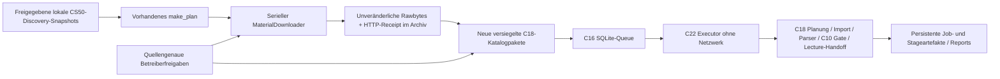

# C26-A – Privater CS50-Verarbeitungsworker

20.10.2026 · Basis Backend-master `ba5956014e6995538e285ae31741f3f7e89eb2cc`.
**`deployment_prepared`, nicht `staging_tested`, nicht `production_approved`.**
Lokales Integrationspaket mit synthetischem Prozessnachweis; keine Installation
oder Verbindung zum Hetzner-Host, keine echten Downloads, kein öffentlicher Dienst.
Serveridentität, Deploy-Account, Hostroots, Kapazität und Nutzungsfreigaben sind
nicht bestätigt. MAINT bleibt On Hold. Kein Bezug zu einer Loviscach-Importfreigabe.

## Tatsächliche Architektur und ergänzte Übergabe

Die bestehende [C22-Architektur](../architecture.md) und
[Betriebsabnahme](../c22_validation.md) bleiben maßgeblich.



Neu sind ausschließlich `src/tools_materials/batch.py`, der CLI-Einstieg
`scripts.cs50_batch`, die drei zusätzlichen CLI-Kopien im bestehenden Runtimeimage
und das separate Compose-Profil. Queue, Scheduler, Parser, Datenbankschemas,
Quality Gate und fachliche Modelle werden nicht ersetzt oder migriert.
Der Download bleibt ein begrenzter synchroner CLI-Schritt mit bestehenden
`ArtifactReceipt`-Zuständen; nur C16 besitzt persistierte Processingjobs.

| Vorhandener Vertrag | Tatsächliche Verwendung / Grenze |
| --- | --- |
| CS50-Discovery / `make_plan` | Ausschließlich explizite lokale Snapshot-Manifeste; keine neue Livecrawler-Pipeline oder Vollständigkeitsbehauptung |
| `MaterialDownloader` | Exakte HTTPS-URL, bestehende Hosts/MIME-/Byte-/Redirectprüfung, atomare Rawpublikation und wiederholbare Receiptprüfung |
| C18 `Definition` / `CatalogEntry` | Ein Material pro Workflow; unveränderte Resource-/Material-/Course-/Lecturebindung und lokale Snapshotbytes |
| C16 `Controller` / `Executor` | Bestehende Authentifizierung, Queue, Idempotenz, Cancel, Guardian und Restart-Reconciliation |
| C19 PDF-v2 | Bestehende Prozessgruppe, Native-Workerlimits und Cleanup; kein neuer PDFparser |
| C10 / Lecture-Handoff | Technische Qualitätsprüfung und referenzierbarer Read-only-Handoff; keine Knowledge-Extraktion |
| C23 | Noch kein automatischer ContentStore-Publish. Kanonische Raw-/Parsed-Artefakte bleiben persistent im C16-/C18-Bestand. Spätere Übernahme nur durch bestehende verifizierte C23-Adapter und eigens freigegebene Importkonfiguration |
| Transkriptmodule | Vorhanden, aber nicht Teil des freigegebenen C18-Materialgraphs. Audio/Video/SRT/Transkriptrollen werden `unsupported` gemeldet; keine ASR-, LLM-, historischen Pfad- oder C23-Fallbacks |

Der ursprüngliche HTTP-Receipt wird zusätzlich zu Raw und Discovery als
`download_receipt.v1.json` mit eigenem Hash im C16-Katalog erhalten. C18 erzeugt
seinen eigenen lokalen Importreceipt. Dieser benennt korrekt `local_import`;
der unveränderte vorgelagerte Beleg erhält `http_download`, URL, Binding und SHA.
Ein im Transfer neu berechneter SHA beweist Byteintegrität, keine unabhängige
Authentizität des Remoteinhalts. Falls bekannt, bindet die Sourcefreigabe einen
zusätzlichen erwarteten SHA; Abweichungen verhindern die Übergabe.

## Grenzen des kontrollierten Batchvertrags

- Höchstens **32 ausdrücklich gewählte Materialien** pro Batch/Katalogfragment;
  größere Kurse bewusst über getrennte Auswahlmengen bearbeiten. Keine stille
  Kürzung, keine automatische Katalogablösung und kein zweiter Scheduler.
- Nur HTML-v2, PDF-v2 und bestehender Codeparser; Bilder als eigenständige
  Materialtypen, Medien, Archive und Transkriptrollen werden hier nicht aktiviert.
- Höchstens **1 MiB Raw pro Material**; C18 maximal 1000 Blöcke standardmäßig,
  PDF höchstens 20 Seiten/20 Bilder, Worker 10 s/512 MiB. C16-Workflow 90 s Wall,
  60 s CPU, 768 MiB Adressraum und 8 MiB pro Ausgabedatei bleiben unverändert.
  Größere/komplexere CS50-PDFs sind damit nicht pauschal verarbeitbar. Sie erhalten
  einen echten Fehler/Blocker; ein größeres Profil braucht separate Abnahme.
- Serialer Downloader, ein aktiver Executor, `max_parallel=1`, Queue 8,
  maximal 100 gespeicherte C16-Jobs im Template. Pro explizitem Schreibaufruf
  höchstens acht Source-Refs. Kapazitätsgrenzen führen zu Ablehnung, nicht Löschung.
- Kein automatischer HTTP-Retry. Fehler bleiben im bestehenden Receipt;
  ein neuer Versuch erfordert `--retry-failed` und eine bewusste Entscheidung.
  429/Retry-After, temporäre Sperren und Quellhinweise zuerst prüfen. Zwischen
  neuen Transferaufrufen wird das deklarierte Intervall eingehalten, mindestens
  eine Sekunde, standardmäßig zwei; auch ein fehlgeschlagener Transfer zählt.
- Hashidentische, vollständig belegte Downloads werden erneut verifiziert und
  ohne HTTP wiederverwendet. Keine Adoption nackter Dateien oder überschriebenen
  Receipts/Bytes. Erwartete Hashkonflikte bleiben zur Operatorprüfung erhalten.
- Batch/Discovery- und Katalogdigests binden die Auswahl. Die versiegelten Pakete
  werden nochmals durch vorhandenes C18-`prepare` geprüft. Neue Katalog-/Report-
  ziele sind exklusiv; ein unvollständiges Verzeichnis ohne finalen `catalog.json`
  wird nicht als veröffentlichter Katalog übernommen oder automatisch repariert.
  Teilweise gesperrte Materialien bleiben im Bericht sichtbar; nur erfolgreich
  versiegelte Einträge gelangen in dessen `catalog`.
- CLI-Exit 0: angeforderter Schritt ohne ausgewiesene Materialfehler; 1:
  `blocked/failed/unsupported` oder negativer Workflowstatus; 2: Anfrage abgewiesen.
  Ein Queue-Aufruf kann bereits frühere Refs eingereiht haben, bevor eine spätere
  Queuegrenze ihn beendet. Danach vorhandenen C16-Status lesen und idempotent
  fortfahren; keine transaktionale Ganzbatch-Zusage.

## Bereitstellung und Coolify

[Worker-Compose](../../../deployment/cs50-worker.compose.yaml),
[Umgebungsvariablen](../../../deployment/cs50-worker.env.example),
[Controller-Template](../../../deployment/cs50-worker.controller.json.example) und
[leere Sourcefreigaben](../../../deployment/cs50-source-approvals.json.example).
Controller-Ausführung ist standardmäßig deaktiviert, Identitäten und Katalog leer.
Ohne explizites Compose-Profil startet kein Dienst. Sämtliche Mounts müssen bereits
existieren (`create_host_path=false`), Imagepulls sind verboten (`pull_policy=never`).

| Rolle | Netz / Zugriff | Betrieb |
| --- | --- | --- |
| `executor`, Profil `processing` | `network_mode: none`; Jobroot RW, Katalog/Controller RO; keine Tokens | C22-Worker, bestehender Heartbeat-Healthcheck, `unless-stopped`, 30 s Stopgrace |
| `offline-cli`, Profil `tools` | Kein Netzwerk; Jobroot/Katalog/Exporte RW, Archiv/Spezifikationen/Controller/Operator-Token RO | Explizite kurzlebige SSH-/Compose-Aufrufe; kein Server oder Scheduler |
| `downloader`, Profil `download` | Nur vorab angelegtes freigegebenes Egress-Netz; Archiv RW, Spezifikationen RO; keine Queue, Controller, Tokens oder Stores | Expliziter Einmallauf, 1 CPU/512 MiB/64 PIDs, Exitcode statt Dauerprozesshealth |

Alle Rollen: UID/GID 10001, Root-FS read-only, alle Capabilities entfernt,
`no-new-privileges`, begrenztes noexec-/nosuid-/nodev-`/tmp`, keine Hostports,
kein Docker-Socket, keine Host-PID-/privilegierten Container. Worker/Operator:
2 CPU/1536 MiB/512 PIDs, Dockerlogs 3 × 10 MiB. Das sind Limits, keine Messung
der Hostkapazität oder Isolation im tatsächlichen Container.

Docker dokumentiert `network_mode: none`,
[`pull_policy` und `create_host_path`](https://docs.docker.com/reference/compose-file/services/).
Ein externes Bridge-Netz ist **keine Ziel-Allowlist**. Der Betreiber muss DNS,
HTTPS-Egress und gegebenenfalls Firewall/Proxyregeln gesondert freigeben und prüfen.
Die bestehende Downloader-URL-/TLS-Prüfung ergänzt diese Grenze. Keine neue
Firewall, kein Proxy und keine Freigabe beliebiger Netzwerkziele werden installiert.

Coolify unterstützt [Raw Compose](https://coolify.io/docs/applications/builds/docker-compose)
mit weniger automatischen Anpassungen. Daraus folgt eine **vorgesehene**, noch
nicht am Zielhost nachgewiesene Kompatibilität: Raw Compose aus dem Repository,
korrekte Compose-Datei und Profile, keine Domains/Proxy-/Portzuordnung, keine
automatische Netzwerkzugabe und keine automatischen Builds/Pulls aktivieren.
Gerenderte Definition und tatsächliche Netz-/Mount-/UID-/cgroup-Konfiguration vor
Staging prüfen. Falls die konkrete Coolify-Version Profile oder Isolation nicht
unverändert erhält, zunächst Compose ausschließlich über SSH betreiben.

Das vorhandene [Dockerfile](../../../deployment/Dockerfile) verwendet den
unveränderten gefrorenen [Runtime-Lock](../../../deployment/runtime/uv.lock).
Python- und uv-Basisimage müssen **nach gesonderter Freigabe** mit überprüften
Digestreferenzen geliefert werden. Keine Digests werden erfunden; lokal sind keine
Images vorhanden. Kein Build/Pull, keine Dependencyinstallation durchgeführt.
Beispiel erst für einen autorisierten Build mit vorbereiteten Registry-/Wheelrechten:

```sh
docker build --pull=false -f deployment/Dockerfile \
  --build-arg PYTHON_IMAGE="$APPROVED_PYTHON_IMAGE_BY_DIGEST" \
  --build-arg UV_IMAGE="$APPROVED_UV_IMAGE_BY_DIGEST" \
  --label org.opencontainers.image.revision="$APPROVED_COMMIT" \
  -t personal-assistant-runtime:c26a .
```

`--pull=false` garantiert bei fehlender Basis kein Offlinebuild. Basisimages und
gefrorene Pakete müssen aus ausdrücklich zugelassenen Quellen bereitgestellt
werden; dieses Kommando wurde hier nicht ausgeführt. Gebauten, getesteten
Runtime-Digest anschließend als `BACKEND_DIGEST` festlegen. Die exakte Referenz
`personal-assistant-runtime@sha256:…` muss lokal auflösbar sein; ein Buildtag allein
genügt nicht. Den zusätzlichen genehmigten Registry-/Importweg und die tatsächliche
Digestreferenz prüfen, keine Image-ID als ungeprüften Ersatz einsetzen.
Container-/Imageabnahme
bleibt [#109](https://github.com/rf-data/Personal_Assistant/issues/109).

## Vorgeschlagenes lokales Hostlayout

Ausgangspunkt des Auftrags ist `/srv/personal-assistant`; **kein untenstehender
Pfad wurde als vorhanden, frei oder genehmigt behauptet oder angelegt**.

| Vorgeschlagener Unterroot | Inhalt / Containerbindung |
| --- | --- |
| `specs` | explizite Discovery-Snapshots, Batch- und Sourcefreigaben → `/run/c26`, RO |
| `archive` | Originaldownloads und HTTP-Receipts → `/var/lib/personal-assistant/archive` |
| `catalog` | neue unveränderliche Eingabepakete → `/var/lib/personal-assistant/catalog` |
| `jobs` | einzige Queue `jobs.sqlite3`, C18-Zustand, temporäre und finale Jobartefakte → `/var/lib/personal-assistant/private` |
| `exports` | neue JSON-/Markdownberichte außerhalb der Input-/Jobroots |
| `config`, `secrets` | private Controllerdatei und individuelles C16-Token; getrennte RO-Dateimounts |
| `content`, `evaluation`, `index` | reservierte getrennte C23-/B1-/FTS5-Roots; in diesem Profil **nicht gemountet oder initialisiert** |
| `logs`, `backups` | gesonderte lokale Betriebs-/Sicherungsroots nach Freigabe; keine automatische Retention |

Lokales Linux-Dateisystem mit `flock`, atomarer Publikation, fsync und SQLite-WAL;
kein NFS/SMB oder repliziertes Volume. Rootbesitz durch die tatsächlich verwendete
Container-UID/GID, Verzeichnisse 0700 und Dateien 0600. Bestehende Bestände nicht
rekursiv chownen, verschieben oder ersetzen. Zunächst Hostidentität/Mounts,
Dateisystem/Ownership und Nichtbelegung nachweisen, erst dann ausdrücklich
genehmigte neue Pfade anlegen. Planungsstart: 2 vCPU, 4 GiB RAM und mindestens
10 GiB frei **zuzüglich** dimensionierter Raw-/Job-/Katalog-/Backupkapazität und
bestehender Coolifylast. Host- und Kostenfreigabe fehlen. C22s 512-MiB-Reserve
bleibt unverändert; kein Lasttest, Quota- oder Retentionsautomatismus.

## CLI-Ablauf nach gesonderter Staging- und Sourcefreigabe

Die folgenden Befehle wurden **nicht auf dem Server ausgeführt**. `C26_ENV` benennt
eine private vollständig geprüfte Kopie der Envvorlage. Alle Roots/Dateien und das
Egress-Netz müssen vorher ausdrücklich freigegeben und bereitgestellt sein.
Containerpfade bleiben für alle Rollen identisch, auch nach Neustart/Restore.

```sh
c26() { docker compose --env-file "$C26_ENV" -f deployment/cs50-worker.compose.yaml "$@"; }

# 1. Ausschließlich bereits freigegebene lokale Discovery-Snapshots inventarisieren.
c26 --profile tools run --rm --no-deps offline-cli -m scripts.cs50_batch plan \
  --manifest /run/c26/snapshots/manifest.json --course cs50_python \
  --resource "$APPROVED_RESOURCE_ID" \
  --output /var/lib/personal-assistant/exports/batch-r1.json
```

Ohne `--resource` wird der ausgewählte Snapshotkurs vollständig ausgewählt;
mehr als 32 Materialien werden abgewiesen. `--course` und `--resource` können
wiederholt werden. Source-/Material-ID, genaue URL, Kurs, Rolle und Provenienz
stehen im erzeugten Batch. Betreiber prüft diesen und übernimmt bewusst eine
neue private Kopie nach `specs/batch-r1.json`; kein automatischer Transfer.
Die eingetragenen Snapshotpfade müssen weiterhin `/run/c26/...` bezeichnen.

Für jedes Material die untenstehenden Freigabefelder tatsächlich ergänzen;
die leere Beispieldatei erlaubt keinen Download. Erst danach:

```sh
# 2. Vorschau ohne --confirm: kein HTTP und kein Raw-Schreibzugriff.
c26 --profile download run --rm --no-deps downloader -m scripts.cs50_batch download \
  --batch /run/c26/batch-r1.json --archive /var/lib/personal-assistant/archive

# 3. Autorisierter serieller Download; neuer Reportname pro Aufruf.
c26 --profile download run --rm --no-deps downloader -m scripts.cs50_batch download \
  --batch /run/c26/batch-r1.json --approvals /run/c26/source-approvals.json \
  --archive /var/lib/personal-assistant/archive --confirm \
  --output /var/lib/personal-assistant/archive/download-r1.json

# 4. Neuer Katalog: keine vorhandenen Dateien oder Controllerkonfiguration ersetzen.
c26 --profile tools run --rm --no-deps offline-cli -m scripts.cs50_batch seal \
  --batch /run/c26/batch-r1.json --approvals /run/c26/source-approvals.json \
  --archive /var/lib/personal-assistant/archive \
  --output /var/lib/personal-assistant/catalog/batch-r1 --confirm
```

Betreiber übernimmt die geprüften Einträge aus `catalog.json` in eine neue private
Controllerrevision, konfiguriert echte C16-Identität/Tokenhash/Kursrechte und gibt
`execution_enabled=true` sowie `workflows_enabled=true` ausdrücklich frei.
Import-/Indexjobs bleiben deaktiviert. Vor Konfigurationswechsel laufende Arbeiten
geordnet beenden; Executor lädt seine Settings beim Start, nicht dynamisch neu.
Sourcefreigabewiderruf verlangt Workerstop, gezielte Cancel-/Katalog-/Scopeprüfung
und bewussten Neustart; eine JSONänderung ist keine sofortige Revocationgarantie.

```sh
# 5. C22-Preflight und – nur bei ausdrücklicher Probe-Freigabe – Zielvolumeprobe.
c26 --profile tools run --rm --no-deps offline-cli -m scripts.deployment check --config /run/config/controller.json
c26 --profile tools run --rm --no-deps offline-cli -m scripts.deployment probe --config /run/config/controller.json
c26 --profile processing up --no-build --pull never -d executor

# 6. Bestehende C18-Preview; Source-Ref stammt aus dem verifizierten catalog.json.
c26 --profile tools run --rm --no-deps offline-cli -m scripts.cs50_batch workflow preview \
  --config /run/config/controller.json --token-file /run/secrets/operator.token \
  --catalog /var/lib/personal-assistant/catalog/batch-r1/catalog.json

# 7. Expliziter C16-Start; kein eigener Executor im CLI.
c26 --profile tools run --rm --no-deps offline-cli -m scripts.cs50_batch workflow execute \
  --config /run/config/controller.json --token-file /run/secrets/operator.token \
  --catalog /var/lib/personal-assistant/catalog/batch-r1/catalog.json \
  --source-ref "$APPROVED_SOURCE_REF" --confirm
```

`report` liest alle zugänglichen Refs dieses Fragmentes, `--output` schreibt einen
neuen privaten JSONexport nach `/var/lib/personal-assistant/exports/`. Pro-Workflow-
Markdown ist weiterhin über den bestehenden `scripts.cs50_workflow report` möglich.
`cancel` und `resume` verwenden dieselben Konfigurations-/Token-/Katalogargumente
wie `execute`, konkrete Source-Refs und `--confirm`. Kein freier Shellbefehl oder
Reviewer-/Principalparameter wird aus dem UI übernommen.

Bei Neustart reconciliert C16 alte Ausführungen ohne gespeicherte PIDs zu vertrauen;
laufende Jobs werden nicht blind neu gestartet. Bereits eingereihte Jobs bleiben
autorisiert in der Queue. Nur ausdrückliches C18-Resume erzeugt einen neuen Versuch;
verifizierte Stufen werden wiederverwendet, abgeschlossene Workflows behalten ihre
Job-ID. Nicht bestätigtes Cleanup/Quarantäne sperrt Dispatch. Keine manuelle
SQLumschreibung oder automatische Lock-/Stagingübernahme.

## Sourcefreigabematrix vor echten Transfers

Jede Zeile bindet **genau ein** ausgewähltes Material. Alle realen Zeilen sind
derzeit offen; vorhandene CS50-Snapshots, frühere Downloads und dieser PR sind
keine pauschale Downloadberechtigung.

| Feld des `SourceApproval`-Vertrags | Erforderlicher tatsächlicher Beleg |
| --- | --- |
| `material_id`, `source_id`, `course_id`, `original_url` | Exakte unveränderte Zuordnung aus dem geprüften Batch, keine Bereichs-/Hostfreigabe allein |
| `approval_reference` | Benannter Entscheider, Datum und explizite Sourceentscheidung |
| `usage_reference` | Herkunft/Nutzungsrecht und lokaler Verarbeitungszweck |
| `license_review_reference` | Tatsächlich geprüfte Lizenz-/Weitergabegrenzen; kein pauschales Flag als Beleg |
| `robots_review_reference` | Aktuelle Robots-/Abrufbedingungen, Intervall, 429/Retry-After und Grenzen geprüft |
| `retention_reference` | Erlaubte Roots, Zugriff, Aufbewahrung und Backup-/Weitergaberechte |
| `revocation_reference` | Gültigkeit und operatorgeführtes Stop-/Widerrufverfahren |
| `download`, `process` | Jeweils explizit true nur für den erteilten Schritt; Standard false |
| `expected_sha256` | Optional unabhängiger bekannter Rawhash; sonst neu ermittelten SHA als solchen ausweisen |

Die Datei ist eine private Betreibererklärung, keine Signatur, kein Lizenzprüfer
oder neue Authentifizierung. Bisherige Header-/URL-/TLS-/MIME-/Redirectgrenzen bleiben
erhalten. Keine Cookies, Zugangsumgehung, Browserauth, Videos/Archive oder fremden
Hosts. Reale Netzwerkziele müssen konkret freigegeben werden; derzeitige technische
Allowlist ist ausschließlich `cs50.harvard.edu` und `cdn.cs50.net`, HTTPS ohne
Credentials/Query oder unkontrollierte Redirects. Kein automatisches Robots-Fetching
und keine Behauptung, Quellenrechte seien allein damit nachgewiesen.

## Persistenz, Backup und Restore

Unveränderliche Originale bleiben im Archiv; neue Parsergebnisse in separaten
Job-/Stageverzeichnissen mit bestehenden Provenienz-/Hashbindungen. Temp- und
Kernel-Locks sind keine freigegebenen Löschkandidaten. Keine GC, Datenmigration
oder automatische Queue-/Artefaktretention.

Der [C22-Backupvertrag](../backup_restore.md) sichert gestoppte Jobdaten inklusive
Queue, C18-Zustand, Stagebytes und **deklarierte** Katalogbytes. Der neue C26-
Controlaufruf hält ebenfalls die vorhandene Operationsfence; Maintenance schließt
ihn und den C22-Worker aus. Vor Backup auch Downloader und alle sonstigen Schreiber
beenden, Jobs terminal prüfen. Rawarchiv, Betriebsspezifikationen, Exportroot,
separate Secrets und spätere C23-/Review-/Indexroots sind **nicht automatisch**
Teil des C22-Snapshots. Kein Live-rsync einer SQLite-Datei verwenden.

Für das Staging muss der Betreiber einen konsistenten gestoppten Verbundsnapshot
mit gleicher äußerer Snapshot-ID, Hashinventar und separater Secretsicherung
freigeben. C23 später ausschließlich über seine vorhandene Backup-API/Maintenance-
grenze einbinden; Lockreihenfolge C22 → Content, keine verschachtelte zweite
Content-Exklusivsperre. Erst nach gültigen Teilmanifesten den Verbund veröffentlichen.
Restore in neue getrennte Roots, volle Integritäts-/Scopeprüfung, keine automatische
Umschaltung oder Wiederaufnahme. Dieser Verbundwrapper und ein realer Hostrestore
sind weiterhin [#111](https://github.com/rf-data/Personal_Assistant/issues/111).
Aufbewahrung, Verschlüsselung/Offsiteziel, Budget und echte Restoreprobe sind offen;
keine Sicherungs- oder Retentionsjobs installiert.

## Konkrete Staging-Freigabe – noch nicht erteilt

Der Betreiber muss vor irgendeiner Hoständerung einzeln bestätigen:

1. SSH-Zielalias, Hostkey-Fingerprint/Serveridentität, Account und erlaubter
   Read-only-Preflight; Docker-/Compose-/Coolify-Version und jeweilige Rechte.
2. Exakte vorhandene/neue Roots, Dateisystem/Mountidentität, UID/GID, bestehender
   Bestand, freier Speicher, 2-vCPU-/4-GiB-Ausgangsbudget und Kostenlimit.
3. Konkreter überprüfter Codecommit, Python-/uv-/Runtime-Digests und Herkunft;
   gesonderte Erlaubnis für Build-/Registry-/Wheeltransfer bzw. Imageimport.
4. Erlaubte Pfadanlage und Bereitstellung von Konfiguration/Snapshots/Secrets,
   C22-Volumeprobe, privates Compose-/Coolify-Profil und Ressourcen-/Loglimits.
5. Exakte CS50-Materialzeilen samt obiger Nutzungsbelege, Netzwerkzielen,
   DNS-/Egressregeln, Quoten und Download-/Verarbeitungslimits.
6. Individueller C16-Operator/Kursrechte, Snapshot-/Retention-/Widerrufkonzept,
   autorisierte Staging-Testdaten und eigenständige Stop-/Rollbackentscheidung.

Erst danach Zielhost-Readiness, synthetischen **Container**-Cancel/Restart/OOM-/
PID-/Root-FS-/Netztest und Backup-/Restoreabnahme ausführen. Danach separat über
einen begrenzten echten Download entscheiden. Kein öffentlicher Streamlit-/OIDC-
Start nötig; die bestehende [C26-TLS-/UI-Abnahme #110](https://github.com/rf-data/Personal_Assistant/issues/110)
bleibt unabhängig offen. [Produktionsrelease #100](https://github.com/rf-data/Personal_Assistant/issues/100),
[Monitoring #112](https://github.com/rf-data/Personal_Assistant/issues/112) und
[Go-live #113](https://github.com/rf-data/Personal_Assistant/issues/113) werden nicht
durch diese Vorbereitung geschlossen. Fehlende Hostangaben erlauben keinen
konkreten Zielhost-Erfolgsbefund; es wurden keine SSH- oder Coolify-Anfragen gesendet.

Technische Nachweise und tatsächliche Laufzahlen: [validation.md](validation.md).
