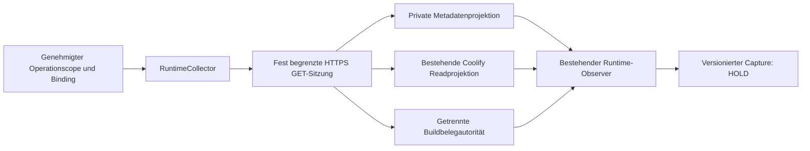

# C26-E – authentifizierter, strikt lesender Runtimecollector

24.10.2026. **Offline-Draft / HOLD.** Implementiert und mit Fake-Transports
geprüft; keine produktive Erfassung, keine Betreiber- oder Deploymentfreigabe.

## Basis und Entscheidung

Eigener Branch `feat/c26e-authenticated-runtime-collector`, isolierter Worktree
`Personal_Assistant-c26e`, exakt auf #161
`8b0ba2d4ab5d0cd6fc8dfa69783276efd929666f` (Tree
`995e2dda5879a8d10efeb13f57f4adeef9719706`). #148/#157 sind darin bereits enthalten
und wurden **nicht erneut übernommen**. Aktueller geprüfter master der Basis:
`e68275205fefb7a5f6db42bc45060e505bfcefb5`. #160 bleibt unabhängiger
Betriebsabnahmebericht. Keine bestehenden Gate-/Observer-/Readclientdateien,
Produktionsvorlagen oder C27-Branches geändert.

Vorhandene Bausteine: `HostCollector` liefert vier feste Abfragearten;
`CoolifyReadClient` projiziert genau Application und applicationgebundene
Deploymenthistory; `observe_runtime` prüft Rollen, Images, Settings, Jobroot,
Mounts, Netz/Namespaces, Health/Readiness, Inventar, Trigger und Freshness.
C26-D bindet dies an den vollständigen Operationscope. Bisher fehlen ein
HTTPS-Hosttransport, Authentifizierung und eine vom Host unabhängige Buildquelle.
Die bestehenden `Image.provenance`-Strings allein sind kein Registrynachweis.

C26-E ergänzt `src/job_control/runtime_collector.py` über denselben Schnittstellen.
Die bestehenden API-/Workerrollen erhalten keine Host-/Dockerrechte. Eine
**gesonderte private Metadatenkomponente** muss die vorhandene Hostprojektion
bereitstellen. Das trennt deren Hostleserechte von den Anwendungsrechten.
Dieser Auftrag implementiert den Client und den verbindlichen Projektionsvertrag;
er erstellt **keinen Listener, Serverdienst oder öffentlichen Endpoint**.
Der Metadatenproduzent und die unabhängige Buildbelegquelle existieren dadurch
noch nicht als abgenommene Livekomponenten. Ohne sie scheitert der Client geschlossen.



## Schnittstellen und Vertrauensgrenzen

| Schnittstelle | Vertrag |
| --- | --- |
| `Target` | Vertrauenswürdige Vorabkonfiguration: kanonischer HTTPS-Origin ohne Userinfo/Pfad/Query/Fragment, Zweck, Target-/Subject-ID, Metadaten-Adapter-ID, Trustdomain und Zertifikat-SHA256 |
| `PinnedHTTPS(target, certificate_pem=...)` | Echter HTTPS-Lesetransport; Konstruktion führt keinen Request aus; kein injizierbarer Transport |
| `SimulatedHTTPS(target, transport=...)` | Beliebige injizierte Fake-Transports bleiben simuliert; auch ein nachgebauter TLS-Header ändert dies nicht |
| `CredentialProvider.acquire(target_id)` | Liefert nur zur Laufzeit eine audiencegebundene, kurzlebige `Credential` mit `SecretStr`; keine Credential-Datei/-Environmentvariable wird von diesem Modul gelesen |
| `RuntimeCollector(...).capture(binding, operation)` | Eine begrenzte Erfassung mit zwei Scans; bei Fehler kein Teilresultat, kein Retry; Instanz und ihre geschlossenen Channel-Pools sind anschließend verbraucht |
| `Capture` | Redigierte strukturierte Evidenz, normalisierter Observerbericht, Requestreceipts, Buildbelege, Trustklassen und kanonischer Digest; kein Approval/Permit |
| `Capture.gate_fixture()` | Ausschließlich explizite simulierte Offline-Testbrücke zu C26-D; authentifizierte Captures werden abgelehnt |

Die Konfiguration stammt vom vertrauenswürdigen späteren Launcher, niemals aus
untrusted Request-/Lecturetext. Erfassungsdaten wählen keine Origins, Methoden
oder beliebigen URLs. Buildautorität muss zu Host und Coolify verschiedene
Origins/Hostnamen, Subject-/Trustdomain-IDs und Zertifikatpins besitzen.
Das ist eine technische Trennung gemäß geprüfter Konfiguration; organisatorische
Unabhängigkeit und tatsächliche Verifierberechtigungen bleiben Betreiberprüfung.
Die Herkunftspolicy wird separat als `transport_policy_sha256` gebunden. Der
bestehende Runtime-TLS-Hash wird nicht stillschweigend umgedeutet.

Der vertrauenswürdige Koordinatorprozess ist keine Sandbox gegen beliebigen
Pythoncode mit gleichen Rechten. Ein deserialisierter Capture ist ein historischer
Bericht, **kein eigenständig authentifizierter aktueller Livebeleg**. Alle Captures
haben `live_accepted=false`, `deployment_permitted=false`,
`production_release=blocked`. Nur der kontrollierte Netzwerkpfad kann bei einer
späteren genehmigten Ausführung `authenticated_capture` erzeugen. Dieser Status
beweist weder vollständige Betriebsabnahme noch fachliche Wahrheit aller Hostclaims.

## TLS und Credentials

`PinnedHTTPS` verwendet einen neuen `SSLContext(PROTOCOL_TLS_CLIENT)` mit
`CERT_REQUIRED`, Hostnamenprüfung, mindestens TLS 1.2 und strikter X.509-Prüfung.
Der Truststore enthält **exakt das geprüfte Nicht-CA-Blattzertifikat**, keine
System-CA oder zusätzliche Zertifikate. OpenSSL partial-chain erlaubt diesen
expliziten direkten Trustanker; Gültigkeit und Hostname werden im TLS-Handshake
geprüft. Der PEM-DER-Hash muss dem vorab geprüften Pin entsprechen. Ein CA-Pin oder
eine mehrteilige PEM-Kette wird abgelehnt. Zusätzlich wird der tatsächliche
Peer-DER-Fingerprint je Antwort kontrolliert.

Damit greift die Pinbindung schon **vor Versand der Authorization**. Eine reine
Fingerprintprüfung nach dem HTTP-Response wäre dafür unzureichend. Redirects,
Proxy-/Environmentübernahme und automatische Transportretries sind abgeschaltet.
Ein Zertifikatswechsel benötigt neue geprüfte Policy und explizite Freigabe;
keine automatische Zertifikatsübernahme oder CA-Ausweichroute.
Requests tragen Cache-Vermeidungsheader; nichtnullige/unverständliche `Age`-
oder `Warning`-Header werden abgelehnt. Die vorhandenen Coolify-GETs bieten
keinen Nonce-gebundenen serverseitigen Erfassungszeitpunkt. Deshalb bleibt
`coolify_server_side_freshness` ausdrücklich unverified, auch bei erfolgreicher
TLS-Abfrage. Ein Cache ohne korrekte Header kann clientseitig nicht sicher
ausgeschlossen werden; kein authentifizierter Capture wird als vollständiger
Live-Nachweis oder Gatefreigabe akzeptiert.

Credentials sind audiencegebunden, höchstens eine Stunde gültig und enthalten nur
einen begrenzten Bearertoken ohne Headersteuerzeichen. Der Providervertrag fordert
lokal verfügbare, sofort und begrenzt zurückgegebene Credentials; externe
Vault-/OIDC-I/O benötigt einen separat geprüften zeitbegrenzten Provider. Beliebiger
blockierender Python-Providercode kann von dieser Bibliothek nicht präemptiert werden.
Für Coolify ist später ein passender reiner Readtoken ohne `read:sensitive` oder
Rootberechtigungen zu prüfen. Die GET-Beschränkung des Clients ersetzt keine
serverseitige Prüfung der Tokenrechte.

Keine Credential ist Bestandteil eines Pydantic-Evidenzmodells. Authorization
wird nach jedem Versuch aus dem Requestobjekt entfernt; keine dauerhaften
Clientauthheaders, Cookies oder automatische Auth-Challengefolgen. Token-Echos
im Response werden abgelehnt. Projektionsallowlists entfernen rohe Envs, Logs
und unbekannte Top-Level-Metadaten; unerlaubte verschachtelte Felder scheitern.
Fehlertexte sind feste Codes, auch für Provider-, TLS-, Streaming- und Closefehler.
Kein Body-/Credentiallogging. Das ist keine allgemeine DLP gegen beliebige vom
Host in erlaubten Feldern verborgene Geheimnisse; diese Felder bleiben ebenfalls
an den genehmigten Scope gebunden.

## Feste Abfragen und Budgets

| Quelle | Ausschließlich GET auf |
| --- | --- |
| Privater Metadatenproduzent | `/v1/runtime/metadata/inventory`, `/v1/runtime/metadata/containers/<container-sha>`, `/v1/runtime/metadata/images/<image-id>`, `/v1/runtime/metadata/boundary/<application-id>` |
| Vorhandener Coolifypfad | `/api/v1/applications/<application-id>`, `/api/v1/deployments/applications/<application-id>?skip=0&take=16` |
| Getrennte Buildautorität | `/v1/runtime/build-receipts/<genehmigter-receipt-sha>` |

Diese Metadaten-/Buildrouten sind **private Protokollanforderungen**, keine Behauptung
bereits vorhandener Coolify-/C16-Endpunkte. Der Auftrag fügt keine Serverroute hinzu.
Container-/Image-IDs werden durch den vorhandenen vollständigen Ressourcen-
Inventarvertrag ermittelt; Boundary/Application und Buildhashes sind vorab gebunden.
Nicht erlaubte Queries, Traversal, Methoden und IDs erreichen keinen Transport.

Maximal 24 Requests, keine Retries, maximal 2 MiB Antwortbytes je Gesamterfassung.
Metadaten/Build je 64 KiB, Coolify je 128 KiB; History bleibt auf 16 Einträge
begrenzt. Unkomprimiertes JSON, strikte Duplicate-Key-, Größen-, Content-Length-
und Typprüfung. HTTP-I/O-Timeout je Phase 3 Sekunden. Kooperatives Gesamtbudget
8 Sekunden, an Request-/Chunkgrenzen geprüft; ein gerade blockierender I/O kann
bis zum konfigurierten Phasentimeout nachlaufen. Dies ist **kein harter
8-Sekunden-Prozessdeadline**. Streaming prüft jeden Netzwerkchunk, ohne erst
8192 Bytes zu puffern, damit langsame Einzelbytes das Gesamtbudget nicht umgehen.

Die gültige Dreirollenkonfiguration mit gemeinsamem API-/Workerimage benötigt
20 GETs: zweimal je sieben Hostabfragen und zwei Coolifyreads, plus zwei
Buildbelege. Es gibt keine unbegrenzte Pagination oder zusätzliche Erkundung.

## Evidenz, Freshness und unabhängige Buildbelege

Metadaten und Buildantworten tragen den versionierten
[Envelope](c26_runtime/collector_envelope.v1.schema.json). Jede Antwort bindet
Target/Subject/Adapter, Batchnonce, neue Requestnonce, Requesthash,
Operationscopehash, Observerbindinghash, Capture-ID und Erfassungs-/Ablaufzeit.
Der Requesthash ist SHA-256 des kanonischen Objekts aus `batch_id`, `request_id`,
`query`, `identity`, `binding_sha256`, `runtime_scope_sha256`. Diese Werte werden
über feste `X-C26-*`-Headers gesendet, kein Queryparameter mit Credentials.

Host-/Buildproduzenten müssen **neu beobachten**, Requestbindung und echten
Erfassungszeitpunkt bestätigen und innerhalb eines Scans eine konsistente
Capture-ID liefern. Das Echo einer Nonce allein beweist keine ehrliche neue
Messung eines kompromittierten Hostagenten. Die Wireantworten sind durch den
TLS-Kanal authentifiziert, keine separat signierten Offlineattestationen.

Beobachtung muss zwischen Requestbeginn und Antwortende liegen; keine Zukunft,
kein vor Requestbeginn erzeugter Cache. Gültigkeit maximal 30 Sekunden und auch
am Ende der gesamten Erfassung noch gegeben, einschließlich früherer Buildreads.
Die vorhandenen Observergrenzen bleiben wirksam: vollständige frische Erfassung
(maximal 30 Sekunden), Workerheartbeat jünger als zehn Sekunden, gültige Rolle/
Version/Instanz und sämtliche Runtime-/Triggerbedingungen. Unknown bleibt NO-GO.

Zwei vollständige Scans vergleichen Application/Deployment, Instanzen, Prozesse,
Netz, Mounts, Settings, Images und Boundary. Container-/Image-/Inventarreihenfolgen
werden für den Vergleich kanonisch sortiert; neue Heartbeatzeiten sind erlaubt,
werden aber in beiden Scans eigenständig auf Freshness geprüft. Identitäts- oder
inhaltliche Änderungen brechen ab. Ein TOCTOU-Restfenster nach dem letzten Read
bleibt; jeder spätere Gate-/Permitpfad braucht erneut frische Erfassung. Keine
Wiederverwendung eines alten Captures als aktuelle Deploymentbefugnis.

Buildreceiptformat:
[Schema](c26_runtime/collector_build_receipt.v1.schema.json), schema v1,
`authority_id`, Repository, Revision, Image-ID, unveränderlicher RepoDigest und
explizite Registry-/Attestationsprüfbehauptung. Hash über dessen kanonisches JSON
muss dem **zuvor genehmigten** `RoleScope.build_receipt_sha256` entsprechen;
jedes Identitätsfeld wird separat mit der Rolle verglichen. Keine nachträgliche
Übernahme eines vom Host neu angebotenen Hashes in den Scope. Vorhandene unbekannte
Receipthashes werden nicht migriert oder als kompatibel ausgegeben. Ihre zukünftige
Registrierung erfordert reale Belege und neue Scopefreigabe.

Die getrennte Autorität liefert den gepinnten Beleg; der Client prüft dessen
**Identität und Inhalts-Hash** unabhängig vom Host. Die Registry-/Signaturprüfung
selbst muss die separat abgenommene Autorität implementieren und nachweisen.
Das Modul behauptet keine eigene OCI-/Sigstore-/Registryprüfung anhand eines
Hostlabels. Fehlender/falscher Beleg, label_only oder unverified bleiben NO-GO.

| Trustklasse im Capture | Bedeutung | Stand dieses Auftrags |
| --- | --- | --- |
| `directly_observed` | Authentifiziert empfangene technische Host-/Coolifyclaims | nur simuliert getestet; kein real beobachteter Host |
| `independently_verified` | Getrennt bezogene Receiptidentität und Inhalts-Hash | nur simuliert getestet; echte Verifierkette offen |
| `operator_reported` | Vorgegebener Scope und Target-/Trustpolicy | Konfigurationsannahmen, keine technischen Messungen |
| `unverified` | Liveproducer/Registryverifier, Betreiberabnahme, Triggerinventur, serverseitige Coolifyfrische | ausdrücklich offen, HOLD |
| `simulated` | Aus Fake-Transports stammende Gruppen und Buildbelege | alle positiven Testcapturen dieses Auftrags |

## Integration mit C26-D

[Capture-Schema](c26_runtime/collector_capture.v1.schema.json) und
[Target-Schema](c26_runtime/collector_target.v1.schema.json) sind versioniert.
Captureprovenienz schema v2 erhält die bestehenden Host-/Adapter-/Zeitbezüge und
ergänzt Scope-/Binding-/Transportpolicyhash, Batch und tatsächlichen Transportmodus.
Der bestehende Observer prüft unverändert eine normalisierte Hostprojektion;
sein `evidence_sha256` bezieht sich ausdrücklich auf diese Projektion mit alter
Offlineprovenienz. Der Capturevalidator rekonstruiert sie und prüft den Hash.
`Capture.digest` identifiziert den vollständigen neuen kanonischen Record.

Authentifizierte Provenienz wird **nicht** als `offline_fixture` an das Gate
umetikettiert. C26-D akzeptiert diese neue Provenienz weiterhin nicht. Nur
`gate_fixture()` für einen ausdrücklich simulierten Capture erzeugt einen
Offlinebeleg für bestehende Gatevertragstests. Reale Captures werden dort
abgelehnt. Kein Live-Gatepermit, Approval, Journalwrite, Queuezugriff, neuer Driver
oder automatische v2-Aktivierung. Eine spätere echte Live-Gateintegration benötigt
eine separate versionierte Betreiber-/Koordinatorfreigabe.

## Lokale Offlineprüfung und tatsächliche Tests

Vorhandene Umgebung, keine Installation:
`../Personal_Assistant-c26b6-planning-results/test-env/bin/python`, Python 3.12.12,
SQLite 3.50.4, pytest 9.1.1, Pydantic 2.14.1/core 2.50.1, HTTPX 0.28.1,
PyYAML 6.0.3, PyMuPDF 1.27.2.2; Ruff 0.16.0 aus vorhandenem Cache.
Runtime-Lockabweichungen wie #161: Pydantic 2.13.4/core 2.46.4 und PyMuPDF 1.28.2.
Kein exakter Image-/Runtime-Locknachweis aus diesen lokalen Tests abgeleitet.

Aus dem C26-E-Worktree:

```sh
PYTHONDONTWRITEBYTECODE=1 PYTEST_DISABLE_PLUGIN_AUTOLOAD=1 \
  ../Personal_Assistant-c26b6-planning-results/test-env/bin/python -B -m pytest \
  -q -p no:cacheprovider tests/test_runtime_collector.py
```

Die Testfixtures verwenden ausschließlich `httpx.MockTransport`, synthetische
Tokens und ein öffentliches Test-Blattzertifikat für `collector.example.test`.
Sein privater Schlüssel wurde nicht gespeichert; keine echten Credentials
abgerufen/erzeugt. Der echte HTTPTransport wird nur ohne Requests konstruiert.
TLS-/Hostnamefehler sind als Fake-Transportfehler geprüft; **kein echter
TLS-Handshake** oder Serverzugriff wurde ausgeführt. Die Offlinefixture sperrt
Sockets. Die Testantworten behaupten keinen erfolgreichen Livecollector.

- Finale Collectorsuite: **86 passed**, 2,03 s; keine Skips.
- Relevante bestehende #161-Regression: **357 passed**, 58,41 s; keine Skips:
  `test_deployment_gate`, `test_deployment_gate_v2`, `test_coolify_observer`,
  `test_coolify_readiness`, `test_c26_runtime_preflight`,
  `test_c26_runtime_bootstrap`, `test_runtime_paths`, `test_deployment_operations`.
- Zusammen **443 unterschiedliche bestandene Tests**. Frühere überlappende
  Entwicklungsläufe werden nicht addiert. Der erste Lauf deckte einen bereits
  konsumierten HTTPX-Fakeresponse auf; der Reader wurde für gestreamte und
  bereits im Speicher befindliche Antworten korrekt getrennt. Kein offener Fehler.
- Negative Fälle: Credentials/Audience/Expiry, TLS-/Transportfehler, falsche
  Host-/Adapter-/Targetbindung, Redirects/Endpoints, Größen/Timeouts/Dripstreams,
  manipulierte/stale/replayed Envelopes, Instanz-/Namespace-/Scopewiderspruch,
  fehlende Buildprovenienz, Secret-/Cookie-/Closefehler, Modepromotion,
  Canonical-/Schemasnapshots und explizite Offline-Gateintegration.

Hooks, Ruff, relative Links und Quellfingerprints:
[Validierungsmanifest](c26e_validation.v1.json). Keine vollständige Backend-/UI-
Regression, neuen Transport-Subprozess-/Browsertests, Dockerbuilds/-downloads,
Livehandshakes, echten Credentials oder produktiven Datenzugriffe. Kein ENOSPC,
keine Bereinigung bestehender Artefakte oder Umgebungen.

## Vorbereitete spätere read-only Betreiberabnahme / C26-F

**Jetzt nichts davon aktivieren.** Voraussetzung ist eine neue ausdrückliche
Betreiberfreigabe mit Targets, Zeitfenster, Umfang und den folgenden Nachweisen:

1. Privaten Metadatenproduzenten mit minimalen Hostleserechten, ausschließlich
   den vier Projektionen, authentifiziertem Zugriff und vollständiger Inventur
   reviewen. Keine Anwendungsrolle mit pauschalem Docker-/Hostzugriff ausstatten;
   keine öffentlichen Metadatenrouten. Ehrliche Frische-/Capturesemantik belegen.
2. Separate Buildautorität und echte Registry-/Buildattestationsprüfung einschließlich
   Issuer-/Repository-/Digestbindung und administrativer Unabhängigkeit prüfen.
   Genehmigte Receiptinhalte und Hashes gesondert registrieren, kein Scope aus Hostlabels.
3. Targets/Hostnamen/Host-/Adapter-/Subject-/Trustdomain-IDs und öffentliche
   Blattzertifikate aus unabhängiger Quelle prüfen. Tatsächliche positive und
   negative TLS-Handshake-/Hostname-/Expiry-/Rotationfälle abnehmen. Revocation
   und Pinwechsel als Betreiberverfahren festlegen.
4. Credentialaussteller, Readrechte, Audience, kurze Gültigkeit, Widerruf und
   begrenzten Provider nachweisen. Erst nach Freigabe echte Tokens ausschließlich
   zur Laufzeit bereitstellen; keine Secrets in Prüfpaketen, Scope oder Journaldaten.
5. Eine einzige frisch gebundene read-only Capture mit konservativem Budget
   durchführen; die beiden Scans und alle 20 Requests prüfen. Nichtverfügbarkeit,
   Zeitabweichung, fehlende Triggerinventur und unbekannte Provenienz bleiben HOLD.
6. Ergebnis außerhalb produktiver Queue/DB/Journal in genehmigtem privaten Prüfpfad
   sichern; Fingerprints/Trustklassen und verbleibende Unklarheiten prüfen. Capture
   ist keine Deploymentfreigabe. Kein automatisches Weiterreichen an Gate.run/release.

Empfehlung **C26-F**: zuerst diese private Producer-/Registry-Vertrauensbasis und
kontrollierte read-only Betreiberabnahme abschließen; anschließend den unabhängigen
Koordinator mit Betreiberidentität, Replay-/Journalrollbackschutz und einer separat
versionierten Live-Gatebindung entwickeln. Mutierender Deploymentdriver und echte
Produktivfreigabe bleiben weitere eigene Schritte. #160-Betriebsblocker bleiben.

Der neue Draft ist auf #161 gestapelt. Nach späterer reviewter Integration von
#161 nur die C26-E-Folgeänderungen übernehmen/rebasen; #148/#157 nicht erneut
integrieren. Keine Merges/Ready-Wechsel in diesem Auftrag. Eigener Branch und
Worktree bleiben fürs offene Draftreview erhalten; keine Integration in master
oder Cleanup behauptet. C27 #158 und UI #21 unverändert.
