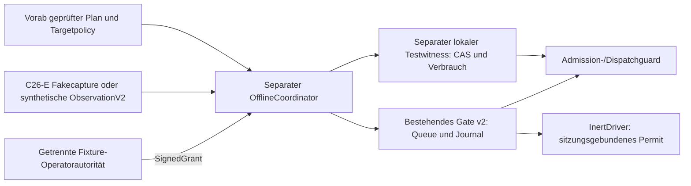
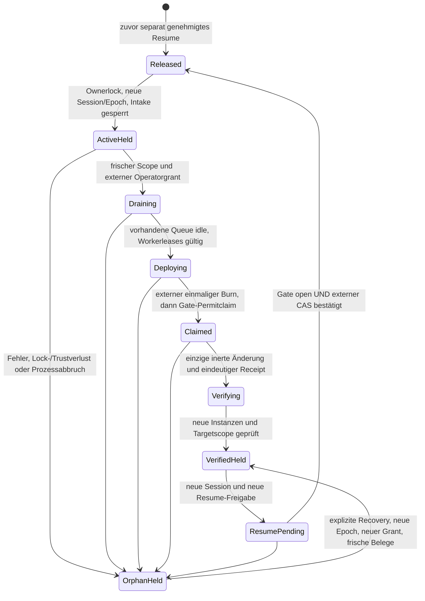

# C26-F – unabhängiger Offlinekoordinator und Vertrauensverträge

25.10.2026 (Europe/Berlin). **Offline-Draft / Produktionsstatus HOLD.**
Keine produktive Liveintegration, Infrastrukturaktion oder Betreiberfreigabe.

## Implementierung, Basis und Architekturentscheidung

Eigener Worktree `Personal_Assistant-c26f`, Branch
`feat/c26f-independent-coordinator`, exakt auf aktuellem #162-HEAD
`28e9a608d74270278cf037e35957d0bae08d50b2`, Tree
`adcf8bb87bb8eabc0e13b7866d84ba2e9aff0e43`. Dieser enthält #161
`8b0ba2d4ab5d0cd6fc8dfa69783276efd929666f`, seinerseits auf master
`e68275205fefb7a5f6db42bc45060e505bfcefb5`. #148 `f98eedd671c8a9d9eb58a3b957eda1a91713844d`
und #157 `80c31e52f76c1f3f62102b6884752b722f796e7c` sind geerbte Provenienz,
**keine erneute Übernahme**. #160 `ecac8cfa844a7e4da9e0066a2c49c0c49fb3541d`
bleibt separater Betriebsabnahmebericht. Original-Branches unverändert.

`OfflineCoordinator` in `src/job_control/deployment_coordinator.py` ist eine
separat ausführbare Pythonkomponente. Sie benötigt keinen lebenden Backend-/
HTTPprozess: das bestehende Gate liest die gemeinsame C16-Queue und die
Worker-/Lifecycleleases unmittelbar. Eigene Prozessabbruch- und Konkurrenztests
führen den Koordinator außerhalb des Workerprozesses aus. Es gibt keinen
aktivierten Dienst, Produktionslauncher oder mutierenden Driver.

Eine zweite Deployment-Zustandsmaschine würde Drain, Idle, Queue, Recovery und
Rollback duplizieren. Der Koordinator orchestriert daher die vorhandene `Gate`-
Implementierung über einen begrenzten Subklassenadapter: zusätzliche Autorisierung,
Ownerlease und externer Checkpoint werden an bestehenden Approval-/Permitpunkten
geprüft. C26-D-/C26-E-Modelle, v1/v2-Journalformate und normale Defaults bleiben
bestehen. Neue versionierte Verträge liegen neben den bestehenden Schemas.

Drei Ergänzungen:

- `coordinator_contracts.py`: deklarative Producer-/Build-/Integrationsverträge;
  keine Listener, Registryclients oder produktiven Authadapter.
- `coordinator_state.py`: ausschließlich lokaler Testwitness mit SQLite-CAS,
  dauerhaft verbrauchten Grant-IDs, Root-/Epoch-/Sitzungs-/Journalbindung und
  Guards für ausdrücklich angemeldete Testroots.
- `deployment_coordinator.py`: exklusiver Koordinator, externe Verifikator-
  Schnittstelle, vollständige Challenges, einmaliges Permit und nur ein inerter
  Driver, dessen einzige Zustandsänderung im Arbeitsspeicher stattfindet.



## Ausdrücklich aktiviertes Testprofil und Kompatibilität

Neues optionales Settingsfeld `coordinator_test_required=false`; nur `true` fordert
bereits aktiv ausgewähltes Pflichtgate v2. Keine Änderung einer Runtimevorlage,
keine automatische Einschreibung, Migration oder Gateaktivierung. Der bestehende
Settings-Schemasnapshot ergänzt **fünf Zeilen**, schema_version bleibt 1.
`settings_digest` lässt das neue Feld bei false weg: alte v1- **und v2-Hashes**
bleiben identisch. Bei true wird die Wahl in Plan/Scope und Approval gebunden.
Controller/Store/Executor reichen die Wahl an dieselben bestehenden Guards weiter.

`OfflineCoordinator.enroll` ist ein expliziter Testbootstrap auf einer vorhandenen
privaten v2-Queue. Er eröffnet keine Queue und legt keine Ersatzqueue an. Der
separate Testwitness muss vorher ausdrücklich in einem anderen privaten Verzeichnis
angelegt werden; keine automatische Verzeichniserstellung. Enrollment bindet
Rootpfad/Device/Inode und Witnessidentität. Required ohne Enrollment sperrt;
ein vorhandenes Enrollment schützt auch einen Zugriff ohne gesetztes Testflag.

Admission und Dispatch prüfen bei eingeschriebenen Roots den zusätzlichen Witness.
Ein normales `Gate.run/release` darf das Koordinatorprofil nicht umgehen. Es wird
nur der konkrete kontrollierte Gateadapter akzeptiert. Ein normales v1/v2-Gate
bleibt für Roots ohne dieses explizite Profil unverändert nutzbar. Ein Rootadministrator
kann Code und lokale Konfiguration umgehen: diese Lösung ist keine OS-Sandbox gegen
beliebigen gleichprivilegierten Python-/SQLitecode. Produktionspolicy und Dateirechte
müssen die spätere verbindliche Enrollment-/Rootbindung extern durchsetzen.

Der Sessionlock wird aus C22-Workspacekopien wie bestehende Laufzeitlocks ausgelassen.
Enrollment und Journal bleiben erhalten; die kopierte Rootidentität stimmt nicht
mit dem ursprünglichen Witness überein und die Kopie bleibt geschlossen. Der
Witness wird **nicht** als Teil des C16-Workspaces kopiert. Keine automatische
Neuregistrierung oder Aktivierung eines Restores.

## Metadatenproduzent und Buildautorität

[Integrationsschema](c26_runtime/coordinator_integration.v1.schema.json) nutzt
unverändert C26-E `Target`, `Envelope` und `BuildReceipt`. Produceridentität
bindet Subject/Host, Adapter, origin-/zertifikatgebundene Targetpolicy und den
Operationscope. Erlaubt sind ausschließlich die vier bestehenden Projektionsarten
Inventory, Container, Image und Boundary. Jeder Read muss serverseitig neu erfasst
und an Nonce, Requesthash, Batch, Scope und Binding gebunden werden.

Capture-ID bezeichnet einen stabilen beobachteten **Runtimeepoch pro Scan**, keinen
alten unveränderlichen Cache mit neu erfundenem Datum. Bei Änderungen während des
Scans muss der Produzent ablehnen. Serverzeit, Ablaufzeit (höchstens 30 Sekunden),
Audience-/Ressourcen-/Queryautorisierung, Nonceverbrauch und höchstens 64 KiB pro
Antwort sind verbindlich. Nur typisierte Projektionen, niemals Raw-Inspect, Envs,
Logs, Secrets oder frei übergebene Befehle. Fehler, Unknown, Teilresultate und
Replay ergeben keine positive Evidenz; kein automatisches Retry.

Die unabhängige Buildautorität benötigt eigene Administration und Signing-Trust,
geprüfte Issuer-/Repository-/Revision-/Image-/Digest-/Attestationsbindung und eine
nachgewiesene Registryprüfung. Plattform-/Manifestzuordnung ist durch den späteren
Verifier zu belegen; der vorhandene Receipt allein beweist sie nicht. Genehmigte
kanonische Receipthashes dürfen nicht aus Hostlabels übernommen werden. C26-F
implementiert **keinen** Registry-/Signaturverifier und behauptet keine neue
unabhängige Herkunftsbestätigung. `independent_verification_executed=false`.

`PrivateProducerFixture` läuft nur in `httpx.MockTransport`, ohne Listener. Sie
prüft Fakeauth, Bindung, serverseitige Zeit und einmalige Nonces. Der Integrationstest
führt den vollständigen C26-E-Collector mit dessen zwei Scans und je 20 Fake-GETs
bis zum inerten Koordinator durch. Das ist ein ausführbarer Offlineadapter,
keine Bereitstellung der späteren privaten Producerdienste.

| Klasse | Tatsächlicher Stand |
| --- | --- |
| Simulierte Daten | Alle Runtime-, Producer-, Credential- und Driverdaten dieses Auftrags |
| Authentifiziert empfangene technische Claims | C26-E-Vertrag vorhanden; kein echter Host-/TLSnachweis ausgeführt |
| Unabhängig verifizierte Herkunft | Echte Registry-/Issuer-/Buildkette offen; Fakebelege ersetzen sie nicht |
| Betreiberangaben | Vorgegebener Scope/Targetpolicy und nur synthetisch signierte Testgrants |
| Offene Nachweise | Producerimplementierung, Admintrennung, Tokenrechte, TLS/Freshness, vollständige Triggerinventur und Betriebsabnahme |

Die in #162 dokumentierte Grenze bleibt: Coolify-GETs bieten keinen Nonce-gebundenen
serverseitigen Erfassungszeitpunkt. `coolify_server_side_freshness` bleibt unverified.
Authentifizierter Transport ist keine eigenständige Runtimewahrheitsbestätigung.

## Betreiberautorisierungsvertrag

Ein Sessionstart erzeugt ausschließlich eine **Challenge**, keine Freigabe.
Die Challenge bindet Rootidentität, Zielressource/Server/Environment, vollständigen
Planhash, Operationscopehash mit Current/Target und allen Images, Aktion, Session-ID,
monotonen Epoch, Journalstartsequenz/-hash, aktuelle Instanz-/Evidenzhashes und Zeit.
Sie ist maximal fünf Minuten gültig und nie länger als die begrenzte Sessionlease.
Vor ihrer Ausgabe werden bestehende Queue-/Workerzustände und frische synthetische
Runtimeidentität geprüft. Bekannte laufende/angenommene Arbeit darf anschließend
durch das bestehende Gate kontrolliert auslaufen.

`SignedGrant`/`OperatorGrant` unterscheiden Issuer, eindeutiges Subjekt,
Beobachter-/Operatorrolle und Aktion. Beobachtung ersetzt keine Freigabe. Nur die
Operatorrolle, exakt dieselbe Challenge, passende Signatur laut externem Verifikator
und ein frisches Zeitfenster werden akzeptiert. Der Koordinator erhält **keine
Issue-/Signier-API**. Er projiziert erst den bereits extern geprüften Grant mit
unveränderter ID, Identität, Aktion, Zeiten und Plan-/Scopebindung in `ApprovalV2`.
Eine CLI-Behauptung/unsigniertes Grantobjekt oder eine echte Liveidentität wird
nicht als Fixturefreigabe akzeptiert.

Die Tests besitzen einen separaten synthetischen HMAC-Issuer; der Koordinator bekommt
nur dessen Verifikatorschnittstelle. HMAC ist hier eine **Simulation**: ein symmetrischer
Testverifikator ist kein unabhängiger produktiver Signiertrust und kein Nachweis gegen
einen böswilligen Verifikator oder Prozessbesitzer. Es gibt keinen produktiven
Identitätsadapter. Die spätere Lösung benötigt separat abgenommene Issuer-/Audience-/
Key-/Rollenbindungen und einen Verifikator ohne eigene produktive Signierfähigkeit.

Grant-ID und Envelopeshash werden vor Drain/Driver dauerhaft in einem separaten
Verbrauchsledger atomar mit dem Witnesszustand gespeichert. Eine ID darf auch mit
neuer gültiger Signatur und neuer Challenge nicht wiederverwendet werden. Resume
benötigt stets eine neue Session und neue Freigabe; ein Healthcheck erzeugt sie nie.

## Ablauf und Zustände



Das Gatejournal behält seine eigenen bekannten Phasen. Der Witnesszustand ist eine
zusätzliche Freigabebedingung. Beispiel: Gatephase `open` und Witness `active` ergibt
**weiterhin gesperrte Admission und Dispatch**. Erst ein vollständig bestätigtes
Resume setzt den Witness auf `released` mit exaktem Journalcheckpoint.

Maximal eine Aktion je Session, Lease höchstens 300 Sekunden (Default 60), höchstens
acht Evidenzerfassungen je Session. Jede C26-E-Erfassung behält ihre eigenen
Request-/Byte-/Zeitgrenzen. Signature-/Witness-/Root-/Owner-/Scopebindungen werden
wiederholt geprüft. Koordinatorlock ist exklusiv; normale kurze Diagnoselocks werden
an kritischen Punkten mit dem bestehenden begrenzten Zweiskundenwait toleriert.

Bereits angenommene Arbeit darf nur während genehmigtem `draining` dispatchen,
wenn Witness, Lease und Koordinatorlock gültig sind. Neue Jobs bleiben gesperrt.
Es gibt keine automatische Jobstornierung. Vor der einzigen inerten Änderung werden
Witness-Claim **und** bestehendes Gatepermit beansprucht; danach werden Lock,
Autorisierung und Gatepermit nochmals geprüft. Ein unklarer/fehlender/falscher
Driverreceipt oder fehlender vollständiger Rollbacktarget erzeugt kein verified
und niemals ein Resume.

## Monotoner Witness, Crash-Recovery und Grenzen

Der lokale Testadapter speichert Root-ID, monotone Revision/Epoch, Session-ID,
Ablauf, Gatecheckpoint und Grantverbrauch in einer eigenen SQLite-Datei außerhalb
des Jobroots. `BEGIN IMMEDIATE` und Compare-and-swap über den gesamten vorherigen
Zustand verhindern zwei erfolgreiche konkurrierende Übergänge. Grantverbrauch
ist Teil derselben Transaktion; kein zweites Claim und kein stilles Retry.
Der dauerhafte Burn geschieht vor dem vorhandenen Gateclaim/Driverseiteneffekt.
Ein Crash in dieser Lücke gilt als unklarer Ausgang, nicht als Wiederholungsfreigabe.

Vor jeder relevanten Operation wird der geankerte Journalprefix geprüft. Eine
vollständig gültige, aber ältere/fremde Hashkette wird abgelehnt. Idle/released
verlangt sogar den exakten letzten Checkpoint. Bei aktiven Operationen dürfen
kontrollierte neue Events nur auf diesem Prefix aufbauen; fremde Operationen
werden nicht automatisch übernommen. Fehlender, beschädigter oder widersprüchlicher
Witness, Root-/Lockdateiaustausch und abgelaufene Session lassen die Guards geschlossen.

Nach Prozessabbruch bleibt die Session im Witness aktiv/claimed. Keine automatische
Leaseverfallsfreigabe, kein automatischer Rollback und kein erneuter Drivercall.
Eine neue Session verlangt ausdrücklich `recover=True`, frische Scopebelege und
neuen Recover-/Rollbackgrant. Sie fencet die alte Epoch. Ein ungeklärtes
open/draining/deploying/verifying wird erst **nach neuer Betreiberautorisierung**
als Recoveryhold im unveränderten Journalformat auditiert. Danach gelten die
bestehenden strengen Gatebedingungen: Recover muss denselben Plan und dessen
Target belegen; Resume bleibt ein eigener weiterer Schritt.

Nach einem Crash vor Änderung ist Target möglicherweise nicht erreichbar. Das
bleibt geschlossen und erfordert die ausdrücklich genehmigte passende Recovery-/
Rollbackentscheidung. Der Koordinator erfindet keine erfolgreiche Änderung und
wiederholt die unklare Operation nicht. Ersteinrichtungsfehler ohne vorhandenen
Plan sowie beschädigte Journale/Witnessdateien brauchen eine separate manuelle
Reconciliation; keine automatische Initialisierung oder Reparatur.

**Lokaler Testwitness ist keine unabhängige Rollbackabsicherung.** Wer auch Witness,
Enrollment, Code oder Mandatorypolicy mit denselben Rechten ändern/zurückspielen
kann, liegt außerhalb dieses Schutzes. Produktiv erforderlich sind ein unabhängiger
monotoner Dienst/Trustanker, authentifizierte CAS-/Fencingbelege, gesicherte Identitäten,
Retention/Wiederherstellung sowie eine nicht umgehbare Root-/Enrollmentpolicy aller
Writer. Es gibt keine Behauptung von genau-einmaliger physischer Deploymentausführung
über Host-/Dienst-/Stromausfälle hinweg. Unklarheit bleibt ein manuelles HOLD.

## Versionierte Live-Gatevorbereitung

`c26-coordinator-integration/1` fordert ausdrücklich `offline_fixture`, inerten
Driver, Fixture-Verifikator und `local_test_only`-Witness. `live_gate_enabled=false`
und `deployment_permitted=false` können nicht aktiviert werden. Authentifizierte
Captures werden **nicht** in simulierte Gatebelege umgewandelt; nur der explizite
simulierte C26-E-Testpfad wird angenommen. Keine produktiven Provider, Operatorclaims,
externen Speicher oder mutierenden Adapter implementiert/aktiviert.

Eine spätere Liveversion muss Producer-, Build-, Betreiber-, Witness- und
Koordinatoridentität gemeinsam binden, echte Freshness/Unabhängigkeit belegen und
für jeden Seiteneffekt eine aktuelle Fencing-/Permitbedingung erzwingen. Das ist ein
neuer separat freizugebender Vertrag, kein Umschalten dieses Testprofils.

## Tatsächliche Prüfung

Vorhandene Umgebung wie #162: Python 3.12.12, SQLite 3.50.4, pytest 9.1.1,
Pydantic 2.14.1/core 2.50.1, HTTPX 0.28.1, PyYAML 6.0.3, PyMuPDF 1.27.2.2.
Runtime-Lock bleibt abweichend (Pydantic 2.13.4/core 2.46.4, PyMuPDF 1.28.2).
Keine neue Installation, keine Docker-/Browserdownloads. Ruff 0.16.0 und
Pre-commit 4.6.2 aus vorhandenen lokalen Umgebungen.

Pytest mit `PYTHONDONTWRITEBYTECODE=1`, `PYTEST_DISABLE_PLUGIN_AUTOLOAD=1`,
`-B -m pytest -q -p no:cacheprovider`, jeweils neuem `/tmp/c26f-*`-Basetemp.
Fake-Transports, synthetische private Queue-/Witnessdateien und inerte Driver;
Socketzugriffe gesperrt. Eigene kurze Forkprozesse prüfen Konkurrenz und abrupten
Exit; keine echten Container-/Backend-/Workerrestarts. Der reale synthetische
Queue-Drain nutzt nur den vorhandenen lokalen Fixtureadapter.

| Finaler Lauf | Tatsächliches Ergebnis |
| --- | --- |
| Bestehende relevante C26-D-/C26-E-/C16-/C22-Regression | **546 passed**, 148,30 s, keine Skips |
| Koordinator und Producer-/Build-/Integrationsverträge | **62 passed**, 67,30 s, keine Skips |
| Nachlauf nach zusätzlicher strikter Driver-Permittypprüfung | **3 passed**, 6,49 s; zwei bereits oben enthalten, ein zusätzlicher Negativfall |
| Strikte Witnessversionsprüfung plus Positiv-/Schema-/Legacychecks | **7 passed**, 5,41 s; fünf bereits enthalten, zwei zusätzliche Negativfälle |

Damit sind **611 unterschiedliche Fälle** erfolgreich geprüft. Der Nachlauf prüft
zusätzlich den Positivpfad und den vollständigen C26-E-Capturepfad nach der
Permittypprüfung. Änderungen an Driverzählern können die genehmigte aktuelle
Instanzbindung nicht aufheben; erst ein gebundener vollständiger Driverreceipt
schaltet auf die Targetverifikation um. Ein Objekt mit selbst behaupteter
`claim()`-Methode ist kein Koordinatorpermit.

Exakte Befehle, Laufzeiten, Überlappungen und Quellfingerprints:
[Validierungsmanifest](c26f_validation.v1.json). Frühere Entwicklungsläufe
werden nicht addiert. Behobene Test-/Entwicklungsfehler: fehlende Imports und
Fixtureweitergabe, anschließend der echte Diagnoselock-Wettlauf im Drainpfad;
kein Fehler durch blindes Abschwächen einer Sicherheitsbedingung gelöst.

Die Regression umfasst Gate v1/v2, Observer/Readiness, C26-Preflight/Bootstrap,
Persistent Roots, C22-Operationen, C16-Controller/Executor/Storekonkurrenz,
HTTPS-/Authpreflight und alle vorhandenen C26-E-Collectorfälle. Schemas,
Settingssnapshot und False-Default-/Hashkompatibilität werden geprüft. Neue
Witness-/Enrollmentversionen verlangen echte Integerkennungen; Booleanwerte
werden auch auf diesem Dateipfad abgelehnt.

Nicht ausgeführt: vollständige übrige Projekt-/UI-Regression, neue echte TLS-
oder Loopback-Servertests, Registry-/Producer-/Identity-/Witness-Liveabnahme,
Imagebuild, produktive DB/Queue/Journaloperationen oder Deployment.
Kein ENOSPC und keine Bereinigung bestehender Artefakte, Daten oder Umgebungen.

## Reproduzierbarer Offlineaufruf

Aus dem C26-F-Worktree mit der vorhandenen Testumgebung:

```sh
c26f_test_root=$(mktemp -d /tmp/c26f-local-XXXXXX)
PYTHONDONTWRITEBYTECODE=1 PYTEST_DISABLE_PLUGIN_AUTOLOAD=1 \
  ../Personal_Assistant-c26b6-planning-results/test-env/bin/python -B -m pytest \
  -q -p no:cacheprovider tests/test_deployment_coordinator.py \
  tests/test_coordinator_contracts.py --basetemp "$c26f_test_root/run"
```

Dies erzeugt ausschließlich neue synthetische Fixtures. `coordinated` und
`FixtureIssuer` in den Tests demonstrieren Enrollment, getrennte Challenge/Signatur,
Deploy, explizites Recover/Rollback und neues Resume. Der Koordinator selbst
implementiert keine Signierfunktion. Kein produktiver Startbefehl oder Credential-
Loader ist Bestandteil dieses Auftrags.

## Vorbereitung der Betreiberabnahme und C26-G

**Alle folgenden Produktionsanforderungen bleiben unerfüllt / HOLD:**

1. Private Metadatenproduzenten mit vollständiger Inventur und minimalen Rechten
   bereitstellen und separat prüfen; TLS-/Audience-/Ressourcenautorisierung,
   Serverzeit, Replay-/Rate-/Ausgabelimits und Secrettrennung tatsächlich belegen.
2. Administrativ unabhängige Registry-/Buildautorität mit echten Signier-/Issuer-/
   Manifest-/Digestnachweisen, genehmigten Receipthashes und Widerruf abnehmen.
3. Echte TLS-/Credential-/Freshness- und Triggernachweise aus #162/#160 vorlegen.
   Keine Ersetzung fehlender Werte durch Operatorbehauptung oder Cachezeit.
4. Produktive Betreiberidentitätsquelle und öffentliche Verifikationstrustanker
   einschließlich Rollen, Audience, kurzer Gültigkeit, Einmaligkeit und Widerruf
   getrennt vom Koordinator abnehmen; keine Signierschlüssel im Koordinator.
5. Unabhängigen externen monotonen CAS-/Fencingdienst und dessen Ausfall-/Rollback-/
   Restorevertrag nachweisen; lokaler SQLite-Testadapter ist kein Ersatz.
6. Koordinator außerhalb des ersetzten Verbunds, sichere Uhr/Leases, feste
   v2-Root-/Enrollmentpolicy aller Writer und unabhängige Recoverywege nachweisen.
7. Separat versionierte Live-Gateintegration reviewen. Erst nach eigener Freigabe
   einen streng permitpflichtigen Driver entwickeln und seine realen Seiteneffekte,
   Postchecks und unklaren Ausgänge prüfen; keine automatische Wiederholung.
8. Vollständige technische/organisatorische Betriebsabnahme aus #160 einschließlich
   Netzwerk/TLS/OIDC, Rollen, Queue, Backups/Restore und Betreiberfreigabe durchführen.

Empfehlung **C26-G**: die private Producer-/Build-/Identitäts-/Witness-Vertrauensbasis
und den unabhängigen Koordinatorbetrieb zunächst in genehmigter isolierter Umgebung
abnehmen und daraus einen echten Live-Readinessvertrag ableiten. Der mutierende
Produktionsdriver bleibt bis zu diesen Nachweisen und eigener Betreiberfreigabe
zurückgestellt. Keine implizite Freigabe durch bestandene Offlinetests.

Der neue Draft wird auf #162 gestapelt. Spätere inhaltliche Reihenfolge:
#161 → #162 → C26-F; deren geerbte Serien nicht doppelt integrieren. #160 bleibt
separater Abnahmebericht. Keine Merges/Ready-/Deployaktionen jetzt. C27 #158
`a0d3ebf7f64d44dd843f1848e70dc70a3a3af835` und UI #21
`218003222d418acc9e93585cd3367b694cd247e2` unverändert. Eigener Branch/Worktree
bleibt für das offene Draftreview erhalten; keine Defaultbranchintegration oder
Cleanup behauptet. Die ausdrücklichen Merge-/Löschgrenzen haben Vorrang vor der
allgemeinen Repository-Lifecycle-Regel.
