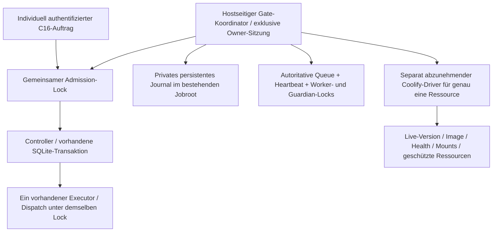
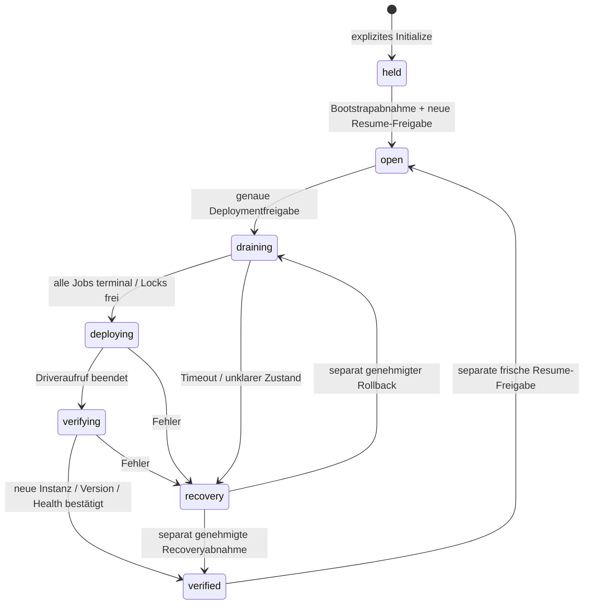

# C26 – Workerbewusstes Deployment-Gate (#146)

22.10.2026. Basis Backend-master `e581e201ef6b3d6c06aca14de845e0687d213b37`,
UI-main `e4be7a2fbf5b20beda0db854462dd2d70c2c93ff`. #137/#147 und UI #18/#19 sind
über GitHub-Mergebelege und Commitgraph verifiziert integriert. Das Gate ist eine
**lokal implementierte und synthetisch prüfbare Single-Host-Steuerung**. Es gibt
hier **keinen produktiven Coolify-Driver**, keine Hostverbindung und keine
Deploymentfreigabe. Issue #146 bleibt bis zur echten Einbindung/Abnahme offen.
Tatsächliche Ergebnisse: [Gate-Abnahme](c26_gate_validation.md).
VPN/HTTPS, sichere Hostinventur und Rollback bleiben im [HTTPS-Handbuch](https.md).

## Architekturentscheidung und Grenze

C16 `Controller`/`Store`, die bestehende SQLite-v1-Queue und genau ein vorhandener
`Executor` bleiben zuständig. Keine zusätzliche Queue, Datenbank, Workerrolle,
HTTP-Adminroute, Proxy- oder Authschicht. C18-Workflows, Import-/Indexjobs und der
C26-`CapacityExecutor` verwenden dieselben C16-Pfade. Kein DB-Schemawechsel und
keine Migration bestehender Jobdaten. Das optionale private Settings-Feld
`deployment_gate_required` ist standardmäßig **false**; der versionierte
Settings-Snapshot ergänzt nur dieses Feld. Keine automatische Produktivaktivierung.



Der Koordinator muss **außerhalb der austauschbaren Container** leben und Zugriff
auf denselben bestätigten lokalen Linux-Jobroot und dieselben Lockinodes haben.
Keine Mehrhost-/NFS-/SMB-/replizierte Volume-Freigabe. PID-Listen, Dashboardwerte
oder ein einmaliges `active_jobs == 0` ersetzen diesen Vertrag nicht.

## Atomare Koordination

- `Controller.create` hält `.deployment-admission.lock` vor und während der
  endgültigen SQLite-Schreibtransaktion. Bereits akzeptierte idempotente Antworten
  bleiben lesbar. `Store.transition(..., queued)` schützt auch spätere Starts.
- Der Executor hält denselben Lock über Queuesichtung, Running-Claim und Start
  des bestehenden Guardians. Im Drain darf er zuvor akzeptierte Jobs ausführen.
  Ein unbekannter Gatezustand sperrt Dispatch; laufende Kinder werden weiter
  überwacht und aufgeräumt, nicht durch das Gate abgebrochen.
- `.deployment-owner.lock` erlaubt genau eine Koordinatorsitzung einschließlich
  Driveraufruf und nachfolgender Abnahme. Die Sitzung läuft nicht per TTL ab.
  Ein Gate-bewusster Executor hält zusätzlich `.deployment-worker.lock`; das ist
  ein Protokollnachweis derselben Workerinstanz, kein zweiter Worker.
- Unter Admission-Lock prüft das Gate die bestehende DB read-only: SQLite-v1 und
  `quick_check`, alle Jobzustände, frischen Heartbeat, bestehenden exklusiven
  `worker.lock`, Protokolllease, keine Quarantäne und freie Guardian-`execution.lock`s.
  Auch `created` ist nicht terminal und blockiert. Solche Jobs vor Wartung bewusst
  fertigstellen; keine automatische Löschung oder Zwangscancellation.
- Erst danach wird `deploying` dauerhaft geschrieben. Alle Annahmen und neuen
  Dispatches bleiben über den Containerwechsel hinweg gesperrt. Ein Request,
  dessen Preview vor dem Drain berechnet wurde, kann danach nicht mehr committen.
  Ein allein außerhalb des Kontexts nutzbarer Freigabeschein wird nicht exportiert.

Lockreihenfolge ist Admission-Lock → kurze SQLite-Transaktion. Laufende Payloads
halten den Admission-Lock nicht. Das Gate stoppt keine Prozesse und führt keine
Job-Reconciliation, automatischen Retries, Restarts oder Queueoperationen aus.
Der Koordinator wartet höchstens zwei Sekunden auf kurze Admission-Lockkonflikte;
Ownerlock, Jobannahme, Dispatch und Status bleiben nicht blockierend. Vor dem
tatsächlichen Wechsel und unmittelbar vor Wiederöffnung wird die Freigabe erneut
geprüft, auch wenn eine Liveprobe oder Lockwartezeit inzwischen Zeit verbraucht hat.
Mit verpflichtendem Gate prüfen API und Executor vor jeder Storeinitialisierung
die **bereits vorhandene** private Queue read-only. Ein fehlender Mount oder eine
fehlende DB erzeugt keine neue leere Ersatzqueue.



Nach Prozessabsturz kann der letzte Zustand `draining`, `deploying` oder
`verifying` stehen bleiben. **Kein Ablauf/Restart öffnet die Annahme.** Recovery
braucht eine neue Freigabe und eine frische Beobachtung des wirklich laufenden
Stands; danach bleibt `verified` geschlossen bis zur weiteren Resume-Freigabe.

## Plan, Betreiberfreigabe und Livebeobachtung

`Plan` bindet genau eine `resource_id` und Rolle, bisherige und gewünschte volle
40-stellige Commit-SHA, beide Images mit `@sha256:`, den Settings-Fingerprint sowie
Fingerprints von Persistenz und geschützten Ressourcen. Die SHA darf nicht durch
`master`, `main`, `latest` oder einen nachträglich aufgelösten Branch ersetzt werden.

Eine private `Approval` bindet den gesamten Planhash, eine eindeutige Freigabe-ID,
den benannten Betreiber, `deploy`/`rollback`/`recover`/`resume`, explizites `confirmed`
und einen maximal einstündigen Gültigkeitszeitraum. Verbrauchte IDs dürfen nicht
erneut verwendet werden. Die Freigabe wird vor Drain, unmittelbar vor Wechsel und
vor Abnahme nochmals geprüft. Freigabeablauf öffnet keine Annahmen.

Der Driver muss **live** beobachten und liefern:

- tatsächliche Ressource, Prozess-/Containerrevision und unveränderliches Image;
  beim Wechsel zusätzlich eine neue Containeridentität;
- Health **und** echte Readiness, höchstens 30 Sekunden alte Beobachtung;
- Gateprotokoll `c26-gate-v1` aller relevanten Writer und exakte Settings-Bindung;
- nachweislich kontrollierte Trigger und genau einen betroffenen Ressourcenwechsel;
- unveränderte Mount-/Volume-/Root-/DB-Identität und geschützte Ressourcen;
- bekannte Inaktivität weiterer nicht von dieser C16-Queue erfasster Jobs und
  deren über das gesamte Fenster gesperrte Annahmepfade (`external_intake_fenced`)
  bzw. nachgewiesene vollständige Trennung von der betroffenen Ressource.

Fingerprints sind keine frei erfundenen Konstanten: der spätere Driver muss sie
aus einer versionierten kanonischen Inventur bilden. Persistenz umfasst mindestens
Mountquelle/-ziel/-typ, UID/GID, Root-/DB-Inodes bzw. Mountidentität. Die geschützte
Ressourcenmenge enthält Pilot/Worker, andere Apps, Proxy/Adminroute und unveränderte
Config-/Mountbindungen. Keine ganzen Konfigurationen, Prozessargumente oder
Secrets hashen und anschließend als Rohdaten protokollieren. Ein Image-Label allein
beweist weder tatsächlich laufenden Code noch Buildprovenienz.

Vor einem expliziten Rollback darf der bekannte Zielcontainer ungesund sein;
Ressourcen-/Versions-/Trigger-/Persistenzbeobachtung und C16-Idlebeweis bleiben
Pflicht. Nach Rollback sind Health/Readiness wieder Pflicht. Ein fehlender oder
unklarer Worker erlaubt auch beim Rollback keinen blinden Containerwechsel.

## Audit und Dateivertrag

`deployment-gate.v1.jsonl` ist **ein** begrenztes Append-Journal für Zustand und
Audit: Sequenz, vorheriger Hash, eigener SHA256, Zeit, Phase, Operation, Plan,
Freigabe und feste Gründe. Jeder Übergang wird vor Fortsetzung synchronisiert.
Kein zweiter State-Store und keine DB-Tabelle. Dateien müssen eigene reguläre
0600-Dateien ohne Symlinks/Hardlinks im bestehenden privaten 0700-Root sein.
Grenzen: 1024 Datensätze / 1 MiB. Volles Audit verweigert weitere Gateübergänge;
zerrissenes, manipuliertes, unbekanntes oder fehlendes Pflichtjournal sperrt Annahme
und Dispatch. Keine automatische Reparatur,
Trunkierung oder Journalrotation. Bereits bestehende Gateartefakte verhindern ein
erneutes Initialize. Eingabe-/Transportausnahmen werden nicht als Privatdetails
in CLIausgaben übernommen.

Das ist ein prüfbarer lokaler Auditpfad, **keine extern unveränderliche Signatur**
gegen einen privilegierten Hostbetreiber. Root-/Runtime-UID mit Schreibrecht könnte
Dateien ändern. Für revisionssichere externe Aufbewahrung muss der Betreiber den
abgenommenen Log-/Backuppfad festlegen. Bei unlesbarem Journal/fehlendem Lock kann
keine neue Journalzeile garantiert werden; die CLI liefert feste Blockdiagnosen.

C22-Backup nimmt das Journal, aber keine Laufzeitlocks mit. Ein Restore wird
ausschließlich auf ein neues isoliertes Ziel kopiert, erhält die Historie und
einen zusätzlichen `held`-Eintrag. Es ist keine Aktivierung. Keine Produktivdaten
oder bestehenden Persistenzpfade werden durch diese Implementierung verändert.

## Konkrete Coolify-Integrationsstrategie und technische Blocker

Die offizielle [Auto-Deploy-Dokumentation](https://coolify.io/docs/applications/deployments/automatic-deployments)
unterscheidet Gitereignisse von direkten Dashboard-/API-/Webhookdeployments:
Watch Paths sperrt direkte Deployaufrufe nicht. Selbst „Manual deployments only“
nimmt dem Dashboard und authentisierten Webhook nicht automatisch ihre Wirkung.
Die tatsächlichen Einstellungen auf Hetzner sind **operator_action_required**.

Der dokumentierte [Deploy-Endpunkt](https://coolify.io/docs/api/endpoints/deployments/deploy-by-tag-or-uuid)
nimmt Ressourcen-UUIDs bzw. Tags an; daraus lässt sich **keine belegte atomare
Commit-SHA-Freigabe für den unbekannten Bestand** ableiten. Deshalb wird kein
generischer HTTPwriter mit geratenen Parametern ausgeliefert. Der kleine, separat
zu reviewende Hostadapter muss:

1. Genau eine bestätigte bestehende Ressourcen-UUID und deren Buildtyp bedienen;
   keine Tags, UUIDlisten, Gesamtscope-Reconciliation oder zusätzlichen Ressourcen.
2. Eine bereits geprüfte SHA↔Registrydigest-Bindung verwenden und die installierte
   Version tatsächlich abnehmen. Kein erneutes Auflösen des aktuellen Branchheads.
3. Vorher alle automatischen und direkten alternativen Trigger kontrollieren,
   Deploymentrechte auf diesen Pfad begrenzen und keine ausstehenden Deployments
   übersehen. Konfiguration nur nach gesonderter Freigabe ändern.
4. `Gate.run(plan, approval, driver)` in einem Hostprozess außerhalb der Zielrolle
   ausführen. Der Driver ruft `permit.check()` unmittelbar vor genau einem
   Deployaufruf auf, wartet begrenzt auf dessen konkrete Deployment-ID und nimmt
   live Ressource, neue Containeridentität, Code/Image, Health und Scope ab.
5. Danach geschlossen bleiben. Erst neue Resume-Freigabe und frische Liveprüfung
   über `Gate.release(...)` erlauben Annahmen. Keine automatischen Rollbacks.

[Coolify Rolling Updates](https://coolify.io/docs/applications/deployments/rolling-updates)
kann bei Application-Buildtypen alte und neue Container überlappen; Compose hat
andere Reconciliationregeln. Für den Executor ist ein überlappender Zweitworker
unzulässig. Ressourcen-/Buildtyp und Stop-before-start-Fähigkeit müssen deshalb
vor Umsetzung des Adapters bestätigt werden. Keine Schlussfolgerung aus der
gemeldeten, aber nicht aktuell geprüften Coolify-Version.

**Erstbootstrap ist ein eigener Blocker:** Alte Writer kennen dieses Gate nicht.
Ein neues Gateimage darf sie während laufender Jobs nicht ersetzen. Nach separater
Freigabe erst Trigger kontrollieren, alle Annahmepfade exklusiv sperren, bestehende
Jobs auslaufen lassen und Idle/Locks/Pilotzustand manuell beweisen. Erst dann
dieselben Rollen kontrolliert mit Gatecode und `deployment_gate_required=true`
aktualisieren, Journal geschlossen initialisieren, eine Workerinstanz prüfen und
die Bootstrapabnahme durchführen. Diese Vorbereitung hat keinen dieser Schritte
am Host ausgeführt. Nicht-C16-CLIarbeit, Download/Transcript-/ZIPprozesse und
unabhängige Pilotroots werden nicht durch bloßes Prüfen einer C16-DB abgedeckt.
Unbekannte oder gemeinsam genutzte Ressourcen verhindern die Betriebsfreigabe.
Ein einmaliges „keine externen Jobs aktiv“ schließt ein Startrennen nicht aus;
ohne dauerhafte externe Sperre oder belegte Ressourcentrennung muss der Driver
verweigern. Der unabhängige Week-0-Pilot darf nicht als Nebenwirkung drainiert,
gestoppt oder umgehängt werden.

## Betreiberinventur und späterer Ablauf

Zunächst ausschließlich die gefilterten Host-/Container-/Netzkommandos im
[HTTPS-Handbuch](https.md#erste-betreiberprüfungen-und-benötigte-entscheidungen)
selbst ausführen. Hier ist **SSH ausdrücklich nicht autorisiert**. Zusätzlich lokal
in Coolify für UI, Backend und Pilot/Worker erfassen: UUID, Buildtyp, Quellbranch,
installierte SHA/Image-ID/Digest, Auto-/Previewdeploy, Registry-/Git-/APItrigger,
Scheduler, ausstehende Deployments und berechtigte Deployaccounts. Keine echten
Tokens/Webhook-URLs, Envdateien oder Prozessargumente an Chat/Git/Logs übergeben.

Erforderliche Entscheidungen in Reihenfolge:

1. **P0:** Tatsächliche Rollen, Jobroots/Queuezuordnung, weitere laufende Prozesse,
   identische UID/Pfade/Locks, Mounts/SQLite-WAL, Pilotabgrenzung und Rettungszugang.
2. **P0:** Alle Deploymentauslöser, Zielressource/Buildtyp und zukünftiger exklusiver
   Hostadapter; Bootstrap und dessen exklusives Wartungsfenster separat freigeben.
3. **P0:** Freigegebene SHA/Digests, vorige sichere Version, belegte Backup-/isolierte
   Restore-/Recoverywege; keine laufende SQLite blind kopieren.
4. **P0:** VPN/Geräte, private IPs, eigene Domain/DNS/TLS, OIDC/individuelle Rollen,
   bestehende private C16-HTTPS-API, Netztrennung, Client-IP-Erhalt und öffentliche
   Negativtests gemäß HTTPS-Handbuch. Fehlende API bedeutet weiterhin No-Go.
5. **P1:** Hostbudget, Monitoring/Alarmempfänger, externe Auditaufbewahrung,
   Rollbackverantwortlicher. Dann konkreten Adapter separat reviewen/testen.

Die folgenden Kommandos sind Schnittstellen der neuen Version, **keine Anweisung
zum jetzigen Produktivaufruf**. `status` ist rein lesend; `initialize` ist schreibend
und braucht die obige Bootstrapfreigabe. Pfade müssen separat bestätigt werden:

```sh
: "${C26_GATE_PYTHON:?Gepruefter vorhandener Interpreter mit Gatecode}"
: "${C26_GATE_CONFIG:?Bestehende private Konfiguration des richtigen Jobroots}"
"$C26_GATE_PYTHON" -B -m scripts.deployment_gate status --config "$C26_GATE_CONFIG"
# Nur nach separat freigegebenem Bootstrap, erstellt ausschliesslich held:
"$C26_GATE_PYTHON" -B -m scripts.deployment_gate initialize \
  --config "$C26_GATE_CONFIG" --confirm
# Plan-/Freigabedateien 0600, ohne Secrets; ergibt NIEMALS Deploymentpermit:
"$C26_GATE_PYTHON" -B -m scripts.deployment_gate check-plan \
  --config "$C26_GATE_CONFIG" --plan "$C26_GATE_PLAN" \
  --approval "$C26_GATE_APPROVAL" --action deploy
```

Es gibt absichtlich keinen `--execute`-/Webhook-CLIweg. Der zukünftige Hostadapter
verwendet die Bibliothek; ohne seine belegte Einbindung endet der Ablauf hier.
Exit 0 bedeutet ausschließlich einen erfolgreichen Diagnose-/Planaufruf; niemals
aus diesem Exitcode oder `phase=open` einen Redeploy auslösen. CLIausgaben tragen
immer `deployment_permitted=false`; `open` bezeichnet nur die Jobannahme.

Nach genehmigtem Bootstrap und Adapterabnahme: genaue neue Freigabe laden →
Trigger-/Scope-/Vorversion prüfen → Drain → bestätigtes Idle und `deploying` →
eine Ressource wechseln → neue Instanz/Version/Health/Readiness/Scope prüfen →
`verified`, weiterhin geschlossen → separate Resume-Freigabe → erneut prüfen →
`open`. Erst danach HTTPS-/VPN-Liveabnahme und gesonderte Go-live-Entscheidung.

Bei Fehler/Timeout/Koordinatorverlust: Annahme gesperrt lassen, Audit und konkrete
Deployment-ID privat sichern, tatsächliche Container-/Job-/Lock-/Mountzustände
lesen. Keine gespeicherten PIDs signalisieren, Marker löschen oder Replay starten.
Entweder genaue bekannte Vorgängerversion separat als Rollback genehmigen oder
den wirklich laufenden gesunden Stand separat als Recovery attestieren; danach
ist erneut Resume nötig. Bei unbekanntem Worker/Scope zuerst manuelle Diagnose,
kein blinder Rollback. VPN-Allowlist, OIDC, TLS und Adminzugang beim Rollback
erhalten; keine öffentliche Ersatzroute, kein DBrestore ohne separaten Bedarf.

| Bereich | Status |
| --- | --- |
| Admission-/Dispatchfence, Drain, Approval, Audit, Recoverykern | `implemented`, lokal synthetisch `verified` |
| Echte Konkurrenz-/Crash-/Worker-/Restore- und HTTPSregressionen | Ergebnisse im Abnahmebeleg; keine Hostabnahme |
| Produktiver Coolify-Driver und exklusiver Triggerpfad | `blocked`, `operator_action_required` |
| Host, Bootstrap, Pilot-/API-/Mount-/Backup-/Alarmbelege | `not_tested`, `operator_action_required` |
| Echtes VPN/TLS/IdP/öffentliche Abschirmung | `not_tested`, `operator_action_required` |
| Produktion | `blocked`; Merge oder grüne Tests ändern das nicht |
