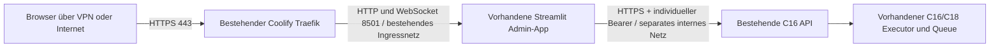

# C26-B: HTTPS über den bestehenden Coolify-Proxy

Stand 20.10.2026. Führende Ergänzung zur [C22-Architektur](architecture.md),
[Konfiguration](configuration.md), [Betrieb](operations.md) und
[Backup/Restore](backup_restore.md). Der [C26-A-Bestandsvertrag](c26a/existing_backend_and_drive.md)
bleibt maßgeblich für das vorhandene Backend. Keine SSH-Verbindung oder Änderung
auf Hetzner ist erfolgt. Alle Hostbefehle unten sind **erst nach gesonderter
Betreiberfreigabe** auszuführen. MAINT bleibt On Hold; kein automatischer Merge,
Rollout, DNS-/Firewall-/ACME-Eingriff oder Entfernen von Images/Volumes.

## Architektur und belegter Iststand

Backendbasis `449437b` (master), UI `a7da646` (main). C22 ist integriert;
`deployment/compose.yaml` ist ein separates Gesamtstack-Template mit API,
internem Caddy-TLS-Gateway, Executor und UI. **Dieses Template hier nicht starten**:
es würde zusätzliche Backendrollen erzeugen. C26-B definiert nur den Ersatz der
vorhandenen UI-Ressource nach Freigabe. Der bestehende Coolify-Traefik terminiert
Browser-TLS. Die C16-URL bleibt verifiziertes privates HTTPS, ohne TLS-Downgrade.



Gemeldeter Zielhost: `ubuntu-4gb-nbg1-2`, Coolify 4.4.2, Traefik v3.6,
Docker 29.8.2, Compose v5.6.0, 2 vCPU / 3,7 GiB RAM, zuletzt etwa 15 GiB frei.
Das sind Betreiberangaben, keine aktuelle Hostmessung. Den SSH-Alias `coolify`
verwendet diese Vorbereitung nicht.

Der C26-A-Bericht beschreibt das laufende breite Backendimage mit PID1
`sleep infinity`; sein Dockerfile kopiert keine `scripts/`. Modulimporte beweisen
keine laufende C16-API und keinen aktiven Executor. Vor Freigabe müssen
Image-ID/Revision, Prozessrolle, TLS-Endpunkt, private DNS-/Netzmitgliedschaft,
einzelner Executor und identische persistente Pfade gefiltert geprüft werden.
**Fehlt die vorhandene authentifizierte HTTPS-API, ist der Rollout blockiert.**
Kein neuer Gateway, Worker, Container, Queue oder spontanes `uv sync` im Backend.
Die lokale Test-API verwendet dieselben Handler mit einem synthetischen TLS-Socket;
dies ist kein Nachweis einer TLS-Funktion des laufenden Backendcontainers.

Bestehende APIs: `/v1/capabilities`, `/v1/previews`, `/v1/jobs`, Jobstart/-status/
-logs/-artefakte, `/v1/workflows/*`, `/v1/content/*`, Content-Suche/Index und
`/v1/evaluation/*`; Verfügbarkeit richtet sich nach der bestehenden expliziten
C22-/Content-/Review-Konfiguration. C16 authentifiziert **vor** dem Routing.
Rollen, Course-Zugriff, Jobowner und Source-ACL werden weiterhin im Backend geprüft.
Die UI kennt Workflowverwaltung, Jobmonitoring, Evaluation/Review und Content-Suche
mit Quelldetails. Eine eigenständige Quellenverwaltungsansicht liegt noch in einem
anderen Entwicklungszweig und wird hier nicht als integriert behauptet.

## Profile und erste Entscheidung

| Profil | Zugang | TLS/DNS | Fachliche Authentifizierung |
| --- | --- | --- | --- |
| Private HTTPS, empfohlen zuerst | Bestätigtes VPN oder explizite private Client-/VPN-Egress-CIDRs; eigene Traefik-IP-Allowlist nur an UI-Routern | Privater DNS zur VPN-Adresse; vertrauenswürdiges vorinstalliertes Zertifikat oder separat genehmigtes DNS-01 | Vorhandenes OIDC und individuelle C16-Bindung bleiben Pflicht |
| Public HTTPS | Eigene bestätigte Domain im Internet | A/AAAA zur Hostadresse; bestehender Traefik und seine genehmigte ACME-Konfiguration | OIDC-Subject-Allowlist, beschränkte Session, individuelle C16-Bindung |

Private HTTPS reduziert die erreichbare Angriffsfläche während API-/OIDC- und
Ressourcenabnahme. Ein einzelner Betreiber wird durch genau einen freigegebenen
`sub` und eine eigene Backendidentität gebunden. Weitere Subjects bleiben später
möglich; keine Rollen aus Formularen, E-Mail-Adressen oder Proxy-User-Headern.
Kein Basic Auth als Rollen-/API-Ersatz.

Private DNS allein schränkt den Zugriff nicht ein. VPN-Routen/NAT müssen die
für Traefik sichtbare Clientadresse erhalten oder auf eine ausdrücklich genehmigte
VPN-Egressadresse abbilden. Die Allowlist verwendet `RemoteAddr`, keine
`ipStrategy` auf Basis beliebiger X-Forwarded-For-Header. Ist davor noch ein CDN,
Tunnel oder L7-Proxy, zunächst Topologie abnehmen; keine Freigabe durch Übernahme
aller Proxyadressen. Loopback-CIDRs sind ausschließlich synthetische Testdaten.
Kein Abschalten oder Umkonfigurieren des globalen Traefik-Ingress für Private HTTPS:
bestehende Coolify-Administration und fremde Domains bleiben unverändert.

## Environment und Secrets

Vorlagen: [Environment](../../deployment/c26-https.env.example),
[Streamlit-Secrets](../../deployment/c26-oidc.secrets.toml.example),
[UI-Compose](../../deployment/coolify.ui.compose.yaml),
[Private-Overlay](../../deployment/coolify.private-https.yaml),
[Public-Overlay](../../deployment/coolify.public-https.yaml).
Alle Domain-/Secret-/Digestfelder sind absichtlich leer. Keine Beispielwerte als
Produktionswerte übernehmen. Private Dateien außerhalb des Repositorys auf lokalem
Hetzner-Storage halten; Google Drive ist kein bestätigter Hostmount.

| Variable | Pflicht / Bedeutung | Geheimhaltung |
| --- | --- | --- |
| `C26_UI_IMAGE` | Freigegebenes Registryimage einschließlich `@sha256:`; exakte UI-PR-Revision | öffentliches Artefakt; Registryzugriff separat geheim |
| `C26_UI_ORIGIN` | Exakter HTTPS-Origin ohne Pfad/Slash, Produktionsport 443 | nicht geheim |
| `C26_INGRESS_NETWORK` | Tatsächlich vorhandenes Coolify-Proxy-Netz | intern |
| `C26_BACKEND_NETWORK` | Vorhandenes separates internes API-Netz, keine Ingressmitgliedschaft der API | intern |
| `C26_TRUSTED_PROXY_CIDRS` | Tatsächliche Traefik-Socket-IP(s), bevorzugt `/32` bzw. `/128`; kein `0/0` | intern |
| `C26_ROUTE_ID`, `C26_ALLOWED_CIDRS` | Private-Profil: kollisionsfreier Ressourcenname und bestätigte VPN/private CIDRs | intern |
| `ADMIN_OIDC_ISSUER` | Exakter vom Provider bestätigter HTTPS-`iss` | nicht geheim |
| `ADMIN_OPERATOR_SUBJECTS`, `ADMIN_VIEWER_SUBJECTS` | JSON-Arrays, disjunkt; zunächst ein Operator und `[]` Viewer | personenbezogene Konfiguration |
| `ADMIN_OIDC_SESSION_MAX_AGE` | Standard 3600 s; zulässig 60–28800 s | nicht geheim |
| `JOB_API_URL` | Bestehender privater HTTPS-Origin mit Port, passendem Zertifikats-SAN | intern |
| `JOB_API_IDENTITIES` | JSON-Array mit `ui_subject`, `backend_subject`, `role`, `token_file` | sensible Zuordnung, enthält **keinen** Tokenwert |
| `C26_UI_TOKENS` | Existierendes geschütztes Hostverzeichnis, Mount `/run/secrets/c16` | enthält geheime individuelle Backendtokens |
| `C26_UI_OIDC` | Bestehende `secrets.toml`, Mount `/home/adminui/.streamlit/secrets.toml` | Client-/Cookie-Secret geheim |
| `C26_API_CA` | Vertrauenswürdiges CA-Bundle, Mount `/run/ca/ca.crt` | öffentliches CA-Material, Integrität schützen |

Der Betreiber stellt eigene Secrets bereit. Es werden keine echten Secrets
hier generiert oder ausgelesen. Token- und TOML-Dateien müssen regulär, frei von
Symlinks, UID/GID 10001 zugeordnet und Modus 0600 sein; Verzeichnisse 0700 und
für UID 10001 durchsuchbar. UI-Tokens individuell, keine gemeinsame Operator-
Identität. Im Backend liegt der SHA256-Hash und die eindeutige Course-/Rollenbindung
nach C16; der Login-ID-Token wird **nicht** als C16-Token weitergereicht.

Das über `SSL_CERT_FILE` gesetzte CA-Bundle gilt auch für OIDC-Discovery/Token/JWKS.
Es muss deshalb sowohl die interne API-CA als auch die benötigten öffentlichen
IdP-Vertrauensanker enthalten. Niemals `verify=False`, `curl -k` oder TLS-Hostname-
Umgehungen einsetzen. Private API-DNS-Aliasse müssen zum SAN passen.

## OIDC, Sessions und Rechteentzug

Das frühere UI-Lock hatte kein Authlib; das offizielle `streamlit[auth]`-Extra ist
nun bei **Streamlit 1.65.0** eingefroren. Das Lock pinnt Authlib und alle neuen
Transitiven; bestehende Versionen wurden nicht gezielt aktualisiert. Authlib führt
Code-/Signatur-/State-/Nonce-Prüfung durch. Nur der minimale Scope `openid`, kein
`expose_tokens`, keine selbst vorgegebenen State-/Nonce-Werte. Der Betreiber muss
Client-ID/Secret, Discovery-URL, `iss`, `sub`, `iat` und `exp` des gewählten
Providers bestätigen. Erforderlicher Redirect ist exakt
`${C26_UI_ORIGIN}/oauth2callback`, im Provider und in `secrets.toml` identisch.

Die Streamlit-Identitätscookies haben frameworkseitig eine lange Lebensdauer.
Deshalb verlangt die vorhandene Principalprüfung zusätzlich numerische endliche
`iat`-/`exp`-Claims; die kürzere Grenze aus Tokenablauf und lokalem Maximalalter
gilt bei jeder App- und aktiven Fragmentausführung. Abgelaufene oder fehlende
Claims sperren Lesen/Schreiben und verwerfen Sessionzustand. Erneutes Anmelden
löscht erst die lokale Identität; kein stiller Refresh und kein neuer Authdienst.

Streamlit 1.65 setzt das `Secure`-Flag seiner Identitätscookies nicht selbst.
Die bestehende Admin-App wird im HTTPS-Profil über den unterstützten `st.App`-
Middlewarehook gestartet, weiterhin einmalig mit **`app_admin.py`**. Die Middleware
setzt `Secure` für jedes einzelne Cookie einschließlich Chunks; `HttpOnly` und
`SameSite=Lax` bleiben erhalten. Uvicorns implizite Proxyheaderauswertung ist aus.
Nur konfigurierte Socketpeers plus exakter Host, Forwarded-Host/-Proto und Origin
werden akzeptiert. Dann erst wird das validierte HTTPS-/WSS-Schema an Streamlit
gegeben. CORS/XSRF bleiben aktiv, keine Headeridentität. Das UI hat keinen
Docker-Socket und keinen Daten-/SQLite-/Worker-Mount.

`st.logout()` entfernt die lokale Identität; andere bereits geöffnete Tabs und
eine bestehende IdP-Session können weiterbestehen. **IdP-seitiger Rechteentzug
ist bei selbständigen Claims/Cookies nicht sofort erkennbar.** Der Notfallweg:
individuelles C16-Token bzw. dessen Backendbindung entziehen, bestehende APIrolle
kontrolliert neu laden/neustarten, UI-Subject entfernen und UI kontrolliert neu
starten. Cookie-Secret-Rotation invalidiert neue Cookieverwendung, beendet aber
keinen laufenden WebSocket rückwirkend. Bei sofortiger Sperrpflicht UI-Verbindungen
durch den genehmigten UI-Neustart schließen. Das betrifft keine zweite Queue und
startet keinen zweiten Worker. Source-/Course-ACL werden bei jedem APIzugriff
geprüft; Berechtigungsfehler dürfen keine alten geschützten Ergebnisse anzeigen.

## Reproduzierbare lokale Vorbereitung und Prüfungen

Eigenständige UI-Builds außerhalb des kleinen Zielservers aus der freigegebenen
UI-Revision bauen; die Images müssen vor dem Rollout in der genehmigten Registry
mit Digest verfügbar sein. Backendimage und Backendlock bleiben unverändert.

```sh
set -eu
: "${C26_UI_REPO:?UI-Checkout der freigegebenen Revision}"
: "${C26_PYTHON_IMAGE:?Python-3.12-Image mit geprueftem sha256-Digest}"
: "${C26_UV_IMAGE:?uv-Image mit geprueftem sha256-Digest}"
: "${C26_UI_BUILD_TAG:?Lokaler Buildtag fuer diese Revision}"
docker build -f "$C26_UI_REPO/docker/DockerFile.UI" \
  --build-arg PYTHON_IMAGE="$C26_PYTHON_IMAGE" \
  --build-arg UV_IMAGE="$C26_UV_IMAGE" \
  -t "$C26_UI_BUILD_TAG" "$C26_UI_REPO"
```

Ein Registry-Push ist separat mit dem Betreiber vereinbart; lokale Image-ID und
Registry-Manifestdigest sind verschiedene Werte. Kein erfundener Digest im
Deploymenttemplate. Der Build nutzt ausschließlich `uv sync --frozen --no-dev`.
Die Acceptance-Gruppe installiert Playwright nur lokal; sie landet nicht im Image.

Die Profile zuerst offline zusammensetzen. Dabei `C26_ACCESS_PROFILE` auf genau
`private-https` oder `public-https` setzen, `C26_ENV_FILE` privat Modus 0600 und
`C26_PREPARED_COMPOSE` auf einen neuen **privaten** Dateipfad. Keine vollständige
Environment-/Composeausgabe in Logs oder Git speichern.

```sh
set -eu
: "${C26_ACCESS_PROFILE:?private-https oder public-https}"
: "${C26_ENV_FILE:?Private ausgefuellte Environmentdatei}"
: "${C26_PREPARED_COMPOSE:?Neuer privater Pfad fuer Coolify}"
case "$C26_ACCESS_PROFILE" in private-https|public-https) ;; *) exit 2 ;; esac
umask 077
# Nur Struktur zusammenfuehren; Variablen bleiben fuer Coolify erhalten.
docker compose --env-file "$C26_ENV_FILE" \
  -f deployment/coolify.ui.compose.yaml \
  -f "deployment/coolify.$C26_ACCESS_PROFILE.yaml" \
  config --no-interpolate > "$C26_PREPARED_COMPOSE"
```

Die ausführbaren Tests und tatsächlichen Resultate stehen im
[C26-B-Abnahmebeleg](c26b_validation.md). Browser-/Container-/TLS-Läufe sind
explizit synthetisch; kein Nachweis des gewählten Providers oder Zielhosts.

## Späterer Coolify-Rollout nach expliziter Betreiberfreigabe

1. Bestehende UI-Ressourcen-ID, vorheriges Image mit Digest, UI-Revision,
   Environment/Secretdateien, Domains, generierte Routinglabels und angeschlossene
   Netze privat exportieren. Secretbackup verschlüsselt und zugriffsbeschränkt;
   Backupziel und Restorepfad bestätigen. Aktuelle C22-Backups unverändert verwenden,
   keine Live-SQLite-Datei blind kopieren. Host-/Containerinventur aus C26-A nur
   im genehmigten Umfang, keine vollständigen Inspect-/Env-/Prozessargument-Dumps.
2. Genau **die bestehende UI-Ressource** bearbeiten, kein zusätzliches Resource-
   Deployment parallel starten. Auto-Deploy/Webhooks für diese Änderung deaktivieren.
   In Coolify 4.4.2 den Compose-Application-/Servicepfad der Ressource verwenden;
   falls die vorhandene Ressource einen anderen Buildtyp hat, dessen bestätigte
   Migrationsmöglichkeit erst prüfen und explizit freigeben. Keine zweite UI zur
   Umgehung dieser offenen Bestandsfrage. Den zusammengeführten Composeinhalt
   als Version der bestehenden Ressource hinterlegen; alternativ nach bestätigter
   Unterstützung auf den entsprechenden versionierten Composepfad verweisen.
3. Vorhandene Netzwerke prüfen. API-Netz muss tatsächlich `Internal=true` sein,
   nur genehmigte API-/UI-Mitglieder haben; UI zusätzlich im bestehenden Proxy-
   Netzwerk. Nur die UI darf Ingressmitglied sein. UI benötigt IdP-Egress über
   Ingress, API/Worker erhalten dadurch keinen neuen Egress. Netzname, Docker-DNS,
   CA/SAN und Proxy-IP(s) bestätigen. Netzwerkänderungen sind Hoständerungen und
   benötigen die separate Freigabe; hier werden sie nicht automatisch erzeugt.
4. Environmentfelder aus obiger Tabelle setzen; Read-only-Binds mit
   `create_host_path:false` und UID 10001 vorbereiten. UIlimit 768 MiB, 0,75 CPU,
   128 PIDs, 64-MiB-Tempfs, begrenzte JSON-Logs. Budget gegen alle bereits laufenden
   Coolify-/DB-/Redis-/Backend-/Providerdienste prüfen; kein paralleles Build auf
   dem 3,7-GiB-Host. Kein OOM-/Volumen-Cleanup automatisieren.
5. Domain vom Betreiber bestätigen lassen. Public: nur diese neue Subdomain A und
   gegebenenfalls AAAA auf die bestätigte Adresse; fehlerhafte AAAA korrigieren.
   Keine Rootdomain/fremden Domains ändern. Private: privates DNS/VPN-Routing und
   Browservertrauen vorab prüfen. Ohne öffentliche HTTP-Erreichbarkeit kein HTTP-01
   voraussetzen; vorhandenes passendes Zertifikat oder separat genehmigtes DNS-01
   nutzen. Keine produktive ACME-Anforderung als Vorprüfung.
6. In **Domains** ausschließlich Service `ui` zuordnen. Eingabewert ist der eigene
   HTTPS-Origin mit internem Zielport `:8501` (Coolify-Portnotation); Browserzugriff
   bleibt auf 443. Rootpfad `/`, keine zusätzliche Prefix-Rewrite-Regel. HTTPS und
   HTTP→HTTPS-Weiterleitung aktivieren. Coolify generiert Hostregel, TLS und
   Loadbalancerservice; die tatsächlichen UI-Router-/Servicenamen übernehmen.
   Globale Traefik-Konfiguration, Adminroute und andere Domains bleiben unberührt.
7. Private-Profil: ausschließlich an den generierten UI-HTTPS-Router die Middleware
   `${C26_ROUTE_ID}-private@docker` anhängen, vorhandene Middlewarelisten erhalten.
   Alle UI-HTTPS-Router müssen geschützt sein; keine zusätzliche ungeschützte
   Domain oder automatische Ersatzdomain. Kein `ipStrategy.depth`, keine globale
   EntryPoint-Allowlist. Public-Profil enthält diese IP-Allowlist nicht.
8. Coolifys **final gerenderten** Composeinhalt lokal privat als JSON normalisieren
   und offline auditieren. Der Originaltemplate-Audit reicht nach Coolify-Ergänzung
   nicht. Exakte Router-/Servicewerte, ohne fremde Ressourcen:

   ```sh
   set -eu
   : "${C26_RENDERED_COMPOSE:?Privater Export dieser UI-Ressource}"
   : "${C26_RENDERED_JSON:?Neuer privater JSONpfad}"
   : "${C26_UI_ORIGIN:?Bestaetigter HTTPSorigin}"
   : "${C26_TLS_ROUTER:?Generierter UI-HTTPSrouter}"
   : "${C26_HTTP_ROUTER:?Generierter UI-HTTProuter}"
   : "${C26_TRAEFIK_SERVICE:?Generierter Loadbalancerservice}"
   : "${C26_PYTHON:?Vorhandene gepruefte Backend-Pythonumgebung}"
   umask 077
   docker compose --env-file "$C26_ENV_FILE" -f "$C26_RENDERED_COMPOSE" \
     config --format json > "$C26_RENDERED_JSON"
   # Public: --middleware weglassen. Private: konkreter ...-private@docker-Wert.
   "$C26_PYTHON" -m scripts.https_preflight \
     --compose-json "$C26_RENDERED_JSON" --origin "$C26_UI_ORIGIN" \
     --profile "$C26_ACCESS_PROFILE" --tls-router "$C26_TLS_ROUTER" \
     --http-router "$C26_HTTP_ROUTER" --service "$C26_TRAEFIK_SERVICE" \
     --middleware "${C26_ROUTE_ID}-private@docker"
   ```

   Der Audit prüft genau eine UI, zwei exakte Hostrouter, HTTPS-Redirect,
   Containerport 8501, Digest, Pflichtflags, Mounts, Netze, Limits und Private-
   Allowlist. Abweichende zusätzliche Coolify-Router/Features führen zu Ablehnung;
   nicht durch Abschalten des Audits umgehen. Die gerenderte Konfiguration gemeinsam
   prüfen und bei berechtigten Versionsabweichungen den Testvertrag per Review
   anpassen. Er prüft weder Livefirewall noch Zertifikatausstellung/Netzmitgliedschaft.
9. Erst nach dokumentierter Freigabe in dieser UI-Ressource **Deploy** auslösen.
   Kein `docker compose up` für den C22-Gesamtstack. Nur vorhandene UI ersetzen;
   keine API-/Executor-/Providercontainer stoppen oder ersetzen. Startverweigerung
   ist bei fehlender Authlib-/OIDC-/Token-/Proxykonfiguration beabsichtigt.
10. Liveabnahme: gültige CA/SAN/Datum prüfen, HTTP→HTTPS, echter Login/Logout/
    Ablauf, VPN-Negativtest von außerhalb, Origin/Host-Negativtests, erfolgreicher
    WSS-Handshake und Reconnect, individuelle API-/Source-/Course-Rechte,
    synthetischer kontrollierter Job, Backendausfall/-Recovery gemäß separater
    Betriebsfreigabe. Keine Produktionsdaten oder echten CS50-Downloads verwenden.
    Bei einem Pflichtfehler abbrechen und unten beschrieben zurückrollen.

Die aktuelle offizielle Coolify-Dokumentation beschreibt die Portnotation und
generierte Routen; Details der gemeldeten 4.4.2-Installation sind hostseitig noch
unbestätigt. Menübezeichnungen können abweichen. Maßgeblich sind der tatsächlich
exportierte Inhalt und die Prüfungen, nicht eine angenommene Router-ID.

## Health, Alarmierung und Remote-Administration

Liveness prüft nur Streamlit `/_stcore/health` über eigenen Loopback. Readiness
prüft zusätzlich `/v1/capabilities` über den realen individuellen TLS-/Bearer-
Client, ohne Tokenausgabe. Kein Backendausfall soll Liveness-Restartschleifen der
UI auslösen. Operatorbefehle erst nach Freigabe, mit exakt bestätigtem UI-Container:

```sh
set -eu
: "${C26_UI_CONTAINER:?Exakter bestaetigter UIcontainer}"
docker exec "$C26_UI_CONTAINER" python -m admin_ui_package.container_runtime health
docker exec "$C26_UI_CONTAINER" python -m admin_ui_package.container_runtime ready
docker inspect --format '{{.State.Status}} {{if .State.Health}}{{.State.Health.Status}}{{end}} restart={{.RestartCount}}' "$C26_UI_CONTAINER"
docker stats --no-stream --format '{{.Name}} {{.MemUsage}} {{.CPUPerc}} {{.PIDs}}' "$C26_UI_CONTAINER"
```

Bestehendes [C22-Monitoring](operations.md) um UI-Health/Readiness und unabhängige
TLS-Prüfung erweitern. Uptimeinterval 60 s; Alarm nach drei Fehlversuchen;
Zertifikatswarnung <14 Tage, kritisch <7 Tage; RAM/Diskreserve und Restart/OOM
überwachen. Dies sind konfigurierte Betreiberaufgaben, **keine behauptete aktive
Alarmzustellung**. Alarmziel (Mail/Push) festlegen und echten Testalarm separat
abnehmen (#112). Niemals Bearer-/Cookie-/Authorizationheader, OAuthcode, komplette
Querystrings, Discoveryantworten oder Token-URL-Ausnahmen loggen. Die UI deaktiviert
Authlib-/Token-Transportdetails und Accesslogs; Traefik-Accesslogs auf dem Host
müssen speziell `/oauth2callback`-Querystrings und sensible Header aussparen.
Globales Accesslogverhalten ist unbekannt: ohne redigierten/abgeschalteten Nachweis
bleibt die Produktionsfreigabe blockiert. Keine globale Logänderung ohne Freigabe.

Remoteverwaltung bleibt über den vorhandenen Betreiberzugang/VPN und bestehende
Coolify-Adminroute. Keine neue SSH-/Adminoberfläche, kein Docker-Socket im UI,
keine Portfreigabe 8016/8443/8501. SSH erfordert eigene explizite Freigabe und
unabhängig bestätigten Hostkey. TLS-Ausfall: Anmeldung und APIaufrufe verweigern,
über bestehenden privaten Adminzugang diagnostizieren; keine unverschlüsselte
Ersatzroute, kein Abschalten der Zertifikatsprüfung.

## Backup, fehlgeschlagenes Update und Rollback

Vor Update private Konfigurationssicherung, vorherigen UI-Digest und Coolify-
Deploymentversion verifizieren. Domain-/Router-/Middleware-/Netzzuordnung und
OIDC-Redirectregistrierung zusammen erfassen. Dateien mit Secrets nur verschlüsselt
sichern; CA öffentlich aber integritätsgesichert. Datenbackups/isolierter Restore
nach [C22](backup_restore.md); C26-B migriert keine Daten. Loviscachdaten unter
`/srv/personal-assistant` bleiben unverändert. Keine breite rsync-/Cleanupaktion.

Rollback wird innerhalb **derselben UI-Ressource** ausgeführt:

1. Fehlgeschlagene UI-Version in Coolify anhalten/zurückrollen, vorherigen bekannten
   UI-Digest und dessen passende Environment-/Secretversion wiederherstellen.
   Nur diese UI, keine Backend-/Provider-/Coolify-/Proxycontainer stoppen.
2. Gesicherte Domainzuordnung und genau die vorherigen UI-Routinglabels/Middlewares
   wiederherstellen. Neue problematische UI-Domain entfernen, wenn der alte Stand
   keine sichere HTTPS-/OIDC-Funktion hatte; dann bleibt UI-Zugriff privat gesperrt.
   **Kein Rückfall auf eine öffentliche ungeschützte Streamlit-Version.**
3. Secretrotation beachten: ein absichtlich widerrufenes Backendtoken nie aus dem
   Backup reaktivieren. Stattdessen sperren und kontrolliert eine neue individuelle
   Betreiberzuordnung freigeben. Laufende Browserverbindungen durch UI-Neustart
   beenden, danach Login und Rechte neu prüfen.
4. Health/Readiness, bestehende Adminroute und fremde Domains prüfen. Kein
   Datenrestore ohne separaten nachgewiesenen Bedarf; keine Queueduplikation.
5. Fehlbefund und Ursache dokumentieren; Images, Volumes und alte Routenbelege
   erhalten. Bei abgelaufenem Zertifikat nur genehmigte Erneuerung bzw. vorheriges
   noch gültiges Zertifikat; sonst Route geschlossen lassen.

## Freigaben und Status

`https_deployment_prepared` bezeichnet ausschließlich bereitgestellte Artefakte.
`https_staging_tested` erfordert den tatsächlich bestandenen isolierten Testlauf;
sein Umfang steht im Abnahmebeleg. `production_release_blocked` bleibt bis zur
separaten Betreiberfreigabe und realen Hostabnahme aktiv. `production_approved`
ist hier nicht vergeben und wird durch keinen Checker automatisch gesetzt.

Offen bleiben: Profil/VPN-CIDRs, eigene Domain/DNS, ausgewählter IdP und Claims,
individuelle Rollen/Courses/Sourcegrants, sichere Secretbereitstellung, vorhandene
API-/Workerrolle und Revision, existierender interner TLS-Endpunkt und Netzplan,
UI-Ressourcen-ID/Buildtyp/Proxy-IP, Zertifikat/ACMEverfahren, Budget, redigierte
Proxylogs, Alarmziel, Backup-/Rollbackbeleg sowie explizite Host-/Rolloutfreigabe.

GitHub Project #1 wurde geprüft: C26 #100, C26-02 #109, C26-03 #110,
Monitoring #112, Go-live #113 bleiben offen. UI C26-01 #14 bleibt bis Image-/Host-
Abnahme offen. Arbeitspakete: B1 Deployment/Audit im Backend-PR; B2 OIDC/UI im
UI-PR; B3 E2E/Security/Operations in denselben fachlich zugeordneten Repositories.
Keine zweite parallele Betriebsanleitung und keine automatische Issue-/Produktiv-
Abnahme. Offene PRs und eigene Worktrees bleiben für Review erhalten; Integration
in master/main und Lebenszyklusabschluss stehen wegen des Mergeverbots aus.

Quellen, am 20.10.2026 geprüft: [Coolify Compose](https://coolify.io/docs/applications/builds/docker-compose),
[Coolify Netzwerke](https://coolify.io/docs/services/configuration/networking),
[Streamlit OIDC](https://docs.streamlit.io/develop/api-reference/user/st.login),
[Streamlit Sessions](https://docs.streamlit.io/develop/concepts/connections/authentication),
[st.App-Middleware](https://docs.streamlit.io/1.64.0/develop/api-reference/server/st.app),
[Authlib OIDC](https://docs.authlib.org/en/stable/oauth2/client/http/index.html).
Die Cookieentscheidung wurde zusätzlich am tatsächlich installierten Streamlit-
1.65.0-Code geprüft; kein Versionsversprechen aus aktuellen Onlinebeispielen.
