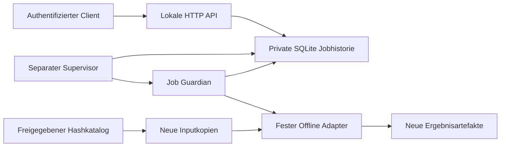

# C16 – Architekturentscheidung

Bestandsaufnahme vor Implementierung, 16.10.2026: `master` bei `1a02efc` enthält
C10–C13 (PRs 61–64). C14 ist als UI-PR 1 gemergt; dessen veröffentlichter
Job-Control-v1-Vertrag dient als Referenz. C15/PR 65 ist noch offen und wird
nicht als vorhandener Master-Code importiert oder vorausgesetzt.

`api/Dockerfile` referenziert nicht vorhandene requirements/fastapi_main-Dateien;
das FastAPI-Beispiel in chroma_helper ist kein implementierter Controller.
FastAPI/Uvicorn sind weder Basisdependencies noch in der vorhandenen Umgebung
installiert. Das SQLite-Skript enthält nur einen URI. Checkpoint-/Material-
Receipts und deren sichere Publikationshelfer sind vorhanden, keine gemeinsame
Jobdatenbank. Bestehende PDF-/Smoke-Worker nutzen begrenzte Subprozesse.

| Vorhandene Komponente | Befund und Verwendung in C16 |
| --- | --- |
| `src/tools_materials/processing.py` | `make_plan`, `MaterialPlan.select`: tatsächlicher Planungsadapter und read-only Startupindex |
| `src/tools_materials/storage.py` | vorhandenes `save_model` für neue Planartefakte |
| `src/model_discovery/cs50.py` | bestehender `CourseId` statt eigener Kursmodellierung |
| C10: `scripts/cs50_material_quality.py`, `src/model_materials/{materials,quality}.py` | unveränderter Offline-CLI; vorhandene Normalized-/Receipt-/Reportverträge |
| C11: `scripts/evaluate_math_formulas.py`, `src/tools_evaluation/` | gemergtes separates Evaluationspaket, kein dritter aktivierter Jobadapter |
| C12: `src/tools_knowledge/consolidation_run.py` | gemergte Konsolidierungslogik, bleibt deaktiviert |
| `src/tools_knowledge/cs50_checkpoint.py` | `JobIdentity` und Receipts sind an Knowledge-Chunks/Provider gebunden; kein allgemeiner API-Jobstatus; keine Änderung dieses Vertrags |
| C13: `src/tools_materials/{visual_inventory,visual_worker}.py` | gemergte offline Provenienz-/Visualinventur; keine automatische Aktivierung |
| `src/tools_materials/pdf_worker.py`, `scripts/cs50_llm_smoke.py` | bestehende begrenzte Einzelprozesse; keine gemeinsame persistente Jobqueue oder HTTP-Autorisierung |
| `src/core/config.py` | Pydantic-Konfiguration mit produktiven `.env`-Pfaden; C16 verwendet Pydantic mit expliziter externer JSON-Datei, ohne Environment-/Secretladen |
| `scripts/start_sqlite.sh` | vorhandener URI-Starthelfer; keine geeignete Jobhistorie, keine produktive DB-Adoption |

Vorhandene Material-/Checkpoint-Zustände bleiben fachliche Runnerverträge.
Die neue Jobhistorie enthält darüber ausschließlich Ausführungskontrolle und
Artefaktreferenzen. Runner-stdout wird nicht als vermeintlich strukturiertes
Statusprotokoll übernommen; feste Zustandsereignisse und originale Reports
liefern die verlässlich verfügbaren Informationen.

Entscheidung: lokale, ausschließlich an Loopback gebundene HTTP-Transportgrenze
mit Python-Standardbibliothek, Pydantic-Verträge und eine neue private SQLite-
Jobdatenbank. Keine neue Dependency oder Migration. HTTP führt keine Jobs aus;
ein separat gestarteter einzelner lokaler Supervisor begrenzt Ausführung und
Parallelität. Linux-Prozessgruppen, Parent-death-Signal und Subreaper dienen
kontrollierter Beendigung. Prozesse werden niemals anhand beliebiger gespeicherter
PIDs beendet. API-Neustarts verändern den unabhängig laufenden Executor nicht.

Nur bestehende Materialplanung und C10-Qualitäts-CLI werden ausgeführt.
Benutzer wählen ausschließlich opaque Katalogreferenzen und validierte Scopes.
Eingabedateien werden hashgebunden in neue Jobverzeichnisse kopiert. Vorhandene
Material-/Knowledge-Modelle bleiben unverändert. Weitere Runner bleiben deaktiviert.

Der HTTP-Adapter ist ein lokaler Startweg, keine Produktionsfreigabe des
stdlib-HTTP-Servers. Ein späterer TLS-/Ingress-/Servicebetrieb benötigt eine
eigene Freigabe. Unterschiede zum C14-Fake-Vertrag und C15-Anbindung werden
zusammen mit API, Wiederanlauf und Betriebsgrenzen dokumentiert.

Zum Abschluss wurde C15 inzwischen als PR 65 gemergt. C16 basiert auf dem
aktuellen `master` bei `b58f63c`; der echte C15-Metrics-Validator wird damit
verwendet und zusammen mit C16 getestet. Die anfängliche offene PR-Referenz
bleibt als historischer Bestandsaufnahmezeitpunkt kenntlich.

