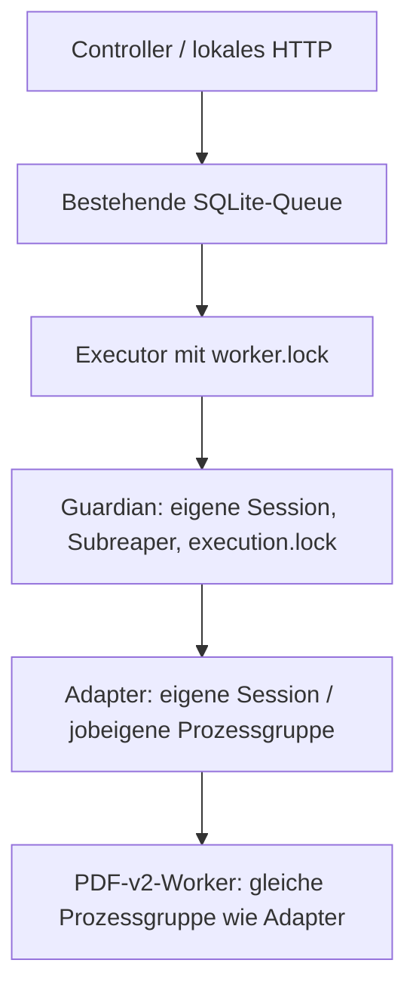

# C19 – PDF-v2 unter C16 und C18

Stand: 16.10.2026; Ausgangspunkt ist `master` `c1007ef` (nach C17.0).
Keine neue Parserimplementierung, Datenbank, Dependency oder zweite Workflow-Engine.

## Prozesshierarchie und Befund



Der API-Prozess startet und beendet keine Payloads. Der Executor besitzt seinen
direkten Guardian; dieser besitzt den unreaped Gruppenführer Adapter und sammelt
als Linux-Subreaper dessen verwaiste Nachfahren ein. Nur diese lebende direkte
Kindidentität wird zum Signalisieren verwendet. Keine PID aus SQLite oder einem
früheren Lauf dient als Killziel.

Vor C19 verwendete `parse_pdf.run_worker` immer `start_new_session=True`. Damit
lag PDF außerhalb der vom C16-Guardian bereinigten Gruppe. Zusätzlich versuchte
`pdf_worker.main` sein Dateigrößen-Hardlimit auf 64 MiB anzuheben, obwohl C16
bereits 8 MiB erlaubte. Beides verhinderte einen verlässlichen integrierten Pfad.

Jetzt setzt nur der feste C16-Adapter den internen `job_worker_scope`. In diesem
Kontext erbt PDF die Adaptergruppe und erhält vor `exec` zusätzlich
`PR_SET_PDEATHSIG=SIGKILL`, einschließlich Parent-Raceprüfung. Weder HTTP-Parameter
noch Environmentvariablen können diesen Kontext wählen. Der feste PDF-Worker
startet selbst keine weiteren Programme. Guardian-Gruppenbereinigung deckt auch
Nachfahren ab; ein Worker-Walltimeout beendet zunächst das direkte unreaped Kind.
Erst der Guardian bestätigt das Ende des Jobs einschließlich seiner Nachfahren.

Direkte PDF-/C13-Aufrufe außerhalb C16 behalten die bisherige eigene Workergruppe
und deren Timeout-Gruppenbereinigung. Eine Parent-Crash-Garantie für diese
Standalone-Aufrufe wird hier nicht neu freigegeben. C13 bekommt keinen Jobadapter.
Text-/Code-/Bildklassifikation und Normalisierung bleiben unverändert. Die einzige
Änderung im nativen PDF-Worker begrenzt Ressourcen auf das jeweils strengere
konfigurierte oder geerbte Hardlimit.

## Freigegebene Pfade und Grenzen

| Pfad | Freigabe |
| --- | --- |
| C16 `material_parsing` | Nur PDF-v2, `pdf_enabled=true` und ausdrücklich genehmigter `pdf_bundle` |
| C18 `material_parsing` | HTML-v2, Code-v1 sowie PDF-v2; ausdrücklich genehmigter `workflow_bundle`, `workflows_enabled=true` |
| Andere Parserversionen / freie Skripte / freie Hostpfade | Nicht freigegeben |
| Downloads, Transkription, OCR, Visual-Enrichment-/Knowledge-Providerjobs | Nicht freigegeben |
| C17-UI für diese optionalen Prozesse | Weiterhin separater Integrationsschritt; eigenes C16-Profil verwenden |

Die zwei Defaultadapter bleiben unverändert sichtbar. Ohne Opt-in wird der neue
Einzeladapter weder angeboten noch akzeptiert; vor Dispatch wird die aktuelle
Freigabe erneut geprüft. `process_for` kennt den Vertrag zur Validierung alter
Jobmetadaten auch bei inzwischen deaktivierter Ausführung.

Einzel-PDF: höchstens 1 MiB Raw, 20 Seiten, 2.000 Blöcke, 20 Bildreferenzen,
10 s Worker-Wallzeit, 512 MiB Workeradressraum. C16: 30 s Wallzeit, 20 s CPU,
768 MiB Adressraum, 8 MiB pro Datei, 64 Deskriptoren, keine Core-Dumps.
C18 bleibt bei höchstens drei Materialien / 13 Stufen, 90 s Job-Wallzeit und
60 s CPU. Für PDF übernimmt es dieselben Workergrenzen; Byte-/Blocklimits können
durch seine bestehende Definition nur strenger werden.

Für PDF-Einzeljobs und den optionalen Workflow beträgt das feste `RLIMIT_NPROC`
512 statt 32. Linux zählt dabei **alle Threads des UID**, nicht Kinder eines Jobs;
32 kann daher einen einzelnen erlaubten Worker bereits am Fork hindern. Die zwei
Defaultadapter bleiben bei 32. 512 ist keine Freigabe für 512 Jobs oder beliebige
Programme: bestehende Queuegrenzen, maximal zwei laufende Jobs, höchstens ein Job
je Process-ID und die feste sequenzielle Workerstruktur bleiben maßgeblich.
Auch 512 kann auf einem stark belegten UID fehlschlagen; es gibt keine automatische
Erhöhung. Dies ersetzt keine späteren dedizierten UID-/cgroup-/Servicegrenzen.

## Einzeladapter: Eingabe und Ausgabe

Bestehende Endpunkte: `POST /v1/previews`, anschließend `POST /v1/jobs` mit
bestätigtem Preview und Idempotency-Key; Start/Cancel/Status wie bisher.

```json
{
  "schema_version": 1,
  "process_id": "material_parsing",
  "parameters": {
    "material_ref": "approved_pdf",
    "course_id": "cs50_python",
    "output_name": "pdf-receipt"
  }
}
```

`Settings.pdf_enabled=true`, `execution_enabled=true`, Operator- und Coursegrant
sowie ein vorhandener Worker sind notwendig. `PdfParams` akzeptiert keine Pfade,
Kommandos, URLs oder Parseroptionen. Das Modell steht im
[versionierten Transportvertrag](contract.v1.json).

Der private Operatorkatalog enthält `kind=pdf_bundle`, einen ausdrücklich
genehmigten absoluten Inputroot, Coursegrants, SHA-256 aller Dateien und exakt
die Rollen `raw` und `receipt`. Ihre Pfade müssen dem vorhandenen Layout
`<material-hash>/raw/source` und `<material-hash>/receipt.v1.json` entsprechen.
Erforderlich ist ein bestehender verifizierter `ArtifactReceipt` mit passendem
Binding/Rawhash. Kein Download oder neuer Receipt aus bloßer Dateinamensvermutung.
Bei `completed` müssen zusätzlich die referenzierte normalisierte Datei und alle
Bilddateien im Hashkatalog stehen; `MaterialProcessor.inspect` prüft sie gegen
Schema, Provenienz, PDF_CONFIG und Hashes. Andere Zwischenzustände oder fremde
Zusatzdateien werden abgelehnt. Ein abweichender früherer Parserconfig benötigt
eine neue ausdrücklich vorbereitete Generation.

Preview liest nur. Dispatch prüft die genehmigten Bytes erneut und kopiert sie
exklusiv nach `jobs/<job_id>/inputs`. Der Adapter kopiert diesen Snapshot in das
neue `results/materials` und ruft **`MaterialProcessor.parse`** auf. Der Original-
Receipt und Originalbytes bleiben unverändert. Bestehende vollständige Ausgaben
werden dort erneut inspiziert und übernommen; ungültige Ausgaben sind ein Fehler.

`results/<output_name>.json` ist der vorhandene `ArtifactReceipt`, kein neues
fachliches Reportmodell. Der C16-Artifacttyp ist `material_receipt` mit Job-ID,
Inputref, SHA und Größe. Der Receipt verweist relativ zu `results/materials` auf
Normalized/Bilder; Raw liegt im bestehenden Materiallayout. Normalized enthält
originale Course-/Lecture-/Resource-/Materialbindung, Parserconfig, Rawhash,
Blöcke, Bildbelege und Warnungen. Der Receipt enthält den Normalizedhash.
Artefaktbytes verbleiben im privaten Workspace; C16 bietet weiterhin nur
Metadaten und keine neue beliebige Datei-Downloadroute an.

## Cancel, Timeout und Recovery

| Ereignis | Bestätigter Zustand / Nachweis |
| --- | --- |
| Erfolg | Exit 0, `completed`, vorhandener gehashter Receipt |
| PDF-Worker-Walltimeout | Exit 4, `failed`, `error_class=timeout`, feste Meldung `PDF worker timeout` |
| Job-Walltimeout | Guardian beendet seine Gruppe, `failed`, `error_class=timeout`, `Execution timeout` |
| Cancel während PDF | Zuerst `cancel_requested` ohne Endzeit, nach Gruppenbereinigung `cancelled` |
| Zweiter Cancel während Anfrage | Derselbe Jobzustand; kein zweites Killziel |
| Cancel nach Abschluss | Bestehender 409-Konflikt; kein Start/Signal |
| Executor SIGKILL / Parentverlust | Parent-death-Kette, Guardianbereinigung und `interrupted`; keine automatische Wiederholung |
| Neustart | Vorheriger Lifecycle-Lock muss frei sein; keine alten PIDs signalisieren; kein automatischer Dispatch terminaler Jobs |
| Bereinigung nicht bestätigbar / Guardianverlust | Bestehende Quarantäne sperrt weitere Starts; keine erfundene Erfolgsbestätigung |

C18 setzt keine zweite Prozesskontrolle auf. Seine vorhandene Parse-Stage nutzt
denselben `MaterialProcessor`, dieselbe PDF-Policy und den C16-Kontext. Abhängige
Quality-/Handoff-Stufen laufen nur nach bestätigtem Parse. Bei Worker-Timeout
bleibt der konkrete `TimeoutExpired`-Klassenbefund im Stufenreport; der Job meldet
Timeout. Bei hartem Abbruch projiziert der Statusabruf den bestätigten C16-Zustand.
Ein explizites Resume erhält abgeschlossene Import-/Planbelege und erzeugt für
unvollständige oder stale Stufen neue Job-/Stagepfade. Teiloutputs werden nicht
als erfolgreich übernommen. Alle bewährten Hash-/Schema-/Provenienz-/Skipregeln
bleiben aktiv.

## Monitoring, Beispiel und nächste Integration

C15 verwendet für Einzel-PDFs den bereits vorhandenen endlichen Prozesswert
`material_parsing`; es gibt keine neue Labeldimension. Echte Starts, laufende
Versuche, bestätigte Success/Failure/Cancelled, Laufzeiten und Fehlerklasse
`timeout` kommen aus dem bestehenden Jobjournal. Interrupted wird nicht als
bestätigtes Failure oder Success umgedeutet. C18 zählt weiter den übergeordneten
`cs50_offline_workflow`; keine erfundenen PDF-Einzeljobs oder Stagecounter.
Keine Prometheus-/Grafana-Konfiguration wird aktiviert.

```bash
python -m scripts.cs50_workflow_demo --pdf --output /tmp/c19-new-pdf-demo
```

Das neue externe Ziel enthält ausschließlich synthetische Eingaben, die
Konfiguration, einen echten C16/C18-Lauf mit fünf Stufen und JSON/Markdownreport.
Existierende Ziele werden abgelehnt. Der normale Demoaufruf ohne `--pdf` bleibt
der bisherige HTML-/Code-Lauf. Ein tatsächlicher PDF-Beleg ist unter
[PDF-Beispiel JSON](../workflows/example-pdf-report.v1.json) und
[Markdown](../workflows/example-pdf-report.v1.md) eingecheckt.
[Testbericht und Grenzen](pdf_validation.md).

Nächster Schritt: die optionalen PDF-/Workflow-Capabilities im separaten C17-UI-
Vertrag abbilden, einschließlich Preview, Stale-/Resume-/Cancelzuständen und
privaten Artefaktmetadaten. Reale PDF-Qualität und spätere Visual-/Knowledge-
Verarbeitung benötigen eigene geprüfte Eingaben und explizite Freigabe.
