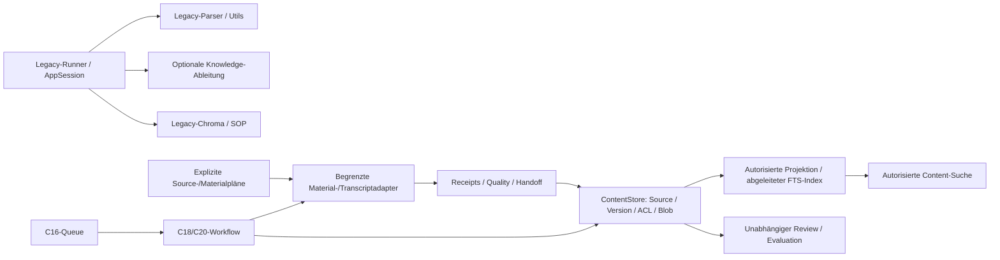

# MAINT-03 – Architekturreview und Konsolidierungsgrenzen

Geprüfte Basis und aktive Stränge: [Inventar](maint03_legacy_inventory.md).
Codebefunde: [Risikomatrix](maint03_risk_matrix.md). Dies dokumentiert Iststand und
Vorschläge; keine Änderung bestehender ADRs, Autorisierung oder Produktionsfreigabe.

## Iststruktur

Die aktuelle Architektur hält Raw Sources, Parsed Content und Derived Knowledge
getrennt. Legacyrunner und neue kontrollierte Adapter existieren daneben. Ihre
ähnlichen Namen begründen keine Austauschbarkeit.

Der Graph ist eine vereinfachte Verantwortlichkeitsübersicht. Er behauptet weder
vollständige Runtimeverdrahtung noch eine Integration der offenen C26-/C27-Drafts.
`content_store` bleibt Datenautorität; FTS/Vektoren sind abgeleitet. `job_control`
behält die einzige Queue. Der Reviewstore besitzt seine eigene Aufgabe und
entscheidet nicht über Deploymentfreigaben.

## Parsing und Dokumentverarbeitung

Legacy-`model_parsing`/`tools_parsing` verwendet eigene Element-/Seitenmodelle,
FeatureEnricher, globale Konfiguration, Dateinamen und teilweise freie URLs.
`tools_materials.parse_html`, `parse_pdf`, `parse_code` erzeugen dagegen
versionsgebundene `NormalizedDocument`-Blöcke mit Hash-/Locator-/Receiptbindung.
Das alte Reinigen von Whitespace oder Mergen von Text ist keine zulässige
Ersatzimplementierung für exakte Originalanker.

Empfehlung: zunächst Adapter mit explizitem Legacyinput-/Output-Schema und
unverändertem Altoutput charakterisieren. Neu importierter Content erhält eine
eigene Parserkonfiguration/Version; bestehende IDs, Receipts und Dokumente werden
nicht umgeschrieben. URL-/DOCX-Reparaturen gehören in kleine eigene Pakete.
Legacy-PDF/Wiki-Headingduplikate erst nach Modell-/Headingvergleich extrahieren.
Keine automatische Migration alter Artefakte und keine Parserabschaltung.

## Knowledge und RAG

Die Knowledgekette besitzt bereits reine Konsolidierung sowie getrennte
Validierungs-/Run-/Receiptmodule. Semantische/visuelle Schritte und Modelle sind
optional. Ihre Wiederverwendung darf keine SDK-/Secretinitialisierung in
Content-Reads erzwingen. Der konservative Evidencevertrag bleibt erhalten.

Legacy-Chroma/SOP, Transcript-Qdrant und Content-FTS sind drei verschiedene
Verträge. `tools_rag.chunk` kann Text strippen, Sätze segmentieren und Headings
hinzufügen. Die neue Indexprojektion bindet dagegen Source-/Parsed-Versionen,
Blockoffsets und aktuelle Rechte. Keine gemeinsame Abstraktion darf ihre
Identitäts- und ACLunterschiede verdecken. Hashhelfer mit `.strip()` und
Originalbytehashes sind ebenfalls nicht semantisch identisch.

Kleinster Konsolidierungskandidat: identische reine Recordbuilder aus
`run_record_upload` und `tools_rag.chunk` in ein SDKfreies Modul verschieben,
alte Namen mit kompatiblen Reexports erhalten. Vorher: gleiche Pydanticinputs,
Formeln, fehlende Metadaten, Payloadserialisierung und Imports in frischen
Prozessen testen. Keine Payloadschemaänderung oder automatische Indexierung.

## Jobs, Pipeline und CLI

Registry und Controller definieren erlaubte Prozesse und Parameter. Workflowstufen
laufen über vorhandene Jobs, mit eigener Resume-/Receiptbindung. Dass Registryeinträge
Runner als Strings nennen, muss in jeder Unused-Analyse berücksichtigt werden.
CLI-`main`/`if __name__` ist ebenfalls ein echter Einstieg.

Empfehlung: Runner langfristig auf Parsing von Parametern, explizite Konfiguration,
Aufruf eines Services und Exitcode reduzieren. Erst reine Plan-/Entscheidungslogik
extrahieren; Timeout, Cancel, Guardian, bestätigte Inputs und Idempotenz bleiben an
ihren vorhandenen Grenzen. Die großen Job-/Workflow-/Storagemodule werden hier
nicht zerlegt. Die gestapelten C26-D/E/F-Drafts dürfen nicht versehentlich doppelt
integriert werden; MAINT-03 bleibt direkt auf der geprüften Masterbasis.

## Konfiguration und Datenmodelle

R08 zeigt zwei gleichnamige, aber auseinanderlaufende Parsingmodellfamilien.
`core.config` koppelt sie zusätzlich an erforderliche Envwerte. Ein pauschaler
Importaustausch verändert Klassenidentität, Defaults und serialisierte Settings.

Migrationsvorschlag in getrennten PRs:

1. Beide Familien mit Feld-/Default-/Schema-/JSONroundtrips dokumentieren; historische
   Configs nur aus freigegebenen synthetischen Fixtures verwenden.
2. SDKfreie kanonische Modelle definieren, Abweichungen explizit adaptieren.
3. Alte Importpfade und Namen erhalten; Reexports nur bei nachgewiesener gleicher
   Semantik. Kein stilles Zusammenlegen der abweichenden PDF-/Logfelder.
4. Env-/Credentialkonfiguration ausschließlich an expliziten Runnereinstiegen
   auflösen; globale Session erst nach dokumentierter Übergangsphase ablösen.

## Persistenz, IO und Pfade

Legacy-`ensure_dir` errät anhand des Suffixes, ob ein Pfad Datei oder Ordner meint.
Die kleinen Fixes umgehen diese Heuristik für Dateilisten und Moves. Sie ändern
`ensure_dir` selbst nicht, weil zahlreiche Schreiber von dessen Verhalten abhängen.
Der Movefix hat eine sequenzielle Existenzprüfung und ist kein atomarer
No-Replace-Publisher für konkurrierende oder nicht vertrauenswürdige Writer.
Symlink-/Race-/Archivlimits werden nicht als neu gelöst ausgegeben.

ContentStore-/Index-/Checkpointfunktionen besitzen eigene strengere Root-,
Hash-, Lock-, fsync- und Veröffentlichungsverträge. Diese dürfen nicht durch den
Legacyhelper ersetzt werden. Eine spätere gemeinsame Persistenzschicht braucht
nachweislich gleiche Fehler-/Crash-/Konkurrenzsemantik, keine bloße APIähnlichkeit.
R19 belegt ein Abbruchfenster im Materialpublisher: vor dessen `finally` kann
ein temporärer Hardlink neben dem publizierten Receipt liegen bleiben. Der
Backupadapter sperrt diesen Zustand korrekt. Ein gemeinsamer Publisher muss
solche Crashreste durch einen expliziten geprüften Recoveryvertrag behandeln;
keine Aufweichung der Hardlinkgrenze oder automatische Löschung unbekannter Namen.
JSONlesen und Schreiben sind zunächst getrennt zu entkoppeln; freie `mode`- und
`cls`-Parameter erfordern einen eigenständigen Kompatibilitätsvorschlag.

## Fehler, Observability und sync/async

Die Retryklassifikation ist jetzt iterativ und zyklusfest. Statusmengen,
cause-vor-context-Präzedenz, Attemptbudgets und Backoff bleiben erhalten. Das ist
eine begrenzte Zuverlässigkeitskorrektur, keine zusätzliche Wiederholungsfreigabe
für nichtidempotente oder produktive Aktionen.

Legacylogging hängt häufig an `app_session.logger`; `core.logger` installiert
Rich-Tracebackhandling beim Import. JSONfehler können repr-Ausschnitte loggen.
Die aktuellen Job-/HTTPgrenzen redigieren Fehler separat. Empfehlung: fachliche
Fehlercodes und technische Diagnose trennen, Logger in Services injizieren und
synthetische Redactiontests vor einer neuen zentralen Fehlerklasse ergänzen.
Keine ungeprüfte Ausnahmevereinheitlichung über Content-, Job- und Reviewgrenzen.

`MarvinProvider.close()` setzt einen synchronen Kontext ohne laufenden Eventloop
voraus. Ein zukünftiges `aclose`/Async-Contextprotokoll braucht einen expliziten
Migrationsweg und Tests für Fehler, Cancel und Freigabe. Keine versteckte
Thread-/Loopverwaltung zur Umgehung der Vorbedingung.

## Importgraph und Teststrategie

Der vollständige Graph enthält sechs starke Zusammenhangskomponenten, weil auch
lokale Imports gezählt werden. Der eine syntaktische Top-Level-Zyklus enthält
einen `__main__`-CLI-Rückverweis. Nach Ausschluss von Main-/TYPE_CHECKING-Zweigen
gibt es keine zyklischen Mitglieder. Das ist ein statischer Befund, kein Beweis
aller dynamischen Importreihenfolgen. Frische Prozessimports, verbotene SDK-/Env-
Imports und konkrete Registry-/CLI-Smokes sind aussagekräftiger als ein pauschales
Verbot aller syntaktischen Rückkanten.

Die vorhandenen Tests prüfen viele moderne negative Grenzen: manipulierte Hashes,
fehlende Berechtigungen, unbekannte Schemata, Abbrüche, Wiederholung und Recovery.
Für Legacy-IO und Retry fehlten vergleichbare gezielte Fälle; die 34 neuen Fälle
decken die reparierten Grenzen ab. Keine Prozentabdeckung wurde gemessen.
Optional installierte Parser-/RAG-/LLMprofile bleiben getrennte Testvoraussetzungen.
Der Offline-Lauf ersetzt keinen echten Workerimage-/Browser-/Live-/Modellnachweis.

Der breite Lauf zeigte außerdem QA-Probleme, die in isolierten Tests verborgen
bleiben: globale umask-Änderungen, Modulcache-Purges mit verschiedenen Identitäten
gleichnamiger Pydanticmodelle und eine Listenpositionsannahme für UUID-sortierte
Recoveryruns (R18). Modell-/Konfigurationskonsolidierung benötigt daher zuerst eine
stabile Testbasis. Die elf ursprünglichen Fehler, fünf reproduzierten Baselinefehler
und zusätzlichen Zustandsprobes bleiben in der Validierung getrennt sichtbar.
