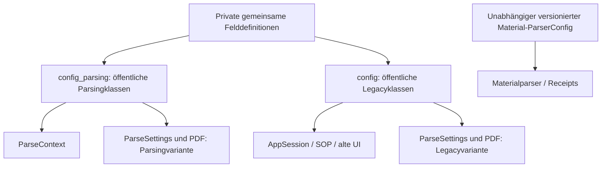

# MAINT-04 – Zielarchitektur und Entscheidung

C26 **HOLD**. [Inventar](maint04_configuration_inventory.md),
[Kompatibilität](maint04_compatibility_matrix.md),
[Migration](maint04_migration_guide.md).

Die kanonische **Feldquelle** ist `src/core/_parsing_settings.py`; der bevorzugte
SDK-/Env-freie öffentliche Einstieg bleibt `src.core.config_parsing`.
`src.core.config` bleibt die Legacyoberfläche mit ihrem bisherigen Vertrag und
ihren bisherigen Envabhängigkeiten. Eine einzige öffentliche Klassenidentität ist
kein Ziel dieses kompatibilitätserhaltenden Schritts.

Zehn kleine Pydantic-Basen halten gemeinsame Feldgruppen, keine Registrierung,
Metaklassen, dynamische Fabrik oder abstrakte Pipeline. Öffentliche nominale
Unterklassen erhalten Namen und `__module__`. Mehrfachvererbung kombiniert bei
DOCX/HTML/Notebook/Wiki und PDF-/Wiki-Generalsettings die jeweilige Feldgruppe mit
der **familieninternen** Dateibasis. Feldreihenfolge, Schematitel, Defaults und
Instanzablehnung sind gegen die vorher eingefrorenen Verträge getestet.

Neun leere Unterklassen je Familie sind bewusst vorhanden: Ihre Identität und
Vererbung sind Teil der Kompatibilität. GeneralSettings hält seine acht lokalen
Typen/Defaultfactories; ein gemeinsamer fremder Factorytyp würde den Dumpvergleich
bestehen, aber Python-/Pydanticverhalten verändern. ParseSettings und
ParsePDFSettings behalten ihre abweichenden eigenen Definitionen. Keine
stillschweigende Umdeutung von Loggingfeldern oder PDF-Flags.

Ein direkter Re-Export wurde verworfen: Heute lehnen gleichnamige Klassen die
Instanzen der jeweils anderen Familie ab. Ein Re-Export oder die Ableitung einer
öffentlichen Familie von der anderen würde diesen Annahmebereich erweitern.
Die gemeinsamen **privaten** Basen sind dagegen Geschwistervorfahren beider
öffentlichen Familien. Exakte MRO und Feldherkunft ändern sich; reflektierende
Erweiterungen brauchen Review. Es gibt keine pauschale Vollkompatibilitätszusage.

Settings beschreiben serialisierbare Optionen. ParseContext enthält aktuelle
Pfade, IDs, Backend und Encoding; AppSession enthält außerdem Logger und globalen
Zustand. Diese Laufzeittypen werden nicht in einen neuen Settingsvertrag gezogen.
Die bestehende Vermischung einzelner Dateinamen/Logfelder bleibt aus Gründen der
Persistenzkompatibilität erhalten. Env-/Credentialauflösung am expliziten Runner
ist eine gesonderte Migration; MAINT-04 verändert nicht deren Initialisierungszeit.

Die bisherigen beiden Verträge sind unversioniert. In der Dokumentation heißen
sie **legacy-unversioned** und **parsing-unversioned**; dies sind keine neuen
akzeptierten Payloadfelder. MAINT-04 fügt weder schema_version noch einen
Discriminator hinzu. Für eine spätere Version empfiehlt sich ein expliziter
Envelope mit Formatkennung, Vertrag und Settingspayload; alte Reader dürfen ihn
nicht automatisch erhalten. Vor Implementierung müssen Altbestand, Reader,
Fehlertypen, Hashes, Defaultsemantik und Opt-in gemeinsam reviewt werden.
Der Material-ParserConfig hat bereits eigene Name-/Versions-/Hashbindung und
bleibt davon unabhängig.

Erweiterungspunkte: Parseroptionen nur im richtigen öffentlichen Vertrag ergänzen;
gemeinsame Felder nur nach Tests beider Familien in die privaten Basen aufnehmen.
Domainunterschiede bleiben in den öffentlichen Varianten. Kontext-/SDKobjekte
werden explizit injiziert. Direkte Importe privater Feldbasen und Änderungen an
`model_fields`/`model_config` bestehender Klassen sind keine unterstützte
Erweiterungs-API. Bestehende externe Nutzung solcher Muster muss vor weiterem
Abbau der nominalen Klassen erhoben werden.

MAINT-05 sollte in getrennten Reviewpaketen (1) den Workflowkurs-/Schemakonflikt
entscheiden, (2) ein kleines echtes SDK-/DOCXprofil samt Legacyimport-Smokes und
versioniertem explizitem Konfigloader bereitstellen und (3) phasenbezogene
Guardian-/SQLite-/Hardlinkdiagnostik verbessern. Keine automatische Recovery,
kein neuer Retry und keine Lockerung der Publikations-/Quarantänegrenzen.
