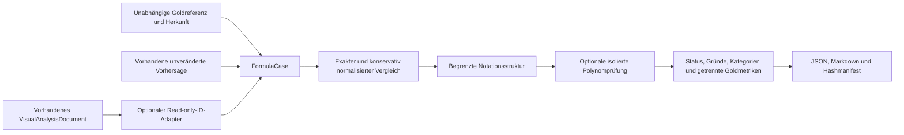

# C11 – Mathematical Document & Formula Reconstruction Evaluation

Stand: 16.10.2026. Basis: aktueller `master`, `09f7384` (einschließlich PR #61).
Die Implementierung entstand unabhängig von C10 auf `90f4ade` und wurde vor
Veröffentlichung auf den inzwischen aktualisierten Master übernommen.
Dies ist ein Offline-Evaluationspaket für vorhandene Formelpaare. Es startet weder
PDF-Parsing noch Visual Enrichment, LLMs, OCR oder Knowledge-Extraktion.

## Architektur und tatsächlich verfügbare Ausgaben

| Bestehende Komponente | Implementiert / Ausgabe | Aussage und Grenze |
|---|---|---|
| `tools_materials/parse_pdf.py`, `pdf_worker.py` | Begrenzter PyMuPDF-Worker; `NormalizedDocument` mit `Block.text`, Typ, `Location(page,bbox)`, Raw-Hash und Parserkonfiguration | PDF-v2 klassifiziert Python/Mathe heuristisch. Keine Rekonstruktion verlorener mathematischer Semantik oder LaTeX-Konvertierung |
| `model_parsing/pdf_extractor.py`, `feature_enricher.py` | `PDFCleanExtractor`, `PDFPageExtract` sowie Schrift-, Layout-, Wort-/Zeilen-/Blockmerkmale | Allgemeiner bestehender PDF-Pfad, kein mathematisches Gold-Evaluationssystem |
| `utils/docling_helper.py`, `tools_knowledge/rebuild_knowledge.py` | `get_docling_image_converter`, `analyze_frame_with_docling`, `DoclingFrameResult(text,formulas,path,section_id,source_time)` | OCR/Formelanreicherung über Docling ist implementiert und kann Modelle benötigen; wird für C11 nicht aufgerufen |
| Derselbe Visual-Pfad | `analyze_visual_batch_locally`, `LocalVisualBatchResult` | Abgleich normalisierter Text-/LaTeX-Varianten mit OCR-/Formula-Frames; kein unabhängiger mathematischer Beweis |
| `analyze_visual_batch`, `finalize_visual_result` | API-Aufruf und Bindung an `VisualKnowledgeResult`, `VisualExpression`, `VisualVerificationItem` | Vorhersage-LaTeX, Plaintext, Abschnitt/Batch/Expression-ID, Zeitreferenzen, Ambiguität, Modellurteile; kein Gold |
| `postprocess_visual.py` | Escape-Reparaturen, einfache LaTeX-Prüfung, kanonische Items, `EvidenceItem` und `CanonicalKnowledgeDocument` | Verändert Kopien / kanonische Knowledge-Inhalte. C11 ruft diese Reparatur- und Verifikationsfunktionen nicht auf |
| `find_knowledge.py`, `cs50_precise_evidence.py`, `consolidate_knowledge.py` | `MathExpression`, `ConsolidatedMathExpression`, zeitbasierte `KnowledgeEvidence`, Segment-/Chunkreferenzen | Vorhandene Extraktions-/Evidence-Verträge. Confidence oder `verification_status=verified` werden nicht als Gold übernommen |
| `utils/latex_helper.py` | `normalize_latex`, `normalize_math_text`, `validate_latex_basic` | Bestehende produktive Hilfen bleiben unverändert. NFKC/Casefold und Reparaturen sind für eine unabhängige, operatorerhaltende Evaluation zu weitgehend |

Ein allgemeiner Runner existiert als `run_knowledge_improvement.py`. Seine aktuelle
Verdrahtung ist jedoch nicht als vollständig funktionsfähig nachgewiesen: Er
importiert `analyze_visual_with_retry`; das Implementierungsmodul bietet
`analyze_visual_batch_with_retry`. Dieser Befund wird dokumentiert und nicht im
Evaluationsauftrag repariert. Die im Visual-Modul kommentierte Entwicklung einer
Verification-Score-/Cross-Batch-Metrik ist Planung, keine implementierte Gold-Metrik.

**Reale vorhandene Datei:** Im bestehenden lokalen Arbeitsverzeichnis wurde
`data/2026-08-29_14h-26M_visual_analysis.json` read-only untersucht: 48.954 Bytes,
SHA-256 `86ed6f706ed128f683b7e29dde235bd14febc56a4dd44a3d254c8902722e1958`,
Wurzelschlüssel `results`, sechs Batchobjekte. Sie ist nicht versioniert und liegt
nicht im neuen Checkout vor. Das aktuelle `VisualAnalysisDocument` erwartet
`local_results`/`api_results`; sein permissiver Legacy-Leser würde `results`
ignorieren. C11 lehnt diese Form deshalb ausdrücklich ab. Die Datei wird weder
migriert noch als unabhängige Referenz oder Qualitätsergebnis veröffentlicht.
Andere lokale extrahierte JSONs sind ebenfalls keine geprüften Goldreferenzen.

Versionierte CS50-Snapshots und Parserregressionen existieren; unabhängig annotierte
mathematische Original-/Vorhersagepaare sind darin nicht nachgewiesen. Der C11-
Report enthält daher **0 reale Goldfälle**, ohne daraus eine reale Qualitätsquote
abzuleiten. Es wurden keine Kursunterlagen oder Modelle heruntergeladen.



Neue Module: `model_evaluation/math_evaluation.py` und
`tools_evaluation/{math_syntax,math_equivalence,sympy_worker,evaluate_math,math_predictions,math_reports}.py`.
CLI: `scripts/evaluate_math_formulas.py`, entsprechend den vorhandenen
Argparse-Skripten. Die bestehenden `DiscoveryModel`-/`NonEmpty`-Verträge,
`VisualAnalysisDocument` sowie `safe_path`/`publish_bytes` werden wiederverwendet.
Keine parallelen PDF-, Visual-, Quellen- oder Knowledge-Modelle.

## Ein-/Ausgabeverträge und Goldreferenzen

`FormulaCase`, Schema **1**, verlangt `case_id`, `source_document_id`, mindestens
`page` oder `section`, `source_reference`, `gold_origin`, `reference_status`,
`reference_formula`, `predicted_formula` und `formula_format`.
`gold_origin` ist `synthetic` oder vom Anwender unabhängig belegtes `real`.
`reference_status` ist `confirmed`, `absent` oder `ambiguous`. `null` bedeutet eine
fehlende Formel; leere/whitespace-only Strings sind ungültig. Unbekannte Formate
können als String eingelesen werden und führen zu `not_evaluable`.

`source_reference` benennt die **unabhängige Goldquelle**, keinen Modelltext.
`evaluation_notes` erhält Referenz-/Reviewhinweise. `prediction_reference` und
`prediction_sha256` binden optional eine vorhandene Vorhersagedatei. Mit
`prediction_ambiguous=true` wird eine unsichere Vorhersage nicht entschieden.

`reference_parts` erlaubt ausschließlich unabhängig annotierte echte **proper
subexpressions** der Referenz. Sie sind nötig, um teilweise rekonstruierte Inhalte
zu bewerten, ohne aus beliebiger Zeichenähnlichkeit Teilrichtigkeit abzuleiten.
Die Prüfung des Goldrubriks erfolgt unabhängig davon, ob eine Vorhersage vorliegt.
Beispiel: Bei `\frac{x+1}{2}` kann `x+1` als separat annotierter korrekter Zähler
Teilpunkte erhalten; die vollständige Formel ist weiterhin nicht rekonstruiert.

[gold_references.v1.json](gold_references.v1.json) enthält 25 eigenständig erstellte
Quellstimuli, darunter Leerstellen und eine unklare Notation. Der separate
[Datensatz](formula_cases.v1.json) enthält 42 absichtlich verfasste Vorhersagen:
binomische Formeln, lineare/quadratische Gleichungen, Brüche, Potenzen/Wurzeln,
Summen, Integrale, Vektoren, Indizes, falsche Operatoren/Exponenten, äquivalente
Darstellungen, Teilformeln und nicht unterstützte Syntax. Die Referenzen wurden
nicht aus Vorhersagen, OCR, LLM-Urteilen oder den zu bewertenden Ausgaben gewonnen.
Die positiven Gleichheitsfälle sind absichtliche synthetische Kontrollfälle.

```json
{
  "schema_version": 1,
  "case_id": "fraction-part",
  "source_document_id": "synthetic:math-reference-sheet-v1",
  "section": "G06",
  "source_reference": "docs/math_evaluation/gold_references.v1.json#/references/G06",
  "gold_origin": "synthetic",
  "reference_status": "confirmed",
  "reference_formula": "\\frac{x+1}{2}",
  "predicted_formula": "x+1",
  "formula_format": "latex",
  "reference_parts": ["x+1"]
}
```

JSON-Datasets: `{"schema_version":1,"cases":[...]}`. JSONL: ein vollständiger
versionierter Fall je nicht leerer Zeile. Doppelte IDs/JSON-Schlüssel, ungültige
Kodierung, fehlende Provenienz, NaN und Schemafehler werden zurückgewiesen.
Maximal 1.000 Fälle und 8 MiB Eingabe; pro Formel 2.048 Zeichen, 256 Tokens und
24 Verschachtelungsebenen. Auswahl verändert die Quellreihenfolge nicht.

`FormulaResult` erhält den vollständigen Fall und liefert `evaluation_status`,
Exact-/Normalized-/Structural-Matches, normalisierte Vergleichsansichten,
`equivalence(status,backend,reason,backend_version)`, `error_categories` und Notes.
Keine Originalformel wird verändert oder in ein Knowledge-Objekt zurückgeschrieben.

## Bewertungsstufen und unterstützte Syntax

1. **Exakt:** Zeichenvergleich der unveränderten Formelstrings.
2. **Normalisiert:** NFC, konservative Whitespace-/Math-Delimiter-Behandlung,
   explizites Unicode-Minus, Multiplikationszeichen, griechische Varianten und
   hoch-/tiefgestellte Ziffern. Keine Kleinschreibung/NFKC; `x²` wird niemals `x2`.
   Befehlsgrenzen und getrennte Zahlen bleiben erhalten. `+`/`-`, Exponenten,
   Indizes und Division werden nicht entfernt.
3. **Struktur:** Ein begrenzter Notationsbaum erhält Symbole, Zahlen und die
   Operatorhierarchie. Bei explizitem `\vec` bleiben Skalar- und Kreuzprodukt
   (`\cdot`/`\times`) verschieden; reine Skalarmultiplikationsvarianten dürfen
   dagegen übereinstimmen. Redundante Gruppierung sowie `\frac{a}{b}` und `a/b` können
   strukturell übereinstimmen; Algebra wird hier nicht umgeordnet.
4. **Äquivalenz:** Identische unterstützte Strukturen gelten als identische
   Rekonstruktion. Verschiedene Strukturen bleiben ohne explizite Symbolikprüfung
   unentschieden. Eine identische Vorlage beweist nicht, dass ihre mathematische
   Aussage als Theorem richtig ist.

Unterstützte Struktur: ganze Zahlen bis sechs Ziffern, einzelne lateinische
Variablen, explizit gelistete griechische Symbole, `+ - * / =`, implizite Produkte,
unäre Vorzeichen, `{}`, `()`, `[]`, `\frac`, `\sqrt`, `\vec`, `\sum`, `\int`,
`^` und `_`. Summen-/Integralgrenzen werden als Notation erhalten. LaTeX-
Abstandscommands `\,`, `\;`, `\!`, `\quad`, `\qquad` sind Layout; `\left`/
`\right` werden nur für unterstützte Klammern behandelt. Ungeklammerte Scripts
haben genau ein Ziffern-/Buchstabentoken; längere Werte brauchen `{...}`.

Matrizen/Align-Umgebungen, Funktionsnotation wie `\sin`, beliebige Befehle,
Dezimalnotation, Bedingungen, mehrfache Gleichheitsketten und unbekannte Zeichen
werden ausdrücklich nicht bewertet. Bei `f(x)` ist Funktion versus Produkt
unklar; für ein Produkt muss `f*(x)` verwendet werden. Unicode-/Whitespace-
Normalisierung macht unbekannte Syntax nicht bewertbar. Ein exakter Stringmatch
kann deshalb gleichzeitig mit `evaluation_status=undetermined` auftreten.

Statusregeln:

| Status | Nachweis |
|---|---|
| `correct` | Unterstützte identische Struktur, bewiesene Äquivalenz im angegebenen Teilbereich oder bestätigte Leerquelle ohne zusätzliche Formel |
| `partially_correct` | Exakte Rekonstruktion einer unabhängig annotierten echten Teilformel; keine Äquivalenzbehauptung für die Gesamtformel |
| `incorrect` | Syntaktisch unterstützte Notation, aber bewiesene Nichtäquivalenz im formal festgelegten Teilbereich |
| `missing_formula` | Bestätigte Goldformel, keine Vorhersage |
| `extra_formula` | Explizit bestätigte formelfreie Quelle, zusätzliche Vorhersage |
| `undetermined` | Ambiguität, unbekannte/defekte Syntax, nicht angeforderte Symbolik, Definitionsbereich oder Ressourcenlimit verhindern eine Entscheidung |

## Optionaler SymPy-Teilbereich und Isolation

SymPy 1.14.0 war in der bestehenden Umgebung vorhanden. Es ist **keine neue
Projektdependency**. Standard ist `--equivalence none`; mit `sympy` erfolgt ein
isolierter Aufruf des installierten Pakets. Fehlt es, lautet das Ergebnis
`undetermined / sympy_unavailable`. Kein Installations- oder Downloadfallback.

Es werden keine LaTeX-/Pythonstrings an SymPy-Parser, `sympify`, `parse_expr`,
`eval()` oder `exec()` übergeben. Der Worker validiert einen begrenzten Baum und
konstruiert ausschließlich erlaubte `Integer`, `Symbol`, `Add`, `Mul`, `Pow` und
`Poly`-Objekte. Lateinische/griechische Variablen und einfache atomare Indizes
sind formale unabhängige Unbestimmte; explizites `\pi` wird nicht als frei wählbare
Gleichungsvariable interpretiert und bleibt außerhalb der Symbolikprüfung.

Entscheidbar sind rationale Polynome, konstante rationale Brüche, nichtnegative
ganzzahlige Exponenten 0–8 und Quadratwurzeln aus nichtnegativen perfekten
Quadratzahlen. Variable Nenner sind ausgeschlossen, auch wenn sie sich kürzen:
`x/x` versus `1` oder `1/(x-x+1)` versus `1` werden nicht über eine verlorene
Definitionsmenge gleichgesetzt. `\sqrt{x^2}` versus `x` bleibt ohne Realitäts-/
Vorzeichenannahmen unentschieden. Summen, Integrale und Vektoren werden nicht
symbolisch ausgewertet.

- Ausdrücke: exakter Vergleich rationaler Polynomkoeffizienten.
- Gleichungen: Vergleich der Residuen `lhs-rhs` bis auf einen von null verschiedenen
  konstanten Faktor beweist gleiche Lösungsmengen. Andere Gleichungen werden nur
  dann als verschieden bewertet, wenn ein rationales Gegenbeispiel gefunden wurde.
- Der begrenzte Gegenbeispielraum ist `{-2,-1,0,1,2}` für höchstens drei Variablen.
  Kein Treffer ist **kein** Gleichheits- oder Ungleichheitsbeweis. Beispielsweise
  bleibt `x^2=0` versus `x=0` in dieser konservativen Prüfung unentschieden.

Grenzen: maximal acht Symbole, Grad 16, 2.048 Polynomterme, begrenzte Baum-/
Anforderungsgrößen. Der Prozess startet mit `-I -B`, ohne API-Schlüssel oder
Projektkonfiguration im Environment, 512 MiB Adressraum, 2/3 s CPU-Soft-/Hardlimit,
32 KiB Dateiausgabe und 5 s Walltimeout. Timeout/Abbruch beendet und reap't die
Prozessgruppe; Ressourcen- oder Plattformprobleme liefern `undetermined`.
Die mathematische Entscheidung bleibt für identische Eingaben/Umgebung stabil;
Ressourcenverfügbarkeit und optionale Paketversion können zu dokumentiertem
Abstain führen. Das sind keine Modellfehlerquoten.

## Fehlerkategorien und Nenner

Alle verlangten Kategorien sind implementiert: `missing_formula`, `extra_formula`,
`symbol_error`, `operator_error`, `exponent_error`, `subscript_error`,
`fraction_error`, `structure_error`, `format_error`, `ambiguous_source`,
`not_evaluable`. Mehrere Kategorien pro Fall sind möglich. Bei nicht entschiedener
Mathematik beschreiben sie ausschließlich beobachtbare Notationsunterschiede,
keinen bewiesenen semantischen Fehler. Beispielsweise kann ein unbekannter
Summenbereich einen Superscript-/Strukturbefund erhalten, während die mathematische
Entscheidung offen bleibt. Ein Äquivalenznachweis unterdrückt rein oberflächliche
Unterschiede als Fehler.

`FormulaEvaluationReport`, Schema **1**, Evaluator `formula_evaluation_v1`, enthält
Eingabepfad/-hash, verwendeten Backendmodus, Ergebnisse, `failed_case_ids` und
vollständig getrennte Gruppen `synthetic`/`real`:

| Kennzahl | Definition |
|---|---|
| `case_count` | Alle ausgewählten Fälle der Herkunftsgruppe |
| `evaluable_count` | Rekonstruktionsstatus entschieden, einschließlich Fehl-/Zusatzformeln und expliziter Teilrekonstruktionen |
| `paired_count` | Bestätigte Goldformel und vorhandene Vorhersage, keine Seite als ambig markiert; enthält auch nicht unterstützte Notation |
| Exact-/Normalized-Rate | Jeweilige Treffer / `paired_count`; reiner Zeichen-/Normalisierungsvergleich, keine mathematische Erfolgsquote |
| `structure_comparable_count`, `structural_matches` | Zwei unterstützte Strukturen beziehungsweise deren Übereinstimmungen |
| `equivalence_decided_count`, `equivalent_count` | Entschiedene Äquivalenzen/Nichtäquivalenzen beziehungsweise positive Nachweise, einschließlich identischer unterstützter Notation |
| `symbolic_equivalent_count` | Positive Nachweise ausschließlich durch den optionalen SymPy-Worker |
| `undetermined_count` | Rekonstruktionsstatus unentschieden |
| `error_frequencies` | Anzahl Fälle je Kategorie; Mehrfachzählung über Kategorien ist gewollt |

Bei leerem Nenner ist die Rate `null`, in Markdown `n/a`. Keine gemeinsame
synthetisch/reale Erfolgsquote und keine erfundenen Modellqualitätswerte.
Die absichtlich fehlerhaften synthetischen Vorhersagen testen das Framework.

## CLI und Reports

```bash
python -m scripts.evaluate_math_formulas \
  --cases docs/math_evaluation/formula_cases.v1.json \
  --equivalence sympy --output /tmp/my-new-math-evaluation

python -m scripts.evaluate_math_formulas \
  --cases docs/math_evaluation/formula_cases.v1.json \
  --case-id M08 --case-id M38
```

Ohne `--output`: JSON auf stdout, Markdown-Zusammenfassung auf stderr, keine
Reportdatei. `--output` verlangt ein **neues** Verzeichnis und erzeugt
`report.json`, `summary.md`, `manifest.json`. Das Manifest enthält SHA-256 über die
exakten beiden Ausgabedateien und den Eingabehash. Bereits vorhandene, auch leere
oder unvollständige Reportverzeichnisse werden niemals ersetzt. Symlink-/`..`-
Ausgabepfade werden abgewiesen. Das Manifest wird zuletzt als Abschlussmarker
publiziert; ein unterbrochener Lauf kann ein neues unvollständiges Verzeichnis
hinterlassen, das ausdrücklich nicht automatisch adoptiert oder überschrieben wird.

Exitcode `0`: gültige Evaluation ausgeführt, auch bei absichtlichen Fehlerfällen.
Mit `--fail-on-failures` ergibt jeder Status außer `correct` Exitcode `1`.
CLI-, Schema-, Referenzrubrik- und Dateifehler liefern `2`. `failed_case_ids` und
eine eigene Markdown-Tabelle weisen alle prüfbedürftigen Fälle aus.

Beispielausgaben: [JSON-Report](example/report.json),
[Markdown](example/summary.md), [Hashmanifest](example/manifest.json).
Alle Beispielwerte stammen aus dem tatsächlichen Offline-Lauf auf dem synthetischen
Datensatz. Der Bericht behauptet keine Qualität des vorhandenen Extraktionsmodells.

## Spätere Anbindung echter Visual-Ausgaben

1. Zuerst unabhängig anhand der Originalseite/des Originalframes eine Formel,
   Fundstelle, Quellenidentität und gegebenenfalls Ambiguität/Teilformeln annotieren.
   Die Vorhersage darf nicht als Goldvorlage dienen. Reale Daten ausdrücklich
   `gold_origin=real` nennen, wenn diese Unabhängigkeit belegt ist.
2. Das bestehende `VisualAnalysisDocument` ohne neue Visual-Ausführung bereitstellen.
   `bind_visual_prediction(case, path, batch_id=..., expression_id=...)` liest die
   Datei read-only, prüft explizite Quellen-/Abschnitts-/Batch-/Expression-IDs und
   liefert einen neuen `FormulaCase` mit unveränderter Goldreferenz, originalem
   `visual_latex` oder `visual_plain_text`, Ambiguität, Dateireferenz und SHA-256.
3. Es gibt keinen automatischen Formatfallback oder Formelrepair. Eine fehlende
   LaTeX-Vorhersage bleibt fehlend. Videoabschnitte dürfen nicht aus PDF-Seiten
   erfunden werden. Historische `results`-Dateien benötigen vorher eine separat
   geprüfte Konvertierung; C11 migriert sie nicht.
4. Den gebundenen Fall als JSON/JSONL in die vorhandene Evaluations-CLI geben.
   Struktur-/Äquivalenzbefunde und `undetermined` manuell anhand des Originals
   prüfen. Lokale Docling-/PDF-Blockausgaben können ebenfalls manuell als
   Vorhersagepaare eingetragen werden, jeweils mit originaler Fundstelle und
   unabhängigem Gold; kein neues Parsing nötig.
5. Ergebnisse bleiben Evaluation. Keine Übernahme in `verification_status`,
   Änderung bestehender Formeln oder Knowledge-Objekte, keine automatische
   Extraction, kein produktiver Datenbankzugriff.

## Tests und verbleibende Grenzen

[Offline-Testbericht](validation.md) enthält die ausgeführten Ruff-/Pytest-Prüfungen.
Das Paket misst noch keine Formel-Detektionsleistung über ganze Dokumente:
fehlende/zusätzliche Formeln brauchen explizit annotierte Regionen; es gibt kein
heuristisches automatisches Matching oder Gold-Erzeugen aus Vorhersagelisten.
Ein vollständiger LaTeX-Renderer, OCR-Goldbenchmark, mathematischer Beweiser,
Definitionsbereichslogik oder neues Visual-Enrichment-System ist nicht enthalten.
