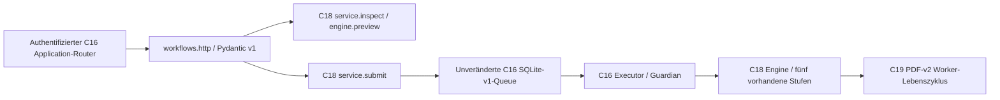

# C20-B – C18-Workflows über HTTP

Basis: Backend-`master` `5f3aa3c6766821baa034962bb771964f7ff2fc68` nach C19/PR 69.
UI-Befund: privater `personal-assistant-ui` Draft-PR 3, Head `29ae186`,
`docs/c20_workflows.md` und `docs/c20_validation.md`. Dessen Workflow-Start-/Resume-
Sperre war korrekt: C16s generische Preview enthielt keine C18-Stufenprüfung.
Dieser Backendvertrag schließt die HTTP-Lücke; der UI-Folgepatch bleibt separat.

## Architektur und bestehende Semantik



Untersucht: `job_control/{http,controller,models,registry,catalog,store,executor,
guardian,adapter_worker}.py`, `workflows/{service,engine,state,definition,models,
validation}.py`, veröffentlichte C16-/C18-/C19-Verträge sowie C20-Wire-DTOs.
Keine zweite Engine, Jobqueue, Datenbank, Registry, neue Dependency oder Migration.
Die beiden Defaultprozesse und der optionale PDF-Einzelprozess bleiben unverändert.

`Workflow`, `Stage`, `Output`, `Job` und `Artifact` werden direkt wiederverwendet.
`src/workflows/http_models.py` definiert ausschließlich HTTP-Hüllen. Die Schemas
stehen in beiden Contract-Dateien unter `workflow_http`. Version ist `1`,
Protokoll `personal_assistant_workflows_v1`; unbekannte Schema-Versionen, Felder
und nicht unterstützte gespeicherte Statuswerte werden kontrolliert abgewiesen.
Alle bekannten C18-Status-/Entscheidungswerte bleiben unverändert.

## Routen und vollständige Nachrichten

Alle Routen benötigen die bestehende C16-Bearer-Authentifizierung. Antworten
verwenden `Cache-Control: no-store`; kein öffentlich gebundener Server wird
automatisch gestartet. POST-JSON höchstens 32 KiB, Workflowantwort höchstens
512 KiB; keine stillschweigende Kürzung vollständiger Reports. Status-Historie:
neueste zuerst, `offset` 0–1000, `limit` 1–100, Default 10. `history_total` ist
die Zahl aller tatsächlichen C16-Versuche dieser Workflow-ID.

| Route | Request / Response |
| --- | --- |
| GET `/v1/workflows/capabilities` | keine Parameter → WorkflowCapabilities |
| POST `/v1/workflows/inspect` | WorkflowInspectRequest → WorkflowInspection |
| POST `/v1/workflows/execute` | WorkflowExecuteRequest + Key → WorkflowSubmission, 202 |
| POST `/v1/workflows/resume` | WorkflowResumeRequest + neuer Key → WorkflowSubmission, 202 |
| GET `/v1/workflows/{workflow_id}?source_ref={ref}&offset=0&limit=10` | WorkflowInspection |
| GET `/v1/workflows/{workflow_id}/runs/{run_id}?source_ref={ref}` | WorkflowRunReport |

Inspect-Request, vollständig inklusive Defaultversion:

```json
{"schema_version":1,"source_ref":"synthetic_pdf","workflow_id":"synthetic_http_workflow"}
```

`source_ref` ist ausschließlich eine freigegebene Katalog-ID. Course, Abschnitt,
Lectures, lokale Quellen, Parser und Limits kommen aus dem genehmigten Bundle.
Keine Browserpfade, URLs, Shellbefehle, freien Parser-/Policyparameter oder Owner.

Der explizite `source_ref`-Query unterscheidet auch einen Workflow mit der ID
`capabilities` vom gleichnamigen Capabilitiesabruf ohne Query.

Die Datei [example-http.v1.json](example-http.v1.json) enthält **vollständige,
tatsächlich serialisierte** Request-/Response-Nachrichten ohne Auslassungen:
Capabilities, fünfstufiges Inspect, Execute, Status/Report, Resume und Replay des
ursprünglichen Execute nach Abschluss. Alle Daten sind synthetisch. Authentifiziert
wurde mit dem vorhandenen öffentlichen Demo-Verifier; Tokens werden nicht publiziert.
Die Datei ist Dokumentation und keine automatisch verwendete Live-Preview.

Reproduktion mit bestehenden Offline-Dependencies:

```bash
uv run --offline --no-sync python -m scripts.cs50_workflow_http_demo \
  --output /tmp/neuer-http-nachweis.json
```

Das Ausgabeziel muss neu sein. Der Demoaufbau verwendet ausschließlich einen
neuen temporären Workspace, den echten Application-Router ohne Socketserver,
die echte Queue und den nativen PDF-v2-Worker. Keine HTTP-Route startet die CLI.

## Preview, Status und Reporthashes

`WorkflowInspection.workflow` stammt aus **`service.inspect`**. Es enthält den
vollständigen Graphen, Stage-Status/-Entscheidungen, Block-/Stale-Gründe,
Input-/Outputreferenzen und den kanonischen `report_sha256`. Nach erfolgreicher
Ausführung kann die erneute Prüfung fünfmal `skipped / verified_reuse` liefern.
`persisted_report` erhält die ursprünglichen Stagewerte aus C18s State; es kann
bei einem gerade neu eingereihten Versuch noch den vorigen Run bezeichnen.
`current_job`, `previous_run_id` und die tatsächliche Run-ID jedes Reports machen
diesen Unterschied explizit. `progress` bleibt immer `null`.

`report_artifact` bezeichnet, sofern vorhanden, die von C16 veröffentlichte
Reportdatei des aktuellen Jobs: SHA-256 der **Dateibytes** und Größe. Dieser Hash
ist vom kanonischen `Workflow.report_sha256` verschieden. Letzterer wird mit der
vorhandenen C18-Kanonisierung über alle Reportfelder außer `report_sha256`
berechnet. `preview_id` bindet zusätzlich Owner/Rolle/Kursgrants, aktuellen Job,
Katalogvertrag, aktuelle Inputbytes/Fehler, Definition und Ausführungspolicy.
Keiner dieser Hashes ist eine Signatur oder ein Ersatz für Authentifizierung.

Der Run-Endpunkt liest ausschließlich den fest definierten Adapterreport des
autorisierten Jobs, prüft Datei-/Reporthash und die Run-/Sourcebindung. Ohne
veröffentlichtes Reportartefakt wird ein vorhandener aktueller oder archivierter
C18-State zurückgegeben. Falls ein Job noch keinen State erzeugt hat, ist
`report: null` korrekt. Historische Reports erhalten ihre ursprünglichen Werte;
sie werden nicht als aktuelle Skip-Prüfung ausgegeben.

Alle Reportreferenzen werden vor dem Lesen von Stagebytes gegen die tatsächliche
Owner-/Course-/Source-Run-Linie und den erzeugenden Stageworkspace geprüft.
Eine neu gehashte Referenz auf einen fremden Job oder andere Stage bleibt ungültig.
Fehlende/korrupt gewordene Stageoutputs erscheinen durch C18 als `stale` und können
in einem **neuen** Arbeitsverzeichnis rekonstruiert werden. Ein manipulierter
Report selbst wird abgewiesen. Keine allgemeine Datei-/Downloadroute.

Inspect/Status/Run lesen nur; sie erzeugen weder Workflow-State noch Requests,
Jobs, Artefakte, Locks oder Ausführung. Controller-/Store-Initialisierung bleibt
Serverstartaufgabe. SQLite öffnet seine bestehende Datenbank mit `mode=ro`; dabei
kann die SQLite-Laufzeit WAL/SHM-Verwaltungsdateien anlegen/aktualisieren. Diese
Datenbankverwaltung ist von der geprüften Unveränderlichkeit der Eingaben,
Workflow-Artefakte, Jobdatensätze und Workflow-Metadaten zu unterscheiden.

## Bestätigung und Idempotenz

1. Inspect abrufen und gesamten Stufenplan anzeigen. Änderungen an Eingaben,
   Auswahl, Run oder Policy verlangen eine neue Prüfung.
2. Execute sendet dieselben IDs, `preview_id`, explizit `current_run_id` (`null`
   beim ersten Start), **boolesches** `confirmed: true` und Idempotency-Key
   (16–64 Zeichen aus A–Z/a–z/0–9/_/-). Resume benötigt eine konkrete aktuelle
   Run-ID. Keine automatische Auswahl eines anderen Parents.
3. Der HTTP-Adapter serialisiert kurze Bestätigungen mit einem eigenen begrenzten
   Lock, prüft aktuelle Reports/Inputs erneut und delegiert an `service.submit`.
   Auch der Service prüft Preview und Parent unmittelbar vor seiner bestehenden
   Entscheidung; C16 prüft Kataloghashes vor Annahme und im Worker erneut.
4. Execute für einen vorhandenen Workflow liefert den bestehenden Job, auch wenn
   dieser fehlgeschlagen ist. Nur ausdrücklich bestätigtes Resume kann neue
   notwendige Arbeit freigeben. Aktive Jobs und vollständig erneut gültige
   Ergebnisse liefern dieselbe Job-ID; es entsteht kein weiterer Historieneintrag.
5. Bei verlorener Antwort wird **derselbe Body mit demselben Key** erneut gesendet.
   Ein anderer Body oder Wechsel Execute/Resume unter demselben Key ergibt 409.
   Ein neuer bewusster Auftrag/Resume erhält einen neuen Key und neue Preview.

Unveränderliche private Metadaten in `workflow-requests/<SHA256>.json` binden
`(authentifiziertes Subject, HTTP-Key)` an die bestätigte Absicht. Sie enthalten
keine Tokens, keine neuen ausführbaren Parameter und keine Queue. Ein Prozessabbruch
nach der C16-Transaktion wird über **C18s bestehenden stabilen Request-Key** und
den gespeicherten C16-Intent erkannt. Deshalb bleibt auch ein inzwischen fertiger
Job nach verlorener HTTP-Antwort auffindbar. Bei Wiederverwendung bindet der
Receipt die vorhandene Job-ID, selbst wenn später ein neuer Run entsteht.

Bei Wiederverwendung wird erst **nach erfolgreicher Rückgabe von `service.submit`**
eine zweite exklusive Annahmemetadatei unter `workflow-requests/accepted/` geschrieben.
Eine bloße Reservierung darf eine zwischenzeitlich abgewiesene Preview nicht beim
Replay als akzeptiert ausgeben. Fehlt diese Annahme nach einem Prozessabbruch,
wird die Bestätigung erneut geprüft; bei inzwischen veralteter Preview folgt 409.
Es wurde in diesem Fall kein zusätzlicher Job erzeugt. Neue tatsächliche Jobs
haben ihren dauerhaften Annahmenachweis bereits in der bestehenden C16-Transaktion.

Receipts werden exklusiv veröffentlicht, nie überschrieben, und sind auf
`max_jobs * 10` pro Workspace begrenzt; keine automatische Löschung oder Ausführung.
Nach reserviertem, aber noch nicht eingereihtem Intent darf ausschließlich ein
erneuter expliziter identischer HTTP-Request einen weiteren Annahmeversuch machen.
Ist seine Preview inzwischen veraltet, folgt 409. Ein bereits akzeptierter
Replay liefert den damaligen Job ohne erneute Ausführung oder Abhängigkeit von
einem verfügbaren Worker. Rolle, Source-Allowlist, Flag und Kursgrants werden
auch dann erneut durchgesetzt. Der ursprüngliche Job ist kein erneuter Beleg
für die heutige Artefaktgültigkeit; dafür erneut Inspect benutzen.

## Rechte, Fehler und Grenzen

Workflow-IDs sind im privaten C18-Workspace global gebunden. Viewer dürfen eigene
Workflows innerhalb ihrer Kursgrants lesen/prüfen, Operatoren zusätzlich schreiben.
Auch ein anderer Operator im gleichen Kurs darf fremde Workflowreports nicht
lesen. Ein Token mit geändertem Viewerrecht desselben Subjects darf weiterhin
lesen, aber keine bestätigte Mutation wiederholen. Katalogkurs und Definition
müssen zusammenpassen. Workflows bleiben standardmäßig deaktiviert; die neue
Capabilitiesroute meldet dies, alle anderen neuen Workflowrouten verweigern dann
Zugriff. Der PDF-Einzeljobflag `pdf_enabled` bleibt separat; PDF innerhalb des
genehmigten C18-Workflows verwendet unverändert C19s feste Policy.

| HTTP | Fehlercode / Bedeutung |
| --- | --- |
| 401 | `unauthenticated`: bestehende C16-Authentifizierung fehlgeschlagen |
| 403 | `forbidden`: Rolle, Owner, Kurs oder Workflowflag verweigert |
| 404 | `not_found`: unbekannte Route oder Run-ID |
| 409 | `conflict`: Key/Body, Preview/Parent oder stabile Sourcebindung widersprüchlich |
| 422 | `invalid_request`: Schema, Parameter, Bundle, Hash oder Reportreferenz ungültig |
| 503 | `unavailable`: Worker/Executionflag, Kapazität, Bestätigungslock, I/O oder Antwortlimit |
| 500 | `internal_error`: unerwarteter Fehler, ohne interne Details |

Unveränderte C16-Fehlerhülle: `schema_version: 1`, `error.code`, `error.message`;
keine Tracebacks, Pydantic-Eingaben, Tokens oder Hostpfade. 202 bestätigt einen
Jobbezug, nicht dessen Erfolg oder einen neu erzeugten Job. Cancel bleibt die
bisherige bestätigte Jobroute; endgültiger Prozessstatus kommt vom Guardian.
Timeout, Restart-Reconciliation und Stage-Recovery bleiben C19/C18 überlassen.

Bekannte Grenzen: Status/State/Job werden kurz nacheinander gelesen, nicht als
globale Transaktion mit dem Worker. Bei Fortschritt kann eine frische Bestätigung
bereits 409 erhalten; neu prüfen. Historie ist begrenzt und wächst ausschließlich
mit tatsächlichen Jobs, C18 erlaubt höchstens zehn persistierte Stageversuche.
Keine neuen Providerstufen, keine öffentlichen Artefaktbytes, keine produktive
TLS-/OIDC-/Browserabnahme. Die bisherigen generischen C16-Workflow-Jobrouten bleiben
kompatibel, ersetzen aber nicht diese bestätigte Execute-/Resume-Semantik.

## Konkreter Übergabevertrag für den C20-UI-Folgepatch

- Bestehendes `/v1/capabilities`-DTO unverändert lassen. Zusätzlich das neue
  `/v1/workflows/capabilities` mit obigem Protokoll/Version und bekanntem Routen-
  und Antwortlimit prüfen. Bei fehlender Route/Protokoll bleibt die bisherige Sperre.
- Die sieben HTTP-Hüllen aus `workflow_http.models` typisiert abbilden;
  `Workflow`/`Stage`/`Output` und C16-Job-/Artefakt-DTOs wiederverwenden. Echte IDs
  getrennt halten, keine Umrechnung `skipped` → `completed`, unbekannte Werte
  anzeigen/Schreibaktionen sperren statt lokal neue Stageentscheidungen erfinden.
- Stufenpreview über POST Inspect, danach Checkbox und stabilen Session-Intent
  mit Body/Key halten. Execute/Resume nur explizit, kein automatischer POST-Retry.
  Nach 409 verwerfen und neu prüfen; nach Antwortverlust denselben Intent halten.
- Nur aktive Ansicht begrenzt pollen: GET Workflowstatus, für historische Auswahl
  GET Run-Report. `history_total/offset/limit` beachten. Für Status, Canonicalhash,
  ursprünglichen Report und Artefakthash die unterschiedlichen Felder benutzen.
- Jobdetails/Logs/Cancel weiter über C17-Routen. Owner/Course kommen vom Backend;
  Identitätswechsel löscht gehaltene Workflowdaten und Bestätigungsintents.
  Keine CLI-, SQLite-, Dateipfad- oder Backend-Python-Zugriffe aus Streamlit.
- Abnahmetests des Folgepatches: echte fünfstufige HTTP-Preview/Execute, Live-
  Stageanzeige, Resume mit fünf `verified_reuse` und identischer Job-ID, Stale-
  Teilresume, verlorene Antwort/Refresh, 409, Viewer/Owner, Cancel/Timeout/Restart.
  Die bisherigen C17/C20-Defaults und DTOs weiter als Regression prüfen.
